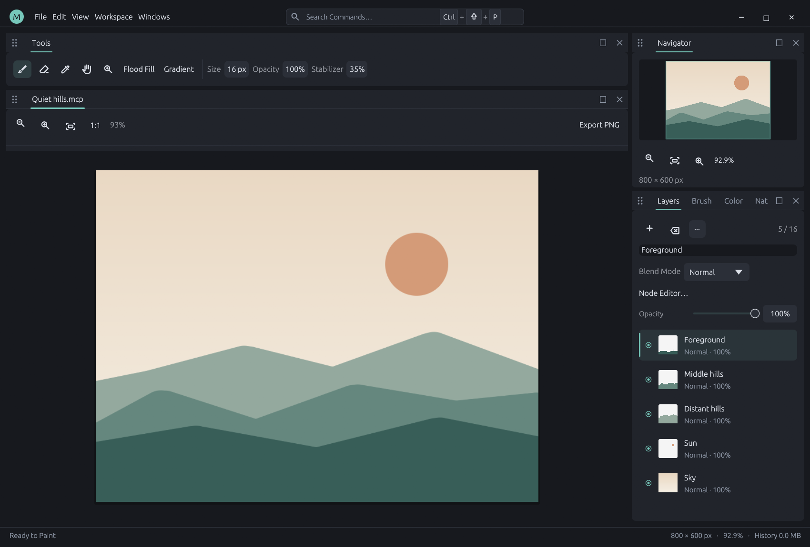

# MiCoPi

[English](README.md) · [简体中文](README.zh.md) · [日本語](README.ja.md) · [한국어](README.ko.md)

애니메이션·만화 일러스트레이터를 위한 Rust 기반의 가벼운 네이티브 페인팅 앱입니다. 그리기 응답성을 우선하며, 확장 가능한 AI 연동 실행 코어를 갖추고 있습니다.

현재 **Windows 10/11 x64**를 지원합니다. 데스크톱 UI는 **egui + egui_dock**과 OpenGL을 사용하고, 펜 입력은 Windows Ink를 사용합니다. 아직 초기 개발 단계입니다.

**0.21.0:** [검증 가능한 이벤트 재생](docs/replay.md)을 추가했습니다. 필압, 레이어와 플러그인 작업을 기록하며 타임라인 재생, SHA-256 무결성 검증, 프로젝트 내 기록 저장, 기록 파일 및 PNG 프레임 내보내기를 지원합니다.

[원자적 작업 그룹](docs/atomic-operations.md)을 추가했습니다. 실패하면 문서 변경을 되돌리고 그룹 결과를 하나의 이벤트로 기록합니다. MCRPLY02는 메타데이터 차분, 타일 참조 및 XOR 압축을 사용하며 이전 형식도 읽을 수 있습니다.



도구 모음과 캔버스는 다른 모니터로 이동 가능한 독립적인 OS 창으로, 플로팅, 네 방향 도킹 및 탭 그룹을 지원합니다. 기능 플러그인이 창 정의와 UI 소스를 소유하며 등록된 액션은 검색하고 단축키를 지정할 수 있습니다. [Plugin Windows](docs/plugin-windows.md)를 참고하세요.

브러시 패널에서 허용 오차, 확장/축소 및 페더를 지원하는 연결 영역/레이어 전체 색상 채우기, 반복/대칭 반복 선형·방사형 그라데이션, 필압 설정과 곡선 미리 보기를 사용할 수 있습니다. [그리기 도구](docs/painting-tools.md)를 참고하세요.

브러시와 지우개는 독립적인 **흐름**과 선택적인 **획별 불투명도 제한**을 지원하며 글레이징 마커 프리셋도 제공합니다. 기본 흐름 100%／누적 모드는 기존 그리기 결과를 유지합니다. 검색 가능한 설정, 노드, MCP, 헤드리스는 같은 파라미터를 공유합니다. 지원 범위와 검증 상태는 [브러시 불투명도와 흐름](docs/stroke-opacity.md)을 참고하세요.

캔버스 크기 변경, 정밀 자르기, 전체 캔버스의 90°/180° 회전과 뒤집기는 레이어·노드 식별 정보, 선택 영역, 실행 취소와 검증 가능한 재생을 유지합니다. 단일 레이어의 90° 회전은 캔버스 크기를 유지하며 프레임 밖 픽셀은 잘립니다. **이미지 크기(Ctrl+Alt+I)**에서 픽셀·밀리미터·인치로 입력하고 종횡비를 고정하여 모든 레이어와 선택 영역을 최근접·쌍선형·영역 평균으로 조정할 수 있습니다. 읽기 전용 계획으로 최종 크기와 버퍼 용량을 확인하며 정확한 밀도를 유지합니다. 영역 평균은 축소할 때 가는 선의 커버리지를 유지합니다. 다듬기는 투명 또는 모서리 색상 여백을 미리 보고 선택한 가장자리에서 모든 레이어를 자르며 실행 취소를 지원합니다. [캔버스 편집](docs/canvas-editing.md)을 참고하세요.

**이동 도구(V)**는 윤곽을 미리 보고 놓으면 함께 적용합니다. 활성 래스터 레이어와 연결된 마스크, 독립적인 원본 래스터 마스크, 마스크가 없는 문서의 선택한 픽셀 또는 선택 영역 윤곽을 이동할 수 있습니다. 자동 모드는 페인팅 대상 마스크를 우선하며 `mask_id`로 활성 레이어와 무관한 안정 ID를 지정합니다. 방향키·Shift+방향키 간격은 검색 가능한 설정에서 조정합니다. 캔버스 밖 내용은 잘리며 한 번의 실행 취소로 복원됩니다. 노드, MCP, 헤드리스도 같은 작업을 실행합니다. [이동과 미세 이동](docs/canvas-editing.md#move-and-nudge) 및 [래스터 소유자 이동](docs/raster-owner-movement.md)을 참고하세요.

**자유 변형(Ctrl+T)**은 숫자 입력과 마우스·펜으로 이동, 크기 조절, 기울이기, 회전, 뒤집기, 기준점을 설정하며 취소 가능한 캐시 픽셀 미리 보기와 한 번의 실행 취소·이벤트를 제공합니다. 같은 네이티브 작업을 노드, MCP, 헤드리스에서도 실행합니다. 캔버스 밖 픽셀은 잘리며 **Ctrl+Shift+T**로 저장된 행렬을 반복 적용하고 **Ctrl+Alt+Shift+T**로 복제 후 적용합니다. 기록은 프로젝트, 실행 취소, 리플레이에 보존됩니다. 가장자리 마름모로 기울기를 조절하며 원근 모서리도 개별적으로 편집합니다. 같은 실행 취소, 반복, 리플레이 동작을 지원합니다. [자유 변형](docs/canvas-editing.md#free-transform)을 참고하세요.

[통합 플러그인 시스템](docs/plugin-system.md)은 설정과 자동화 API에서 버전, 호환성, 의존성 및 로드 상태를 제공합니다. 활성화·비활성화 계획은 의존성을 처리하며 저장 후 재시작하면 적용됩니다. 플러그인별 번역 파일은 서로 격리되며 실행 중 다시 불러올 수 있습니다.
**새 캔버스(Ctrl+N)**에서 일러스트, 정사각형, A4, B5 프리셋을 설정하고 초기 배경 픽셀, 픽셀·밀리미터·인치 크기와 물리 해상도를 선택할 수 있습니다. 공통 읽기 전용 계획으로 생성 전에 최종 픽셀 크기를 확인합니다. 해상도 메타데이터는 프로젝트, 실행 취소 및 리플레이에 저장되며 픽셀을 리샘플링하지 않습니다. [캔버스 만들기](docs/document-setup.md)를 참고하세요.


[PNG 밀도](docs/png-density.md)는 가져오기, 내보내기, 프로젝트 및 리플레이 PNG에서 가로·세로 밀도와 단위를 보존합니다. 실제 크기를 알 수 없으면 명시하며, 해상도 설정은 픽셀을 리샘플링하지 않고 밀도를 바꿉니다.

[PNG 내보내기 크기](docs/export-sizing.md)는 픽셀, 밀리미터, 인치, 백분율, 명시적 미리보기 및 출력 전용 PPI 설정을 지원합니다. 합성 이미지를 네이티브로 처리해 원본 레이어와 기록을 보존하고 내보내기 이벤트에 파일 해시를 기록합니다.

[색상 혼합 모드](docs/blend-modes.md)는 레이어, 독립 합성 그룹과 Blend 노드에 26개 모드를 제공하며 번/닷지, 대비, 색조/채도/색상/명도 계열을 포함합니다. 스크롤 메뉴는 Photoshop에서 익숙한 계열 순서로 표시하며 지원하지 않는 모드도 비활성 항목으로 남깁니다. 기존 8개 모드의 ID와 픽셀 결과를 유지하고 공통 API로 현재 합성기의 지원 모드를 확인할 수 있습니다.

## 핵심 철학

**그리기를 우선하고, 동작은 플러그인으로 구현하며, 사람과 자동화가 하나의 실행 코어를 사용합니다.**

펜 샘플은 타입이 지정된 인터페이스로 처리하여 필압, 손떨림 보정 및 부분 업데이트를 유지합니다. 플러그인, MCP와 headless는 스키마로 설명된 작업과 공개 상태를 통해 같은 Session을 조작합니다. 이미지 노드는 비파괴 합성을 제공하고, 작업 워크플로는 명시적으로 실행할 때만 동작합니다.

AI-ready는 기능을 검색하고 상태를 확인하며 실행 계획을 검사할 수 있는 연동 규약을 뜻합니다. 클라우드 연결이나 내장 AI 어시스턴트가 필수라는 의미는 아닙니다. 스크린샷이 포함된 영어 [설계 철학](docs/philosophy.md), [문서 목록](docs/README.md), [로드맵](ROADMAP.md), [디렉터리 구조](docs/project-structure.md)를 참고하세요. 기술 문서의 기준 언어는 영어입니다.

## 주요 기능

- 독립 DLL로 구현한 브러시, 지우개, 스포이트, 손 도구 및 확대/축소.
- Windows Ink 필압, 필압 곡선, 손떨림 보정 및 브러시 윤곽 커서.
- HSV 색상환, RGB 조절, 색상 견본 및 브러시 프리셋.
- 레이어 표시, 불투명도, 투명도 잠금, 단색 채우기, 혼합 모드 및 타일 기반 실행 취소/다시 실행.
- 도킹, 부동 창, 탭 그룹을 지원하는 패널. 간격, 크기, 테마 및 바로 가기 키 설정.
- 검색 가능한 설정, JSON 편집, 명령 팔레트 및 바로 가기 키 기록.
- 투명 PNG 내보내기, PNG/JPEG/BMP 가져오기 및 `.mcp` 프로젝트.
- 레이어 연동 비파괴 이미지 그래프, 레이어별 필터, 자유 합성 및 플러그인이 등록하는 작업·상태 워크플로.
- JSONL 일괄 처리, MCP stdio 및 실행 중인 GUI 연결.
- 공통 플러그인 목록, 의존성을 고려하는 설정 및 플러그인별로 격리된 언어 팩.

레이어 이름 변경, 복제, 순서 변경, 삭제와 정확한 뒤집기, 180° 회전, 정수 오프셋을 지원합니다. [레이어 편집](docs/layer-editing.md)을 참고하세요.

레이어는 픽셀·위치 잠금, 색상 라벨과 이름·표시·잠금 상태의 공통 읽기 전용 필터를 지원하며 실행 취소, 프로젝트와 검증 가능한 리플레이를 유지합니다. 네이티브 쓰기 권한으로 잠긴 대상을 보호하고 읽기 도구는 계속 사용할 수 있습니다.

Ctrl/Shift로 여러 레이어를 선택해도 그리기는 활성 레이어에 적용됩니다. 안정적인 ID를 명시한 일괄 명령으로 속성 변경, 복제, 삭제, 순서 변경과 정확한 픽셀 편집을 수행하며 한 번의 실행 취소/다시 실행과 검증 가능한 결과로 묶습니다. 노드, MCP와 headless에서도 같은 명령과 선택 상태를 사용할 수 있습니다.

[레이어 링크](docs/layer-links.md)는 선화·채색 레이어의 관계를 저장하여 전체 레이어 이동과 방향키 미세 이동을 함께 적용합니다. 링크/해제 버튼과 체인 표시를 제공하며 그리기는 활성 대상에만 적용됩니다. 명시한 대상 배열과 각 레이어의 연결된 마스크를 메모리 한도 안에서 한 번의 실행 취소와 검증 가능한 결과로 묶습니다. 명령과 상태 노드는 MCP/headless에서도 사용할 수 있습니다. 연동 자유 변형과 정렬/분포는 이후 계획입니다.

**Ctrl+J**는 선택 영역을 새 레이어로 복사하며 선택 영역이 없으면 전체 레이어를 복제합니다. **Ctrl+Shift+J**는 선택 영역을 새 레이어로 잘라냅니다. 두 작업 모두 한 번에 실행 취소할 수 있고 클립보드를 변경하지 않습니다.

레이어 병합(Ctrl+E)은 여러 레이어를 선택하면 선택한 래스터를 병합하고, 하나만 선택하면 아래 레이어와 병합합니다. 보이는 레이어 병합(Ctrl+Shift+E), 보이는 내용 스탬프(Ctrl+Alt+Shift+E), 투명도를 유지하는 이미지 병합도 지원합니다. [Layer editing](docs/layer-editing.md)을 참고하세요.

[선택한 레이어만 병합](docs/selected-merge.md)은 떨어진 레이어와 서로 다른 부모 그룹의 대상도 지원하며, 선택하지 않은 버퍼와 모든 폴더를 보존합니다. 선택한 내용을 투명 배경 위에 굽기 때문에 외부 배경 및 쌓임 순서와의 상호 작용은 달라질 수 있습니다. 읽기 전용 계획과 선택적인 비모달 검토 창에서 배치와 숨겨진 대상의 제거를 확인할 수 있고, 명시적인 안정 ID 실행은 노드, MCP, headless에서 한 번의 실행 취소와 검증된 결과를 공유합니다. Ctrl+E는 즉시 실행되며 기존의 명시적인 아래 레이어 병합 단축키도 유지됩니다.

[레이어 그룹](docs/layer-groups.md)은 중첩된 표시, 불투명도, 독립 또는 [통과 합성](docs/pass-through.md), 하위 트리 작업과 실제 합성 노드 보기를 지원합니다. 통과 모드는 자식 레이어를 부모 배경과 혼합한 뒤 그룹 불투명도로 전체 변화를 조절하며, 독립 합성의 혼합 모드는 보존합니다. Ctrl+G로 같은 부모의 선택 레이어를 묶으며 그리기는 활성 래스터 레이어에 유지됩니다. 그룹 병합은 독립 합성 그룹을 대상으로 하며 내부에 통과 그룹을 포함할 수 있습니다. 보이는 레이어 병합은 숨겨진 분기와 폴더를 보존합니다. MCP/headless에서도 같은 명령, 프로젝트, 원자적 기록과 리플레이를 사용합니다.

현재 Session당 문서 하나를 지원합니다. Wintab, 캔버스 외부 레이어 저장, 클리핑 마스크 및 수채화 엔진은 아직 지원하지 않습니다. 네이티브 DLL은 호스트와 같은 프로세스에서 실행됩니다.

[래스터 마스크 편집](docs/raster-mask-editing.md)은 레이어/그룹 A8 마스크, 필압과 손떨림 보정을 지원하는 브러시/지우개, 비파괴 농도/페더, 선택 영역 변환, 래스터 레이어의 원본 알파에 마스크 적용을 제공합니다. 11개 마스크 액션과 공개 상태를 데스크톱, 워크플로 노드, MCP, 헤드리스에서 공유하며 타일 단위 실행 취소와 검증 가능한 저장을 유지합니다. [문서 전체 지오메트리](docs/mask-canvas-geometry.md)는 숨김·비활성·연결 해제 마스크를 포함한 모든 원본 마스크를 캔버스와 함께 재배치·회전·반전·리샘플링·트리밍합니다. 공통 읽기 전용 계획은 마스크별 메모리 비용, 접촉 상태, 네이티브 기능을 보여 주며 한 번 적용하면 하나의 실행 취소 가능한 편집이 됩니다. [단일 레이어 소유자 복제/삭제](docs/mask-owner-editing.md)는 원본 마스크 샘플, 새 ID, 명시적인 페인팅 대상 규칙을 하나의 복합 실행 취소/기록 결과로 처리합니다. [그룹 생성과 계층 이동](docs/mask-group-editing.md)은 모든 기존 소유자, 원본 마스크와 페인팅 대상을 유지하며 하나의 구조적 실행 취소/기록 결과와 공통 스키마 바인딩을 제공합니다. [그룹과 내용 삭제](docs/mask-group-delete.md)는 삭제된 소유자의 마스크만 제거하며 명시적인 페인팅 대상/선택 대체 규칙, 필수 결과 ID 배열과 하나의 복합 실행 취소/기록 결과를 제공합니다. [그룹/하위 트리 복제](docs/mask-group-duplicate.md)는 정해진 순서의 새 ID와 독립적인 원본 버퍼로 중첩 소유자를 복제하며 페인팅 대상 매핑, 형식화된 결과 배열과 하나의 복합 실행 취소/기록 결과를 제공합니다. [래스터 소유자 정수 이동](docs/raster-owner-movement.md)은 연결된 마스크를 함께 옮기거나 원본 마스크만 옮기는 작업을 하나의 편집으로 처리합니다. 소유자 자유 변형, 그룹 마스크 이동, 선택한 픽셀 전송, 그룹 해제, 일괄 편집, 선택 영역 복사/잘라내기 전송, 병합, 클립보드 변경과 그룹 마스크 적용에는 보호된 제한이 남아 있으며, 완전한 통합은 계속 계획 중입니다.

[선택 영역 명령](docs/selections.md)은 사각형·타원·다각형, 결합 모드, 그리기 클리핑, 실행 취소와 리플레이를 지원합니다. 모두 선택·해제·다시 선택·반전의 PS 단축키를 설정할 수 있습니다. 도구 모음의 사각형·타원형 선택과 자유·다각형 올가미는 취소 가능한 미리 보기를 지원합니다. [Session 내부 클립보드](docs/clipboard.md)의 복사·잘라내기·붙여넣기 명령을 사용할 수 있습니다. Windows PNG/DIB 이미지 클립보드와 PS 복사·잘라내기·붙여넣기 단축키를 구현했습니다. 테스트 환경의 권한 제한으로 네이티브 상호 운용성 검증은 아직 완료되지 않았습니다.

자동 선택(**W**)에서 허용 오차, 인접 영역, 병합 이미지 샘플링과 선택 확대·유사 색상 버튼을 사용할 수 있습니다. 같은 명령을 매개변수 양식과 자동화에서도 실행할 수 있습니다. 선택 영역 기본값을 설정 센터에서 검색하고 `settings.json`에 저장할 수 있습니다. 선택 영역의 확장·축소·페더·매끄럽게 처리를 네이티브 명령으로 실행할 수 있습니다.

## 빌드 및 실행

Rust 1.88 이상, Visual Studio C++ Build Tools 및 Windows SDK가 필요합니다.

```powershell
.\scripts\build.ps1 -PluginsOnly
cargo run --release --locked
.\scripts\build.ps1 -Test
```

`dist/MiCoPi.exe`를 실행하고, 같은 위치의 `plugins/`, `locales/`, `licenses/`를 유지하세요. 최종 사용자는 Rust를 설치할 필요가 없습니다. 프로젝트 로컬 포터블 도구 모음은 영어 [개발 가이드](docs/development.md)를 참고하세요.

```powershell
New-Item -ItemType Directory -Force target/example-output | Out-Null
.\dist\micopi-cli.exe run examples/automation/draw.jsonl
.\dist\micopi-cli.exe actions
.\dist\micopi-cli.exe mcp
```

기본 MCP는 독립 캔버스를 사용합니다. `mcp --attach <profile>/session.json`으로 기존 GUI에 연결할 수 있습니다. 용도별 예제는 [examples](examples/README.md)에 있습니다.

## 표시 언어

기본 언어는 영어이며 중국어 간체, 일본어 및 한국어를 지원합니다. **Ctrl+,**로 설정을 열고 `ui.language`를 검색한 뒤 언어를 선택하고 저장하세요. 변경 사항은 즉시 미리 보기에 반영됩니다. 저장하지 않고 닫으면 마지막으로 저장한 설정으로 돌아갑니다.

```json
{"version":1,"ui":{"language":"ko"}}
```

언어를 바꿔도 작업 ID, 설정 키, 노드 포트 이름, 파일 경로 및 캔버스 픽셀은 바뀌지 않습니다. 자세한 내용은 영어 [현지화 가이드](docs/localization.md)를 참고하세요.

영어만 실행 파일에 내장됩니다. 다른 언어는 실행 파일 옆의 `locales/`에서 읽고, 설정 디렉터리의 `locales/`에서 덮어쓸 수 있습니다. JSON 변경은 재빌드나 재시작 없이 반영되며 잘못된 편집 시 마지막 유효 번역을 유지합니다. `--locales-dir <directory>`로 기본 카탈로그 위치를 바꿀 수 있습니다.

## MiCoPi 확장

[Quick tools 예제](examples/plugins/quick-tools/manifest.json)는 브러시 프리셋, 매크로 및 다국어 버튼 패널을 제공합니다. 패키지 전체를 플러그인 디렉터리에 복사한 뒤 재시작하세요. `plugins.list`로 상태, 진단 및 기능 소유자를 확인하고, 읽기 전용 `plugins.plan`으로 의존성 변경을 미리 볼 수 있습니다.

픽셀 알고리즘은 [네이티브 C ABI SDK](docs/native-plugins.md)로 확장합니다. 기능 UI 소스는 호스트와 함께 컴파일하며 DLL 교체나 기능 선언 변경에는 재시작이 필요합니다. 호스트는 실행, 문서 기록 및 창 수명 주기를 관리합니다. [플러그인 시스템](docs/plugin-system.md)과 [플러그인 창](docs/plugin-windows.md)을 참고하세요.

## 구조 및 기여

`src/`에는 호스트와 UI, `plugins/`에는 설치 가능한 패키지와 독립 알고리즘, `crates/plugin-api/`에는 ABI SDK가 있습니다. 문서, 스크린샷, 예제 및 개발 도구는 각각 `docs/`, `docs/screenshots/`, `examples/`, `scripts/`에 정리되어 있습니다. 빌드 결과, 배포 파일 및 개인 작품은 Git에 포함하지 않습니다.

영어 [기여 가이드](CONTRIBUTING.md), [아키텍처](docs/architecture.md) 및 [변경 기록](CHANGELOG.md)을 참고하세요. 영어 README를 기준으로 하며, 번역본도 같은 기능과 제약을 설명합니다.

코딩 에이전트는 [AGENTS.md](AGENTS.md)도 읽어야 합니다. 관리자가 지정한 Git 절차를 따르며, 현재 위임 작업은 `main`에 기능별로 커밋합니다. 푸시는 명시적인 요청이 있을 때만 수행하고 빌드 결과나 개인 설정은 커밋하지 않습니다.

## 라이선스

앱 소스는 [MIT](LICENSE)입니다. 내장 Google Material 아이콘은 [Apache 2.0](assets/material-symbols/LICENSE)을 따르며 [고지](assets/material-symbols/NOTICE.md)가 포함됩니다. 배포 파일에는 의존 라이브러리의 라이선스가 포함됩니다.
