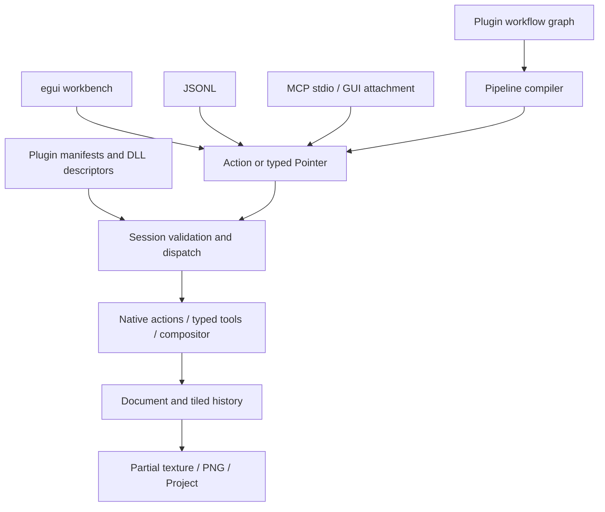

# Architecture

The desktop entry point and CLI share `application::Session`, the sole owner of mutable document state. Presentation does not maintain a second writable canvas.

## Boundaries

| Module | Responsibility |
| --- | --- |
| application | Session, actions, validation, revision, events, pipeline and workflow compilation |
| src/plugins | Atomic contribution registration, DLL loading, host handlers and tool routing |
| plugins | Independently compiled algorithms, presets, actions, state and panel definitions |
| automation | JSONL, MCP and local GUI request transport |
| engine | Pixel layers, image DAG, dirty rectangles and tiled history |
| configuration | Window-free settings validation and atomic persistence |
| i18n / locales | Embedded translations; English source messages and stable protocol IDs |
| desktop | egui presentation, coordinates, caches, dock state and dialogs |
| platform | Windows Ink, DWM, file replacement and native integration |

The default desktop feature uses eframe Glow, egui_dock and egui-snarl. No WebView, wgpu or scripting engine is required. A headless build excludes desktop/OpenGL dependencies and does not create a window or graphics context. The retained GDI frontend is a regression reference, not an alternate production execution core.

## Execution and concurrency

Actions carry an ID, JSON arguments and optional expected revision. Session validates schemas and native constraints before dispatch. Macros expand into existing actions. Workflow graphs compile into `pipeline.run`, using typed result references and explicit ordering edges. Runtime failures preserve earlier completed work and report partial completion.

GUI request transport parses and queues on worker threads; the GUI thread executes mutations against its Session. Requests do not call DLLs from transport threads. External pointer streams survive loss of GUI focus. Long-running actions occupy the Session thread; independent headless sessions suit offline batch work.

Read-only queries cannot mutate document pixels or dispatch mutating actions. They do not finish strokes or increment revision. A bounded event buffer retains the most recent 512 action/pointer events for diagnostics, not persistent event sourcing. A separate append-only outcome journal records document mutations, raw pen samples and changed tiles with a SHA-256 chain. Playback applies verified results without executing plugins or external effects.

## Painting and performance

Layers are contiguous `Vec<u32>` buffers in straight-alpha `0xAARRGGBB`. The painting DLL uses the typed tool ABI for pressure, stabilization, interpolation and rasterization. Ordinary MOVE input does not serialize JSON, look up the tool registry, create instances or copy entire regions.

The host snapshots a touched 64×64 tile once per stroke; history has a 64 MiB budget. The compositor receives a dirty region and a typed topology, rather than one DLL call or full-size allocation per node. Default normal-layer rendering retains its existing fast path. Metadata history caches its accounting size to avoid serializing workflow JSON per brush point.

Document display updates return dirty rectangles. Desktop uploads partial textures, shares document textures with the navigator, reuses color-wheel/thumbnail/input buffers and repaints on demand. CPU performs painting/compositing; GPU presents the UI and textures.

## Persistence and presentation

MICOPI03 projects save layer pixels, blend properties, image/workflow metadata and a sealed verified event journal; MICOPI01/02 remain readable. The undo stack is not persisted; the replay journal is independent. See [Verified Replay](replay.md). Image decoding checks dimensions before allocation; PNG export preserves alpha.

`settings.json` contains appearance, language, keybindings, painting defaults and plugin preferences. Saving validates ranges/conflicts, preserves unknown root fields and atomically replaces the file. Dock trees and floating rectangles are kept in `workspace.egui.json`; new plugin panels are reconciled without reopening previously closed panels.

Localization is applied at presentation boundaries. English metadata, machine IDs, schemas, file paths and documents stay independent of display language. Catalogs are embedded and loaded once. Existing Windows CJK fonts provide glyph fallback without a bundled font pack.

Window activation is forwarded to winit. `WM_NCACTIVATE` uses `lParam=-1` to preserve activation handling while suppressing native non-client repaint; see [Microsoft's message contract](https://learn.microsoft.com/en-us/windows/win32/winmsg/wm-ncactivate).

## Verification

See [Development](development.md) for unit, actual-DLL and end-to-end checks. Runtime smoke tests compare identical PNG bytes across JSONL, MCP and GUI. Localization checks cover catalogs, placeholders, settings round trips, search and four-language UI captures. Actual tablet/driver compatibility still needs hardware testing.

Document transactions and provisional pen contacts use replay state plus shared undo tiles as rollback checkpoints. Atomic pipelines suppress child journal writes and publish one outcome after success; failure restores the checkpoint. A journal append publishes its index/head only after writing the entire compressed record. Partial writes truncate the uncommitted tail. MCRPLY02 adds metadata deltas, intra-event tile references and sparse XOR blocks; MCRPLY01 remains readable. See [Atomic Operations](atomic-operations.md).
