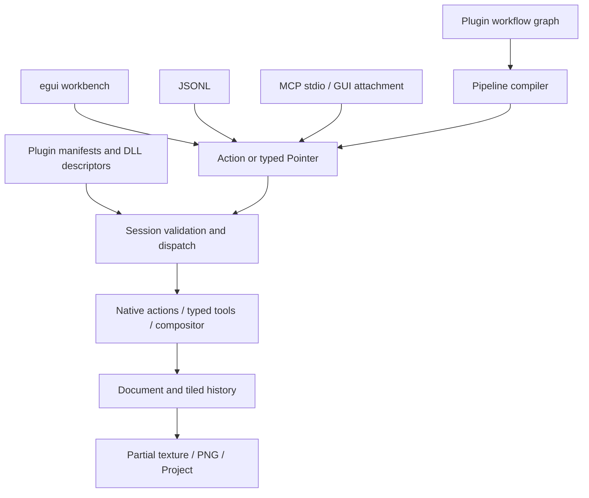

# Architecture

The desktop entry point and CLI share `application::Session`, the sole owner of mutable document state. Presentation does not maintain a second writable canvas.

## Boundaries

| Module | Responsibility |
| --- | --- |
| application | Session, actions, validation, revision, events, pipeline and workflow compilation |
| src/plugins | Atomic contribution registration, DLL loading, host handlers and tool routing |
| plugins | Independently compiled algorithms, presets, actions, state and panel definitions |
| automation | JSONL, MCP and local GUI request transport |
| engine | Pixel layers, image DAG, dirty rectangles and tiled history |
| configuration | Window-free settings validation and atomic persistence |
| i18n / locales | Embedded English, external catalog snapshots and owner-scoped plugin translations |
| desktop | egui presentation, coordinates, caches, dock state and dialogs |
| platform | Windows Ink, DWM, file replacement and native integration |

The default desktop feature uses eframe Glow, egui_dock and egui-snarl. No WebView, wgpu or scripting engine is required. A headless build excludes desktop/OpenGL dependencies and does not create a window or graphics context. The retained GDI frontend is a regression reference, not an alternate production execution core.

## Execution and concurrency

Actions carry an ID, JSON arguments and optional expected revision. Session validates schemas and native constraints before dispatch. Macros expand into existing actions. Workflow graphs compile into `pipeline.run`, using typed result references and explicit ordering edges. Runtime failures preserve earlier completed work and report partial completion.

GUI request transport parses and queues on worker threads; the GUI thread executes mutations against its Session. Requests do not call DLLs from transport threads. External pointer streams survive loss of GUI focus. Long-running actions occupy the Session thread; independent headless sessions suit offline batch work.

Read-only queries cannot mutate document pixels or dispatch mutating actions. They do not finish strokes or increment revision. A bounded event buffer retains the most recent 512 action/pointer events for diagnostics, not persistent event sourcing. A separate append-only outcome journal records document mutations, raw pen samples and changed tiles with a SHA-256 chain. Playback applies verified results without executing plugins or external effects.

## Painting and performance

Layers are contiguous `Vec<u32>` buffers in straight-alpha `0xAARRGGBB`. The painting DLL uses the typed tool ABI for pressure, stabilization, interpolation and rasterization. Ordinary MOVE input does not serialize JSON, look up the tool registry, create instances or copy entire regions.

The host snapshots a touched 64×64 tile once per stroke; history has a 64 MiB budget. The compositor receives a dirty region and a typed topology, rather than one DLL call or full-size allocation per node. Default normal-layer rendering retains its existing fast path. Metadata history caches its accounting size to avoid serializing workflow JSON per brush point.

Document display updates return dirty rectangles. Desktop uploads partial textures, shares document textures with the navigator, reuses color-wheel/thumbnail/input buffers and repaints on demand. CPU performs painting/compositing; GPU presents the UI and textures.

Free Transform keeps provisional parameters in the compiled Canvas UI adapter. Read-only geometry plans expose raw content bounds, pivots and matrices; desktop-only preview requests preserve document state/revision. Idle previews invoke the shared native sampler against immutable source buffers and borrow untouched layer descriptors for the existing compositor. They do not clone source layers, publish document outcomes or replace the committed canvas texture. Apply dispatches the same atomic action used by workflows, MCP and headless clients. A bounded optional document recipe remembers the resolved numerator matrix, optional homogeneous denominator row and target/method for repeat and copy-repeat, with history, project and outcome replay ownership in the host; changed canvas geometry invalidates it. See [Free Transform](canvas-editing.md#free-transform).

The internal selection container stores full-canvas 8-bit coverage in immutable shared buffers. No active mask means unrestricted editing; an active all-zero mask selects nothing. Composition/history clones share coverage and its cached encoding. Compression runs only when constructing a changed mask, not while cloning a pointer-event snapshot. Current and previous masks follow canvas crop/resize and undo. Each mask is bounded to 4096 pixels per side and 128 KiB of compressed data; metadata uses cached lowercase hexadecimal Deflate bytes. Decoding checks the exact output length, complete stream termination, absence of trailing data and document dimensions. Project saves reject metadata above the reader's 1 MiB limit before replacing a file. Native geometry, typed tool clipping and cold action blending now use independent DLL kernels; see [Selections](selections.md) for commands and desktop gestures, color-selection commands and [Session clipboard](clipboard.md) transfers.

Desktop Sessions also own a cold external clipboard adapter bound to the root window/UI thread. Windows copy/cut/paste uses bounded PNG/DIB codecs and the same native pixel transfer kernels as internal transfers. Explicit system mutations take local recovery checkpoints but are excluded from atomic document groups; rollback cannot undo a successful OS write. Clipboard data stays outside document/project metadata, and replay records compact transfer context plus document outcomes without invoking the adapter. See [Clipboard](clipboard.md) for limits and the still-open native interoperability gate.

## Persistence and presentation

MICOPI03 projects save layer pixels, blend properties, image/workflow metadata and a sealed verified event journal when mask state has never been used; MICOPI01/02 remain readable. The raster-mask storage foundation selects MICOPI04 for nondefault mask metadata and stores raw A8 planes outside bounded composition JSON. Its separate byte-tile history and outcome namespace preserve legacy default bytes/hashes and permit DLL-free restoration. Generated coverage gates represent layer and group masks in Actual Composition; editable source filters remain separate. Density/feather, public mask controls and complete mask-aware editing remain pending, with explicit rejection at unsupported boundaries. See [Raster-mask storage](raster-mask-storage.md). The undo stack is not persisted; the replay journal is independent. See [Verified Replay](replay.md). Image decoding checks dimensions before allocation; PNG export preserves alpha.

Project headers are recognized independently of the filename extension; renamed projects retain their save path when opened. Layer creation is a structural undo entry that restores the previous active layer and invalidates the old redo branch.

Document resolution, optional exact PNG density and initial-background provenance are bounded composition metadata, shared by history, projects and verified replay. Defaults are omitted from legacy serialization. New-canvas replacement is an explicit lifecycle boundary with journal-failure recovery; metadata-only resolution changes use ordinary atomic history. Central presets and the compiled Canvas creation dialog do not change document state until a revision-guarded Create. See [Document Setup](document-setup.md) and [PNG Density](png-density.md). Live and recorded-state PNG output share an encoder; strict bounded import validates density through IEND before document installation.

`settings.json` contains appearance, language, keybindings, painting/selection/movement defaults and plugin preferences. Saving validates ranges/conflicts, preserves unknown root fields and atomically replaces the file. Dock trees and floating rectangles are kept in `workspace.egui.json`; new plugin panels are reconciled without reopening previously closed panels.

Localization is applied at presentation boundaries. English metadata, machine IDs, schemas, file paths and documents stay independent of display language. Only English is embedded; external Chinese, Japanese and Korean JSON catalogs hot-reload through a bounded background watcher and immutable UI snapshots. Existing Windows CJK fonts provide glyph fallback without a bundled font pack. See [Localization](localization.md) for file precedence, validation and fallback behavior.

The plugin registry validates package metadata and compatibility before native loading, resolves dependencies and registers contributions atomically. Package inventory retains disabled, blocked and failed records with paths and diagnostics. Settings and automation share a pure dependency planner; saving its disabled list does not unload live instances. Contribution and DLL changes take effect after restart. Loaded packages supply scoped locale sources to the same catalog watcher; their text cannot replace another owner's labels. See [Plugin System](plugin-system.md).

Window activation is forwarded to winit. `WM_NCACTIVATE` uses `lParam=-1` to preserve activation handling while suppressing native non-client repaint; see [Microsoft's message contract](https://learn.microsoft.com/en-us/windows/win32/winmsg/wm-ncactivate).

## Verification

Multiple selected layers use bounded stable IDs in sparse composition metadata, with the active painting layer always included. Desktop gestures and automation share `layer.selection.set`; ordinary painting stays active-layer only. `layer.batch` validates explicit targets, dispatches the existing handlers under one document transaction and wraps their metadata/tile/structural edits into one reversible history group. It publishes one revision and verified outcome without running batch work on pointer MOVE. See [Layer Editing](layer-editing.md#multiple-selected-layers-and-explicit-batches).

See [Development](development.md) for unit, actual-DLL and end-to-end checks. Runtime smoke tests compare identical PNG bytes across JSONL, MCP and GUI. Localization checks cover catalogs, placeholders, settings round trips, search and four-language UI captures. Actual tablet/driver compatibility still needs hardware testing.

Document transactions and provisional pen contacts use replay state plus shared undo tiles as rollback checkpoints. Atomic pipelines suppress child journal writes and publish one outcome after success; failure restores the checkpoint. A journal append publishes its index/head only after writing the entire compressed record. Partial writes truncate the uncommitted tail. MCRPLY02 adds metadata deltas, intra-event tile references and sparse XOR blocks; MCRPLY01 remains readable. See [Atomic Operations](atomic-operations.md).

PNG export sizing uses pure unit/aspect plans and a cached native sampler on the composed frame. Previews remain read-only; file export stages its PNG before replacement and binds a compact artifact digest to its external-effect event. It does not resize source layers or add document undo. See [PNG Export Sizing](export-sizing.md).

New Canvas and PNG export share cold unit conversion with bounded positive half-up rounding. Creation plans validate dimensions, density and background without allocating pixels; the mutating New action uses the same plan before the existing document/journal lifecycle replacement. Physical-unit creation records explicit square density; legacy pixel defaults remain omitted. Desktop presets retain canonical pixels and PPI. See [Document Setup](document-setup.md).

Image Size uses the same unit conversion with exact current density, plus a source-aware plan for all layers and current/previous masks. Plans remain read-only during a contact. Execution requires an idle contact and reuses existing native sampling, staged geometry, atomic history and outcome replay; source density is preserved. Literal validation is separate from contextual geometry/density limits so earlier pipeline operations can establish the source. See [Image Size](canvas-editing.md#image-size-and-resampling).

## Stable layer editing

Optional versioned group trees keep raster buffers flat in depth-first order. Isolated defaults retain version-1 bytes; opting into Pass Through promotes the tree to version 2. The linked source graph stores stable raster/filter branches. A cached effective graph seeds isolated children with transparent zero and Pass Through children with the incoming parent result, then applies each group boundary once. A capability-gated native Mix node interpolates the completed before/after change in premultiplied integer form without image intermediates. Group visibility has a metadata-refreshed per-raster cache for input guards; typed MOVE neither walks nor serializes the tree. The Node Editor displays actual composition separately from editable Layer Filters; disabling effects preserves groups, and free compositing cannot coexist with a nonempty hierarchy. Outcome restoration bypasses renderer capabilities and restores verified surfaces. See [Layer Groups](layer-groups.md) and [Pass Through](pass-through.md).

Selected-only merge builds a bounded metadata projection from explicit stable raster IDs. It retains selected filters and intermediate group gates over a transparent base, excluding the lowest common parent and ancestors that remain around the result. A read-only plan reports normalized targets, placement, hidden consumption and topology/output costs without sampling pixels or ending a contact. Execution preflights source/projected/final capabilities and budgets, renders one output from borrowed global-index sources and publishes through the existing structural history helper. Unselected buffers/filter identities and all folders survive. The result uses the top target's identity and one shared Undo/revision/outcome; outside-backdrop/stacking interactions can change by contract. Group public-state schemas accept versions 1 and 2, and no project/replay format or native ABI is added. See [Selected-only Merge](selected-merge.md).

The generic `layer.merge` captures current selected IDs for a multi-selection and delegates to that operation; a singleton delegates to existing Merge Down. The optional nonmodal review captures explicit IDs, document identity and revision. Opening it queues a presentation effect without a revision increment; stale drafts require explicit refresh and cannot silently retarget. Headless clients use plan/execute and receive explicit unavailability for the review window. Opening or refreshing the review leaves pixels and history intact; its Merge Selected Layers button explicitly commits the shared operation. Editing a workflow never runs it.

Layer organization is bounded host metadata: pixel/position flags and color labels share composition history and omit defaults from stored records. Read-only layer queries expose the same public rows as Session state. The compiled panel caches only filtered indices by metadata/filter identity; painting pixels do not invalidate discovery. Native action access declarations and typed contact permissions gate mutable host loans, while immutable reads and document-wide geometry retain separate contracts. See [Layer editing](layer-editing.md) and [native access](native-plugins.md#layer-pixel-access).

Optional composition metadata stores document-scoped layer IDs, custom names and the next ID. Legacy projects receive deterministic IDs when opened. IDs persist across save, undo and reorder; committed undo does not reuse allocated IDs. Atomic failure restores the allocator with the document checkpoint. Image graphs retain their index-based wire format. New documents use validated linked stacks: structural edits rebuild branches through stable IDs, preserving per-layer filters; duplication copies filters and deletion removes the corresponding branch. Linked blend modes stay synchronized with layer properties. Legacy/free graphs keep explicit wiring and reject deletion of referenced layers, including disabled sources. See [Image Node Editor](node-editor.md).

Reorder moves existing pixel buffers. Delete stores the removed buffer in a shared undo entry; duplication copies only its source layer. Integer pixel transforms execute in the native painting DLL without an additional image-sized scratch buffer. Host tile snapshots, atomic checkpoints and replay recording retain their existing costs and limits. Typed pen movement is unchanged.

Missing legacy metadata is omitted when serializing old journal records, preserving their hashes. New recordings include layer identities; this release reads old archives, while older hosts are not guaranteed to read new recordings. See [Layer editing](layer-editing.md).
