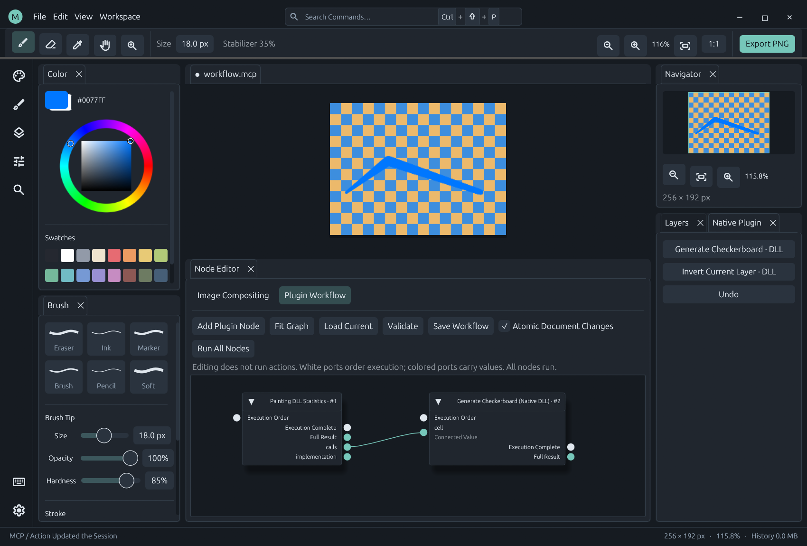

# Atomic document operations and compact history

MiCoPi 0.21 adds atomic document execution to the shared Session used by the GUI, DLL host callbacks, MCP and headless clients. A failed operation restores document pixels, layer/image/workflow metadata, brush/view state, revision and undo/redo history. The history checkpoint shares tile buffers; successful operations do not copy the full canvas or undo pixel history.

## Single operations and pen contacts

Host document actions (strokes, layers, graph edits, undo/redo, parameters and view) use rollback checkpoints when no contact is active. Tools that finish an existing contact first retain that contact boundary. Programmatic atomic groups require an idle contact. Raw pen samples retain the typed DLL path, pressure and stabilization. They are written in bounded 256-sample segments; those segments remain a **provisional tail** until the contact ends. A storage failure restores the entire contact's starting state and truncates all its provisional segments.

`replay.status.transaction_pending` marks a provisional contact or group. During a contact, `head_hash` can describe the provisional tail; `committed_head_hash` and `committed_events` identify the stable prefix. Verification reports its scope and pending samples. Finish a contact before exporting a sealed replay or frame sequence. Completed recordings remain append-only; rollback removes only an uncommitted tail. Diagnostic events are a separate bounded record of attempts.

The application is serialized through one Session. Journal records are prepared and compressed before publication; partial writes are truncated and never advance the head or event index. Project saves reserve the journal record before atomically replacing the project file. If file writing fails, the reservation is removed and the failure is recorded. This is application-level atomicity, not a claim that every operation is independently fsynced or survives power loss. Project/archive saves provide the durable file boundary.

## Atomic pipelines and workflows



The workflow editor enables **Atomic Document Changes** by default; uncheck it for explicit sequential execution. Programmatic callers opt in with `atomic: true` on `pipeline.run` or `workflow.run`; omitted/false preserves existing sequential behavior.

```json
{
  "action": "pipeline.run",
  "args": {
    "atomic": true,
    "steps": [
      {"id":"brush","action":"brush.set","args":{"color":"#668ff0","radius":12}},
      {"id":"stroke","action":"canvas.stroke","args":{"points":[{"x":20,"y":30},{"x":150,"y":90}]}}
    ]
  }
}
```

All child writes are staged in the document and combined into **one replay event**, containing the original group request and final outcome. Intermediate brush settings, nested pipelines and plugin callbacks do not each generate duplicate history events. A runtime/output-schema failure rolls the group back. Results include `transactional`, `rolled_back` and `committed`; `completed` lists attempted completed steps and must not be read as committed work after rollback. Static validation errors remain action errors. Nested groups share the outer commit boundary.

Existing per-stroke undo granularity is retained after a successful group; atomic failure rollback is separate from undo grouping. Atomic groups require an idle contact. Supported effects are document changes and queries, not arbitrary external transactions. File open/new/save/export, settings writes, UI effects and replay loading/opening are rejected in a group. Static action capabilities are checked during pipeline validation/dry run and host callbacks are checked again during execution.

## Plugin capability

A native action can declare `"document_atomic": true` in its contribution descriptor. `app.describe` reports this as `documentAtomic`. This opts the action into document checkpoints and a single commit around nested host actions. The bundled native-paint and AI-assistant examples declare support. Unmarked mutating native actions are rejected inside atomic groups.

The guarantee covers host-owned document state. Plugin-private counters, caches, network calls, arbitrary filesystem access and process crashes are outside it. DLLs run in-process; this flag is a plugin contract, not a sandbox. An opted-in action must restrict durable effects to the host document API. The C ABI tables are unchanged; the optional descriptor field requires host 0.21+.

## Compression without dropping operations

MCRPLY02 archives retain SHA-256 chains and state verification while reducing repeated payloads:

- Metadata stores only changed top-level fields after a full snapshot; unchanged image/workflow graphs are inherited.
- Identical tiles in an event reference a preceding tile, including matching layer/composite tiles; the current in-memory state shares those buffers too.
- Sparse changes over existing pixels use XOR deltas with long zero runs.
- Uniform tiles keep one color; each event is then compressed using fast Deflate.
- Atomic groups record one outcome instead of each internal leaf operation. Raw pen data remains lossless.

References only point backward within their event and must match tile dimensions. XOR bases, reconstructed metadata and final state hashes are verified before loading. MCRPLY01 archives remain readable and can be upgraded without changing existing event hashes; new v2 archives need MiCoPi 0.21+. The 1 GiB / one-million-event / 512 MiB decoded-event limits remain in force. Compression bounds growth but does not silently discard authored operations or promise unlimited history.

Regression checks cover nested and output-schema failures, redo restoration, partial journal writes, existing-project preservation, contact rollback across segment boundaries, v1 compatibility, large unchanged metadata and sparse edits on noisy pixels. See [Verified Replay](replay.md) and `examples/automation/atomic.jsonl`.

A local eight-stroke workload with a filter, undo/redo and project save produced identical final PNG bytes: the 0.20 v1 recording was 379,324 bytes; the 0.21 recording with the drawing grouped atomically was 238,486 bytes (37.1% smaller). This measures the combined grouping/encoding strategy for that workload, not a universal compression ratio.
