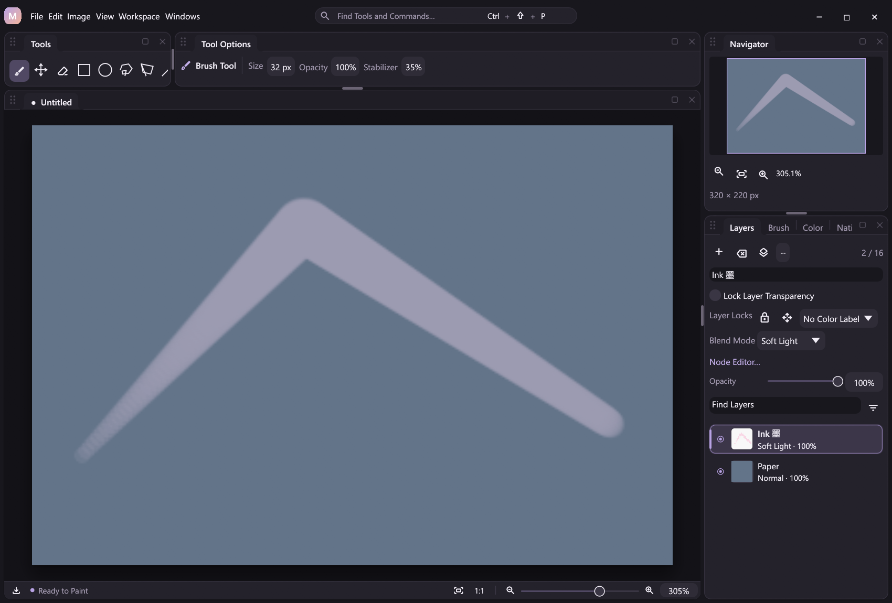

# Color blend modes

MiCoPi provides 26 deterministic color blend modes for raster layers, isolated groups and image Blend nodes. They use the shared action, document and native compositor contracts; original pixels remain editable. The interface arranges modes into familiar families with separators and a bounded scrolling menu. Labels follow the display language; wire names and numeric IDs remain stable.



The reviewed Release capture uses generated drawing content. Four-language inspection covers the property labels and selected mode; desktop regression tests exercise the open scrolling menu, including narrow panels and unavailable modes.

## Stable catalog

| Family | Mode | Wire name | Native ID |
| --- | --- | --- | --- |
| Normal | Normal | `normal` | 0 |
| Darken | Darken | `darken` | 4 |
| Darken | Multiply | `multiply` | 1 |
| Darken | Color Burn | `color_burn` | 8 |
| Darken | Linear Burn | `linear_burn` | 9 |
| Darken | Darker Color | `darker_color` | 10 |
| Lighten | Lighten | `lighten` | 5 |
| Lighten | Screen | `screen` | 2 |
| Lighten | Color Dodge | `color_dodge` | 11 |
| Lighten | Linear Dodge | `add` | 6 |
| Lighten | Lighter Color | `lighter_color` | 12 |
| Contrast | Overlay | `overlay` | 3 |
| Contrast | Soft Light | `soft_light` | 13 |
| Contrast | Hard Light | `hard_light` | 14 |
| Contrast | Vivid Light | `vivid_light` | 15 |
| Contrast | Linear Light | `linear_light` | 16 |
| Contrast | Pin Light | `pin_light` | 17 |
| Contrast | Hard Mix | `hard_mix` | 18 |
| Difference | Difference | `difference` | 7 |
| Difference | Exclusion | `exclusion` | 19 |
| Difference | Subtract | `subtract` | 20 |
| Difference | Divide | `divide` | 21 |
| Component | Hue | `hue` | 22 |
| Component | Saturation | `saturation` | 23 |
| Component | Color | `color` | 24 |
| Component | Luminosity | `luminosity` | 25 |

IDs 0–7 and their existing arithmetic are unchanged. The public `add` name continues to mean Linear Dodge. Dissolve is a separate planned coverage operation; Pass Through is a planned group policy. Neither is approximated by one of these color modes.

## Color and alpha contract

The native implementation independently follows the standard equations described in [W3C Compositing and Blending](https://www.w3.org/TR/compositing-1/#blending) for its defined separable and nonseparable modes. It does not import PhotoCraft source. Arithmetic operates on stored encoded RGB components, without a linear-light or ICC conversion. Hue/Saturation/Color/Luminosity use RGB luminance weights 0.30/0.59/0.11 with saturation/luminance adjustment and gamut clipping, rather than replacing HSV picker channels.

Appended rational modes compute half-up byte rounding with bounded integer ratios. Soft Light and component-mode calculations use scalar double precision, clamp to the supported range and quantize the blended RGB once; a tightly bounded correction handles floating roundoff at mathematical half-byte ties. The existing integer alpha composition then applies unchanged. Layer opacity scales source alpha once; a group composites children before its own opacity and blend boundary. Alpha-zero composited output is canonical zero. See [Layer Groups](layer-groups.md) for isolation and baking.

Endpoint and tie choices are explicit:

- Color Burn gives a white backdrop precedence over a black source. Color Dodge gives a black backdrop precedence over a white source, matching their standard endpoint rules.
- Divide uses clamped backdrop/source ratios; a zero source component produces white, including zero/zero.
- Darker Color and Lighter Color compare complete RGB sums and retain the backdrop on equal sums; alpha is handled by composition afterward.
- Hard Mix thresholds the unquantized Vivid Light result at 0.5. Its exact byte comparison retains the Color Dodge black-backdrop/white-source exception.
- Existing Overlay/Screen keep their historical intermediate integer rounding. Algebraic equivalences with newly added modes can therefore differ by one byte step. These are documented MiCoPi semantics, rather than a bit-for-bit Photoshop compatibility claim.

## Shared actions and availability

`layer.set {"blend_mode":"soft_light"}`, `group.set {"group_id":1,"blend_mode":"color"}` and `graph.set` share the same catalog. `layer.batch` explicitly targets multiple layers and publishes one Undo/Redo group. Schema-derived action/state nodes, JSONL, MCP and GUI attachment use those handlers. Editing or validating a workflow never executes it.

`graph.catalog.blend_modes` lists recognized values. `graph.read.available_blend_modes` and `graph.catalog.available_blend_modes` report current availability, including the CPU Normal fallback. The public `compositing.graph` state exposes the same typed list. Unsupported menu entries remain visible with an explanation. Required capabilities are checked before changing properties, graphs or staged projects, even for hidden groups/layers, disabled effects and unused graph branches. A dry run validates syntax and bindings without calling a DLL; it does not guarantee that a later runtime has the required renderer.

The compositor retains its v1 callback prefix and optional transparent-source Features tail. A complete 32-byte `CompositorApiModes` tail adds a 64-bit supported-mode bitmap at offset 24. Prefix-only or 24-byte DLLs imply legacy modes 0–7. A complete bitmap must keep every mandatory legacy bit; it may advertise a subset of appended modes. Hosts read only complete advertised tails and reject unsupported modes before native dispatch. No dependency, per-pixel allocation or image-sized node intermediate is added. DLL changes require restart. See [Native Plugins](native-plugins.md).

Projects using appended modes need a reader that understands those values and a supporting compositor for editing/rendering. Older projects and recording hashes retain their defaults. Verified outcome playback restores stored surfaces without executing the compositor; its metadata/cache restoration does not require a new renderer.

## Verification

The [automation example](../examples/automation/blend-modes.jsonl) demonstrates layer/group modes, subtree baking, undo, catalog discovery and verified replay. `scripts/smoke-blend-modes.py` compares 186-action fixtures across JSONL/MCP/GUI, exact opacity references, workflow/batch behavior, project loading and DLL-independent replay. Four-language captures show a selected new mode; desktop interaction tests cover actual menu ordering, scrolling, configured metrics and unavailable entries.

Run the example from a portable package directory after creating its output folder:

```powershell
New-Item -ItemType Directory -Force target/example-output | Out-Null
.\micopi-cli.exe run examples/automation/blend-modes.jsonl --plugins plugins --config-dir target/blend-example-profile
```

It writes four PNGs; the Color group result and its baked layer result are identical. The profile is isolated from existing preferences.

Native checks compare normalized independent references, dirty strides and rejection-before-write behavior. Fixed output hashes from the preceding DLL protect the original eight modes. High-precision independent Decimal/Fraction goldens cover all 65,536 Soft Light and Hard Mix byte pairs, alongside explicit Color Burn half-byte cases. Session regressions cover capability preflight, stable IDs, pressure/stabilization continuity, structural baking, undo, atomic/render/journal failure and saved outcomes. Physical tablet compatibility and Photoshop file/color-management parity remain separate checks.
