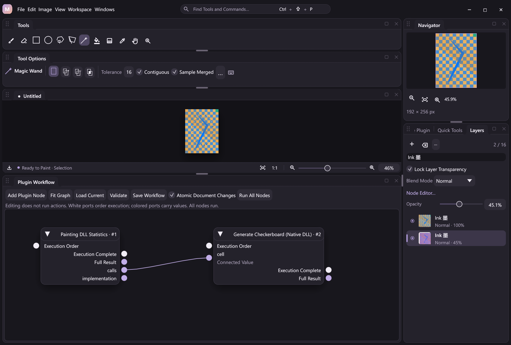
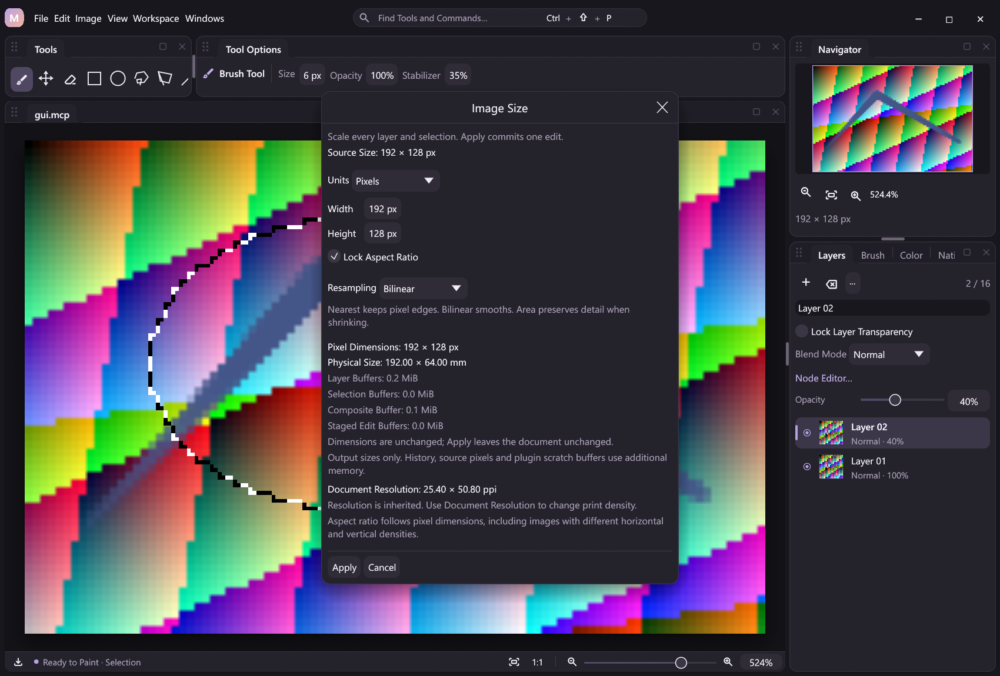
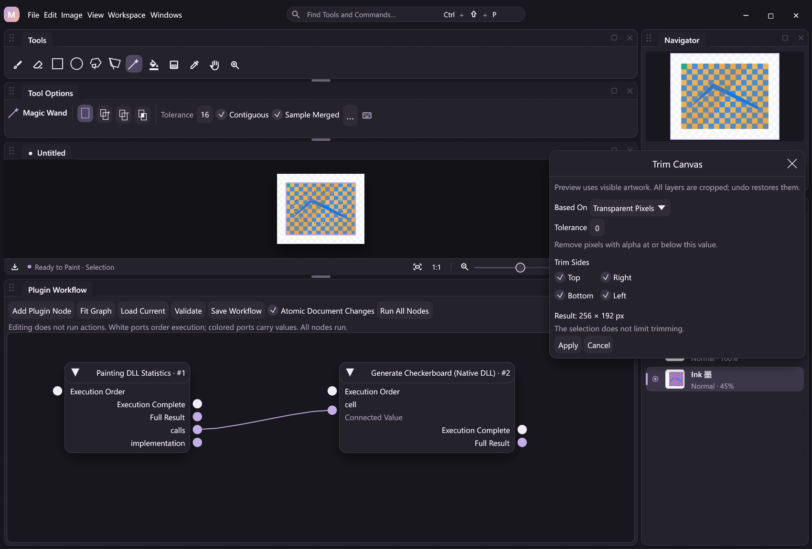
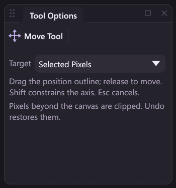
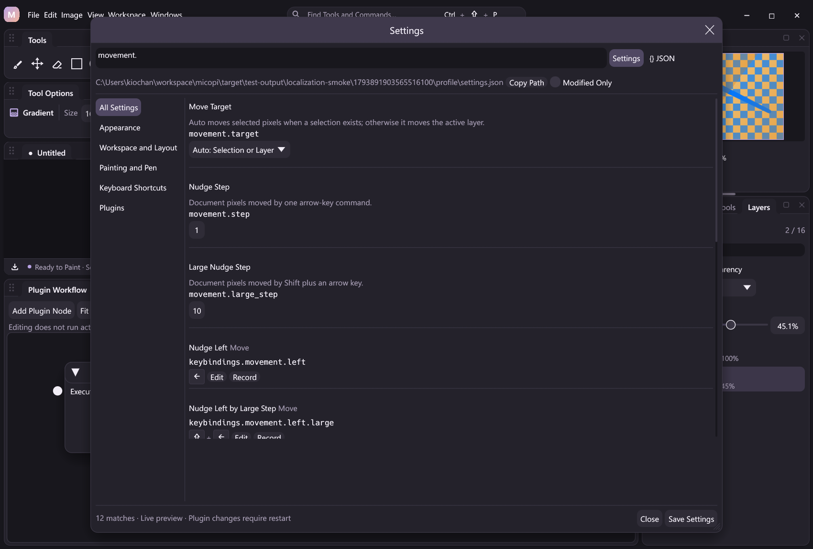
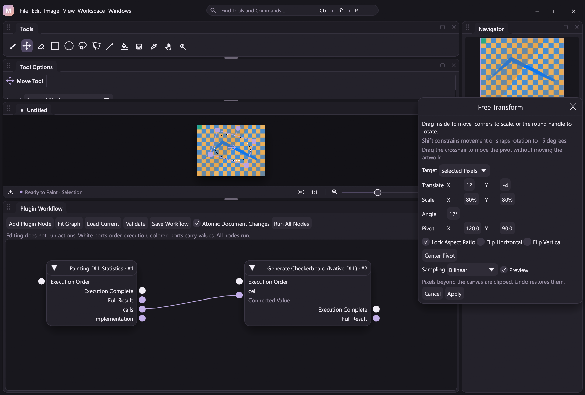
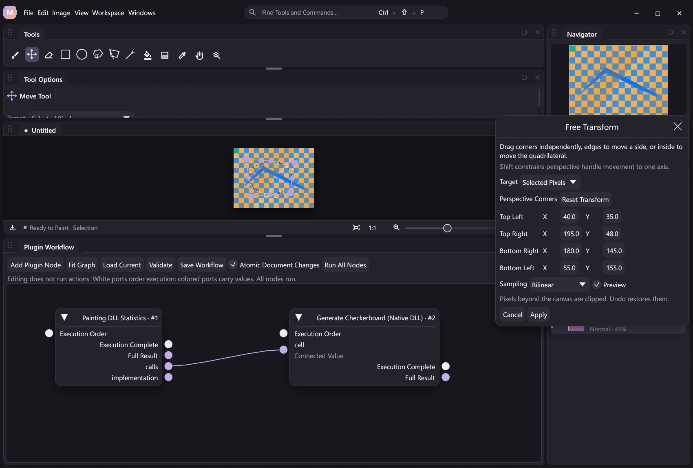

# Canvas geometry

Geometry references to current/Reselect coverage in this guide describe pixel selections. First-class layer/group raster masks have separate raw A8 storage. Document-wide framing/crop, rotations/flips, Image Size and Trim transform every raw mask with the canvas, including hidden, disabled and unlinked masks. [Integer raster-owner movement](raster-owner-movement.md) supports linked pairs and independent raw masks. Owner Free Transform, group-mask movement, selected-pixel transfers on masked documents, active-layer rotations and incomplete structural paths remain guarded. See [Raster mask canvas geometry](mask-canvas-geometry.md) and [remaining boundaries](raster-mask-editing.md#current-boundaries).

Use **Edit > Canvas Size…** (**Ctrl+Alt+C**) to expand or contract the document frame. Enter the new width and height in pixels and select one of nine anchor positions. The anchor determines which edge or corner stays fixed. Added space is transparent; pixels beyond the new frame are clipped. Pixel colors and scale are unchanged.

Use **Edit > Crop Canvas…** to enter an exact rectangle: X/Y locate its top-left corner, and Width/Height specify its size. The canvas shows the rectangle with a thirds guide while the dialog is open. Apply commits one edit; Cancel, Escape and the close button leave the document untouched. A dialog whose source document or dimensions changed must be reopened.

Both operations affect every layer, including hidden and transparency-locked layers. They preserve layer names, stable IDs, active layer, opacity, blend modes, lock flags, image graphs and workflow graphs. The transparency lock governs painting; a document framing operation moves/clips the whole document coordinate system. Undo restores the original dimensions and all clipped stored pixels, including hidden RGB under zero alpha. Redo reapplies the frame.

## Public actions

```json
{"action":"canvas.resize","args":{"width":1600,"height":1200,"anchor":"center"}}
{"action":"canvas.crop","args":{"x":100,"y":80,"width":1000,"height":800}}
```

`canvas.resize` requires width and height, each an integer from 1 to 4096. The optional anchor defaults to `center` and accepts `top_left`, `top`, `top_right`, `left`, `center`, `right`, `bottom_left`, `bottom` or `bottom_right`. Centered offsets round toward negative infinity: enlarging 12 pixels to 17 adds 2 pixels on the left and 3 on the right; shrinking 12 to 7 removes 3 on the left and 2 on the right.

`canvas.crop` requires integer x, y, width and height. Its nonempty rectangle must be entirely inside the existing canvas. Both actions enforce the document budget of 64 million pixels across all layers. Invalid bounds, dimensions, anchors and stale expected revisions fail without changing the committed document. Identical framing adds no undo entry.

The actions are discoverable in command search, schema-derived workflow nodes, JSONL and MCP. They support document-atomic pipelines, expected revisions, project persistence and verified outcome replay. A failed atomic group restores dimensions, pixels, graphs and prior history; playback applies recorded results without rerunning commands. Existing recording and SDK formats are unchanged.

## Implementation and verification

Framing is a host-owned document structure operation. It copies retained RGBA row slices without resampling, blending or invoking a pixel filter. Raw A8 masks use the optional native sampler's reframe callback; expansion fills those new samples with revealing white (`255`). Existing layer/mask buffers move into a shared undo record; undo/redo exchanges dimensioned buffer sets. Unshared sets move directly; a transaction checkpoint retaining a saved set requires a copy when that set becomes editable again. Checkpoints share saved sets without eagerly cloning their pixels. History accounts for retained buffers under the existing retention policy. Geometry changes invalidate the complete render surface, effective coverage and replay tile grids; ordinary strokes retain tiled history and their typed input path. No new dependency is needed.

Regression coverage checks every anchor with odd expansion/contraction, exact per-layer pixel oracles, hidden/locked layers, linked filters, texture dimensions, cancellation, stale dialogs, atomic failure, project reopen and replay. Runtime smoke compares JSONL, MCP and GUI output and checks geometry with linked graphs. The feature scope was informed by PhotoCraft's [everyday document editing tools](https://github.com/storytold/photocraft#-the-everyday-essentials); implementation follows MiCoPi's document/history boundaries.

## Exact rotation and flips



The **Image** menu offers Canvas Size/Crop alongside these document-atomic actions. They take an empty argument object and return the typed `canvas.state` result. Command search, configurable shortcuts (unbound by default), workflow nodes, JSONL, MCP and headless execution share the same registrations.

| Action | Operation |
| --- | --- |
| `canvas.rotate_90_cw` | Clockwise quarter turn; swap width/height |
| `canvas.rotate_90_ccw` | Counterclockwise quarter turn; swap width/height |
| `canvas.rotate_180` | Half turn; keep dimensions |
| `canvas.flip_horizontal` | Mirror left/right |
| `canvas.flip_vertical` | Mirror top/bottom |

Every raw layer participates, including hidden and transparency-locked layers. Current and Reselect masks follow the same permutation with exact fractional coverage. Stored 32-bit pixels, including hidden RGB under zero alpha, are permuted without resampling or blending. Layer IDs, names, locks, opacity, blend modes, active index and image/workflow graphs remain unchanged; filters render from transformed raw sources rather than being baked. A free image graph is retained as-is. These are document edits, distinct from the planned non-destructive view rotation.

The painting DLL's optional `micopi_geometry_v1` table supplies tiled, allocation-free pixel/mask kernels. The host stages validated masks and all layer outputs before publishing one dimension-aware undo entry. A mask exceeding the existing compressed selection budget rejects before publication. Identical output creates no undo entry. Atomic or journal failure restores dimensions, masks, pixels and history. Outcome replay applies saved buffers without invoking geometry DLLs; existing projects, recording hashes and ABI prefixes remain supported. No work is added to pen MOVE.

`layer.rotate_90_cw` and `layer.rotate_90_ccw` are also available in Layers actions/context menus. They operate on the visible active layer, preserve canvas dimensions and keep masks fixed. Rotate the full raw layer, center its swapped rectangle in the existing frame with offsets `floor((width-height)/2)` and `floor((height-width)/2)`, clear uncovered destination pixels to transparent, then blend the destination through the current selection. Thus the selection clips **where the result is written**, not a separately rotated selection bounding box. Alpha lock rejects changes to transparency or hidden RGB under zero alpha. Opaque square-layer color permutations remain permitted.

MiCoPi currently stores each layer within the document frame: layer quarter turns **clip out-of-frame pixels**. Undo restores them, but a reverse quarter turn after clipping cannot recover them. Use document rotation to retain all content. Off-canvas storage/Reveal All remain planned; interactive affine editing is described under [Free Transform](#free-transform). See [the runnable geometry example](../examples/automation/geometry.jsonl).

The Image menu uses intrinsic label/keycap layout and configured spacing so long English/CJK titles do not overlap shortcut badges. Tests cover asymmetric and strided buffers, tile boundaries, fractional masks, missing/truncated tables, compressed-mask limits, locks, structural identity, undo/redo, atomic/journal failure, inert workflow editing, project reopening and verified outcomes.

## Image size and resampling



Use **Image > Image Size…** (**Ctrl+Alt+I**, configurable) to scale every layer and both current/Reselect selection masks. Enter pixels, millimeters or inches. Aspect lock is on initially; convert the requested axis to pixels, then derive the other from the source **pixel ratio**, rounded to the nearest integer with half ties upward. Unlock to set dimensions independently. A shared read-only plan reports resolved dimensions, physical size and all-layer/mask buffer estimates before Apply. Cancel/Escape/close leaves pixels and history untouched. Reopen the dialog after an external edit, including a density-only resolution change. Successful local fit-view updates may advance its revision guard only when no intervening external revision occurred. Spacing follows the configured appearance metrics; controls scroll separately from Apply/Cancel. Explicit older shortcut preferences take priority over the default.

`canvas.image_size` is document-atomic and returns the typed `canvas.state` result. `canvas.image_size.plan` accepts the same arguments and is read-only: it does not sample, allocate raster buffers, finish a contact, change revision/history or append an operation. Both share command search, schema-derived workflow nodes, JSONL, MCP and headless execution. The actions accept:

| Parameter | Contract |
| --- | --- |
| `width`, `height` | Positive dimensions in `unit`. Pixels must be integers, including integer-valued JSON numbers. Physical inputs round half up to whole pixels; each final side must be 1–4096, without clamping. With aspect lock supply **exactly one**; with lock off supply both. |
| `unit` | `px` (default), `mm` or `in`. Physical inputs use exact current X/Y density independently; legacy scalar PPI is known. Unknown PNG units or zero axes require a deliberate `canvas.resolution` change first. |
| `lock_aspect` | Defaults to `true`; derive the omitted dimension from the current source ratio. |
| `method` | `bilinear` (default), `nearest` or `area` (area averaging on shrinking axes, bilinear on enlarging axes). |

```json
{"action":"canvas.image_size","args":{"width":1600,"method":"nearest"}}
{"action":"canvas.image_size","args":{"width":1200,"height":900,"lock_aspect":false,"method":"bilinear"}}
{"action":"canvas.image_size.plan","args":{"width":25.4,"unit":"mm","method":"area"}}
```

Physical sizing preserves the document's exact density metadata. It resamples pixels rather than changing PPI, and accepts no output-only resolution override. With unequal metric axes, equal physical width/height can require unequal pixel counts; aspect locking still retains the source pixel ratio. Switching desktop units preserves the resolved pixel dimensions. Use [document resolution](document-setup.md) for an explicit metadata-only change, or [PNG export sizing](export-sizing.md) to resize only an external copy.

The plan returns `source_width`, `source_height`, `width`, `height`, `method`, `identity`, `document_info`, `layer_count`, `mask_count`, `revision`, `drawing` and `contact_active`. The latter includes Hand contacts even when `drawing` is false. Buffer estimates describe target uncompressed storage: `estimated_layer_bytes` is pixels × layers × 4, `estimated_mask_bytes` is pixels × current/previous pixel-selection count, and `estimated_composite_bytes` is pixels × 4. Additive `raster_mask_count`, `estimated_raster_mask_bytes` and `estimated_effective_mask_bytes` describe separate document A8 masks and derived coverage. `estimated_staged_bytes` includes layers, pixel selections and raw A8 outputs for a resize, or zero for identity; it excludes the separately reported composite/effective cache. These are not peak-memory estimates: source storage, shared undo/replay tiles, compressed selection caches, native row buffers and desktop textures add separate costs. Plans enforce the existing 64 × 1024 × 1024 raster-pixel budget and separate 64 MiB logical raw-A8 budget without allocating those buffers or predicting selection-compression success. Capability flags report optional sampler availability. Numeric feather stays fixed in canvas pixels. See [Raster mask canvas geometry](mask-canvas-geometry.md) and the [physical sizing example](../examples/automation/physical-image-size.jsonl).

Complete literal parameter shape, pixel integrality and unit-independent bounds are checked before earlier pipeline steps execute. Source-dependent aspect, density and layer/mask budgets are resolved against the state at that step, so a preceding New Canvas or resolution command can intentionally establish the context. Result references retain the pipeline's dynamic failure and partial-completion semantics.

Plans can inspect a live provisional contact. Mutating Image Size rejects active contacts with `stroke_active`, avoiding implicit stroke completion before a later native/encoding failure. Opening/cancelling a geometry dialog or generic geometry command form preserves an existing contact; clients must finish their own stream before applying a resize. Unrelated mouse releases do not end an external native contact.

Derived dimensions outside 1–4096, missing/ambiguous dimensions, unknown arguments/methods, stale expected revisions and the existing 64 Mi-pixel all-layer budget reject before output allocation/publication. Derived zero or oversized dimensions are rejected rather than silently clamped. An identical size preserves every raw stored word and adds no undo entry.

Sampling maps destination pixel centers into the source. Nearest uses `floor((destination+0.5)*source_size/target_size)` with edge clamping; the selected raw 32-bit word, including hidden RGB, is copied exactly. Bilinear uses the four neighboring source centers with clamped edges and exact rational fixed-point weights. Alpha is interpolated, RGB is weighted by source alpha then unpremultiplied; rounded zero-alpha results have RGB zero. Channel and alpha rounding is half-up. Filtering uses the document's existing encoded 8-bit RGB values, not linear-light/ICC color management. Masks use the same nearest or bilinear coordinates, independently interpolating coverage bytes.

Bilinear smooths enlargement and small reductions but is **not an area/anti-aliasing filter for substantial downscaling**. Choose **Area (Downscale)** to integrate the source footprint of every destination pixel on each shrinking axis. For example, reducing an eight-pixel row to two pixels averages each group of four; a one-pixel white line over black contributes 25% gray instead of disappearing between sample centers. Noninteger ratios use exact overlap fractions. Enlarging or unchanged axes use bilinear centers; mixed-axis scaling combines these rules. The default remains bilinear, retaining prior workflow/action behavior.

Area sampling accumulates alpha and alpha-weighted RGB, rounds only after both axes, then unpremultiplies; coverage masks use the same footprint weights. Filtering remains in encoded RGB, not linear light. A box footprint suppresses aliasing during reductions without negative-lobe ringing, but is not a claim of Photoshop bicubic, Lanczos or ideal frequency rejection. No command promises lossless downsampling; undo retains original buffers. The native kernel reuses two horizontally filtered source rows and one accumulator row, with at most 480 KiB pixel scratch (192 KiB for masks) on x64, rather than a full intermediate image. Old resampling DLLs without the complete advertised area-capability tail reject `area` explicitly; nearest/bilinear and identity sizing remain available.

Hidden and transparency-locked layers participate because this changes document coordinates. Names, IDs, active layer, visibility, opacity, blend/lock flags and image/workflow graphs are retained. Source filters are not baked or scaled: their parameter values remain unchanged and they render against the resampled sources. All masks/outputs are staged and validated before one structural undo entry and verified outcome event. A failed later layer, missing optional DLL capability, oversized compressed mask, atomic batch or partial journal write leaves the previous committed document/history intact. Replay restores outcomes without executing a sampler. See [the runnable example](../examples/automation/image-size.jsonl) and [native extension](native-plugins.md#optional-image-resampling-table).

The shared desktop texture cache checks its own dimensions before partial uploads, including GUI Undo and equal-pixel-count quarter turns. Dimension changes rebuild the surface; ordinary drawing retains dirty-region uploads. This protects Canvas and Navigator even when a command has not performed an adapter-level state sync.

## Automatic trim



Use **Image > Trim Canvas…** to preview removal of uniform outer margins. The command is searchable and bindable, with no default shortcut. Choose transparent pixels or the merged image's top-left/bottom-right corner color, set tolerance (0–255), then choose any nonempty set of Top/Right/Bottom/Left. The draggable dialog opens on the right to keep the central artwork visible. The outline and resulting pixel dimensions update only when parameters change. Apply commits one edit; Cancel/Escape/close leaves the document untouched. A changed document/revision or an intervening contact requires reopening the dialog.

The analysis source is the **current visible merged artwork**, including opacity, blend modes, enabled raster masks and the image graph, without the display checkerboard. Hidden layers, zero-opacity content and the selection do not enlarge the sampled bounds. Applying the resulting frame crops **all raw layers and raster masks**, including hidden, alpha-locked, disabled and unlinked storage, and reframes both current/Reselect pixel selections. Undo restores the original stored words, dimensions and mask samples. Names, IDs, active layer/painting target, opacity, blend/lock flags and image/workflow graph identities remain unchanged. Filters and numeric feather retain their parameters and rerender rather than being baked.

Transparent mode removes alpha values at or below tolerance, independent of RGB. Corner modes compare straight RGBA against the selected corner: a pixel matches if every channel differs by at most tolerance. Two zero-alpha pixels match regardless of hidden RGB. Retain the bounding rectangle of every nonmatching pixel, then keep original edges for unchecked directions. Matching pixels inside that rectangle are retained; this does not erase a color or flood-fill a border.

If all pixels match, or selected edges have no removable margin, dimensions/pixels/history remain unchanged. In particular, a uniform opaque image in corner-color mode is an all-matching result, not a claim that its artwork is transparent. MiCoPi never creates a zero-sized document. The GUI disables Apply for these no-ops; explicit automation calls still publish their audit event without adding an undo entry.

| Action | Result |
| --- | --- |
| `canvas.trim_bounds` | Read-only `{x,y,width,height,source_width,source_height,revision,drawing,empty,would_change}` |
| `canvas.trim` | Atomic document framing; typed `canvas.state` result |

Both share optional arguments: `mode` is `transparent` (default), `top_left` or `bottom_right`; `tolerance` defaults to 0; `top`, `right`, `bottom`, `left` default to `true`, with at least one required to remain true. Bounds coordinates use current document pixels. Empty/all-matching analysis returns the original frame with `empty: true` and `would_change: false`. Analysis does not finish a provisional typed contact or increment revision; `drawing: true` identifies such a query. The mutation requires no active Brush or Hand contact and **recomputes** bounds instead of trusting a previously returned rectangle. Use the standard action envelope's expected revision for concurrency guards.

```json
{"action":"canvas.trim_bounds","args":{"mode":"transparent"}}
{"action":"canvas.trim","args":{"mode":"top_left","tolerance":2,"top":false}}
```

The painting DLL owns the source-pixel scan. The host validates its rectangle, prepares bounded selection/frame buffers and publishes through the existing all-layer structural history. Missing callbacks, failed composition, invalid native rectangles, invalid arguments and stale revisions reject before cropping. Atomic failure restores the previous frame/history; verified replay restores recorded outcomes without rerunning the scanner or compositor. JSONL, MCP, command search and action nodes use the same registrations; editing a workflow does not trim. See [the runnable example](../examples/automation/trim.jsonl) and [native extension](native-plugins.md#optional-trim-analysis-table).

Reveal All is still planned: current layer buffers are bounded by the document frame. Clipped pixels retained for undo are not live off-canvas layer content.

## Move and nudge



Select **Move Tool (V)** in Tools. Tool Options chooses Auto, Active Layer, Selected Pixels or Selection Outline and shows the resolved owner. Auto first moves a selected **raster painting mask**; otherwise it moves selected raw pixels and their pixel-selection coverage, or the active whole raster when no pixel selection exists. An empty pixel selection never falls back to moving a layer. Layer mode ignores pixel selections and moves only its owned linked raster mask alongside pixels; unlinked masks stay fixed. Outline mode moves only the current pixel selection, even on hidden or transparency-locked layers. The previous Reselect mask stays in its original coordinates in all modes. See [Raster owner movement](raster-owner-movement.md) for mask ownership, neutral-white expansion, idle admission and remaining selected-pixel/group-mask restrictions.

Drag to preview a translated bounding outline and document-pixel offset. Source pixels remain visible until release; this is an outline preview, not a live pixel transform. Shift locks the dominant axis. Escape, focus loss, pen cancellation and input-cancelling modals discard the gesture; preserving command/geometry drafts retain it. A changed source document/revision/layer rejects stale release. Release publishes one action with an expected revision. No pixel copy, JSON serialization, DLL call or history event is produced for each MOVE sample. The existing brush/eraser pressure and stabilization path is unchanged.

Arrow keys nudge by **1 document pixel** by default, or **10** with Shift. These bindings operate while Move is active and no text editor has keyboard focus; command search/direct actions remain usable independently. All bindings are configurable and new defaults yield to older explicit preferences. Search Settings for `movement` to change the target, `movement.step` or `movement.large_step` (integer 1–4096). Preview/cancel/save follows the existing settings contract. Tool Options overrides are session-local; saving changed defaults replaces the override, while unrelated settings and writes to inactive profiles preserve it. `canvas.state` exposes `movement_defaults` and effective `movement_options` separately.



| Action | Arguments |
| --- | --- |
| `canvas.move` | Required integer `dx`, `dy`, each within ±4096; optional `target`, `mask_id` |
| `canvas.nudge` | Required `direction`: `left`, `right`, `up`, `down`; optional `large` (default false), `target`, `mask_id` |

Targets are `auto`, `layer`, `selection`, `selection_mask`; omitted target follows the effective preferences. An explicit stable `mask_id` overrides those preferences and moves only that whole raw raster-owned mask; it accepts an omitted or Auto target, rejecting an explicit other domain before pipeline prefixes execute. Positive offsets move right/down. Both actions are document-atomic, schema-described and available through nodes, JSONL, MCP and headless execution, returning `canvas.state`. `toolbox.mode.move` and `toolbox.movement.options` explicitly require desktop presentation. Editing a workflow never executes movement. See the [unmasked example](../examples/automation/movement.jsonl) and [owner-mask example](../examples/automation/mask-owner-movement.jsonl).

All movement clips to the existing frame; it does not retain live off-canvas pixels. Undo restores clipped words and masks. Whole-layer movement copies raw words exactly, including hidden RGB, without baking filters. Selected movement reads original pixels and coverage immutably: remove selected coverage from source alpha with `round(alpha * (255-coverage) / 255)`, then source-over translated extracted alpha `round(alpha * coverage / 255)` onto that cleared base. Rounding is half-up; cleared zero-alpha pixels become canonical zero, and untouched unselected words retain their hidden RGB. This avoids overlap feedback or applying destination selection twice. A zero offset preserves all stored words and adds no undo entry.

Pixel moves require a visible active layer. Transparency locking rejects changed alpha or changed hidden words in fully transparent pixels before publishing masks or pixels. Names, IDs, graph/filter parameters, opacity and blend flags stay unchanged. Outputs are staged before one bounded history edit; owner moves pair changed raster tiles with the previous raw A8 plane without a composition snapshot. Atomic or journal failure restores pixels, masks and history. Replay restores verified outcomes without executing the DLL; compact event context records resolved target and offsets, not per-drag samples. See [the optional native table](native-plugins.md#optional-integer-movement-table).

On this test host, a release kernel-only run on 4096² pixels took 23.75 ms for whole-layer movement and 297.80 ms for fractional selected movement. These single-run measurements exclude allocation, mask encoding, host history, composition and recording; they are not frame-rate or tablet-latency promises. Kernels allocate no scratch; the host stages one pixel output (up to 64 MiB) and, when needed, one mask output (up to 16 MiB), in addition to bounded tiled history/rollback/replay costs.

Those unmasked kernel measurements predate raw owner-mask staging and do not measure it.

## Free Transform



Open **Edit > Free Transform… (Ctrl+T)** or search for the command. New defaults yield to older explicit shortcuts. Choose the active raw layer, selected pixels or the selection outline. Drag inside the frame to translate, corners to scale, and the round handle to rotate. Shift constrains translation to one axis, locks corner aspect ratio, or snaps rotation to 15° steps. Numeric controls provide independent scale, flips, clockwise angle and pivot coordinates; drag the crosshair to relocate the pivot, or reset it to the source bounds center with **Center Pivot**. Moving/recentering the pivot compensates translation to preserve the current artwork mapping. Direct action arguments instead describe the complete final mapping.

Control-frame gestures update parameters only. After interaction stops for 150 ms, the optional raster preview samples the original committed pixels and composes against borrowed untouched layers with the same filters/blends as Apply. It reuses one texture and caches the mask contour; no source layers are cloned, history entries created or outcomes written for individual MOVE samples. While dragging, the source artwork remains visible under the live control frame. Preview checkbox changes display only; pixel snapshots, exports and project saves continue to read the committed document. Cancel/Escape/close discards the draft. Losing input focus or pen contact cancels the current handle drag; an external document/revision/layer change hides cached pixels and requires reopening. Apply submits one shared action with an expected revision; pending previews never become document state.

The **Skew** X/Y controls and four edge-midpoint diamond handles use the same parameters as `canvas.transform`. Top/bottom diamonds adjust X skew; left/right diamonds adjust Y skew, projected along local axes after rotation. Shift snaps skew to 5° steps. Dragging preserves scale, flips and pivot; a degenerate midpoint exactly on the relevant pivot axis cannot change that shear and numeric controls remain available. Corner scaling removes existing rotation/shears before resolving scales, preventing skewed artwork from jumping. Invalid combined matrices do not replace a valid gesture draft. Pixel sampling remains in the existing native plugin, with no new ABI table or dependency. Apply/Cancel stay below a separately scrolling parameter region in short viewports. See [the skew example](../examples/automation/skew.jsonl).


*Actual English Release capture. X/Y shears combine with scaling and rotation; snapshots still read the committed artwork until Apply.*

| Action | Contract |
| --- | --- |
| `canvas.transform.plan` | Read-only source bounds, pivot, matrix, corners, frame, revision and drawing flag; no rasterization, stroke finishing, history or event mutation |
| `canvas.transform` | Atomic pixel/mask operation returning typed `canvas.state`; available to JSONL, MCP, workflows and headless |
| `canvas.transform.open` | Desktop-only preview command, bound to configurable Ctrl+T |
| `canvas.transform.configure` | Desktop-only `{parameters: {...}}` request that opens/configures the preview and returns `{queued:true}` without changing revision or public document state |

Geometry queries accept the same arguments and inspect committed/provisional source pixels without executing a sampler; `drawing: true` identifies an ongoing contact. Results describe geometry, not pixel-change or sampler-availability guarantees. `source_bounds` uses exclusive `[x0,y0,x1,y1]`, `pivot_x`/`pivot_y` are scalar document coordinates and `corners` contains four transformed edge points. Use expected revisions when applying a plan.

Configure replaces the draft parameters; omitted fields use the same defaults as the pixel action. Presentation requests explicitly return `ui_unavailable` in headless mode and cannot join atomic document groups. They are asynchronous; opening the window may separately synchronize the local view through existing view actions. Use the pixel action for automation results, not a presentation request. Workflow editing is inert until explicitly run. See [the runnable example](../examples/automation/transform.jsonl).

| Pixel argument | Default / bounds |
| --- | --- |
| `target` | Effective movement preferences; `auto`, `layer`, `selection`, `selection_mask` |
| `quad` | Optional four destination `[x,y]` pairs within ±8192; [perspective corner mode](#perspective-corners), exclusive of affine component controls |
| `translate_x`, `translate_y` | 0, document pixels within ±8192; positive right/down |
| `scale_x`, `scale_y` | 1, factors 0.01–100; 1 means 100%. Flips are separate. |
| `angle` | 0, clockwise degrees within ±360 |
| `skew_x`, `skew_y` | 0, local horizontal/vertical shear angles within ±80; combined native limits also apply |
| `flip_x`, `flip_y` | false; mirror before shears and rotation |
| `pivot_x`, `pivot_y` | Both omitted for the source bounds center, or both supplied within ±8192 document-edge pixels |
| `method` | `bilinear` or `nearest` |

For source point `q`, pivot `p`, signed scales `S` and clockwise rotation `R`, the forward edge-coordinate mapping is `q' = p + translation + R * Hy * Hx * S * (q - p)`. `Hx = [[1,tan(skew_x)],[0,1]]` applies horizontal shear first; `Hy = [[1,0],[tan(skew_y),1]]` applies vertical shear second. The order is fixed and the two angles do not commute. A positive X angle moves points below the pivot right; a positive Y angle moves points to its right down, before rotation. Combined linear coefficients must fit ±256, translations ±4194304 and absolute determinant at least `1e-8`; individually valid controls can still exceed these limits together and are rejected before native sampling. Pixel centers are at `(x+0.5,y+0.5)`. Layer control bounds/default pivots use the active raw pixels with alpha greater than zero; hidden RGB, opacity and filters do not enlarge them. Empty raw layers reject layer transforms. The entire raw frame is still sampled, including hidden RGB outside the handle box. Selected targets use positive-coverage mask bounds. Quarter/half turns snap their sine/cosine coefficients exactly. A rectangular layer rotated about its geometric center may have half-pixel alignment when side parities differ; the existing exact layer-quarter-turn commands retain their separate pixel-aligned framing contract.

Nearest chooses `floor(source_edge_coordinate)` and treats out-of-frame samples as transparent. Bilinear samples around source pixel centers with independently rounded 16-bit fractional weights, interpolates alpha and alpha-weighted encoded RGB, then unpremultiplies with half-up channel/alpha rounding. Missing neighbors are transparent rather than clamped. Exact aligned samples retain stored words, including hidden RGB; fractional zero-alpha results are canonical zero. This is encoded 8-bit RGB interpolation, not linear-light/ICC processing or an area filter for large reductions.

Selected pixels are extracted with coverage before sampling, cleared at their original location and source-over composited once onto that cleared base; transformed coverage becomes the current mask. The destination mask is not applied a second time. Outline-only transforms leave all layer words untouched. Previous Reselect coverage remains fixed. Layer mode ignores the selection and keeps it fixed. Empty active selections reject selected modes. Identity matrices retain raw words and add no undo entry.

The output frame is unchanged; outside pixels are clipped, not stored off canvas. Undo restores them. Pixel transforms require a visible active layer and reject changes to locked transparency/hidden words; outline-only transforms work with hidden/locked layers. Layer IDs, names, active layer, filter/graph parameters, opacity and blend flags remain intact. Stage outputs and bounded masks before one tiled pixel/composition undo entry; atomic and partial journal failures restore source pixels, masks and history. Verified replay restores outcomes without invoking the DLL. Compact context records the resolved target, source bounds, pivot and forward matrix. Reveal All remains planned pending off-canvas storage.

On this host, one release kernel-only 4096² run measured whole-layer nearest/bilinear at 125/438 ms and selected nearest/bilinear at 309/699 ms. Kernels allocate no scratch; measurements exclude host allocation, mask compression, composition, texture upload, undo and recording. Host staging is bounded by one active-layer pixel output (up to 64 MiB), mask coverage (up to 16 MiB) and a preview composite (up to 64 MiB), plus display/texture and existing compositor/history budgets. These cold costs motivate idle preview caching; they do not describe pen latency or physical tablet compatibility. No dependencies were added. See [the native table](native-plugins.md#optional-affine-sampling-table).


### Repeat Last Transform

**Ctrl+Shift+T** repeats the saved transform; **Ctrl+Alt+Shift+T** inserts a transformed copy above the active layer. Both commands appear in Edit and command search, have configurable shortcuts and use the same native sampler through nodes, JSONL, MCP and headless. See [the runnable example](../examples/automation/transform-repeat.jsonl).

| Contract | Behavior |
| --- | --- |
| `canvas.transform.repeat` | Optional `duplicate` boolean, default false |
| `canvas.transform.repeat_copy` | No parameters; equivalent to repeat with `duplicate: true` |
| `canvas.transform.state` / `core.transform` | Read-only state: `available`; when true, `matrix`, resolved `target`, `method` |
| `canvas.state.last_transform` | The same bounded state summary |

A committed nonidentity Free Transform remembers its **resolved six-coefficient document-space matrix**, sampling method and resolved target. Repeat applies that exact matrix to the current active raw layer/current selection. It does not recenter around new content bounds, multiply the stored matrix or bind to a layer identity. Changing the active layer is supported. Repeated rotations therefore retain the original world pivot. Each repeat resamples the current committed result, so fractional repetitions accumulate interpolation loss; this is not a non-destructive transform stack. Clipping stays frame-bounded, and undo restores discarded pixels.

Whole-layer copy repeats transform raw pixels and leave the current mask fixed. Selected copies extract current coverage once with the native transfer kernel, transform that extracted frame and transform the current mask once. The source layer remains byte-identical; unrelated source pixels are absent from the copy. New copies inherit the source name, opacity, blend mode and the existing duplicate operation's filter/graph mapping, receive a new stable ID and are **not alpha locked**. Source transparency locks do not prevent copying. Ordinary repeats still enforce destination transparency locks. Outline-only recipes cannot duplicate; they support ordinary repeat. Selected modes require nonempty current coverage; pixel modes require a visible source. Empty raw layers and missing samplers fail explicitly.

Pixels, the current mask, layer insertion and recipe publication share one undo entry and one verified outcome event. The recipe is document metadata, saved in `.mcp` projects, restored by undo/redo, atomic rollback and plugin-independent outcome replay. A nonidentity transform with unchanged pixels can still create a metadata undo entry when it replaces the recipe. Identity transforms leave the previous recipe intact. Unrelated painting, selection changes, Move/nudge and layer operations preserve it; a changed whole-canvas reframe, image resize, rotation or flip clears it, with undo restoring it. New documents start without a recipe. Stored matrices reject unknown fields, nonfinite/singular values and native coefficient limits before use. The optional absent field preserves pre-feature recording hashes; older applications are not promised to read projects containing new metadata.

Read-only recipe inspection does not finish contacts, invoke a DLL or change revision/history. Workflow editing does not execute repeats. Failed native callbacks, invalid selections, graph/identity/layer limits and journal writes cannot leave a partial copy. Copy and repeat use staged outputs, without duplicating all source layers. Whole-layer copy needs one full-frame output (up to 64 MiB); selected copy additionally needs one extracted frame (up to 64 MiB) and transformed mask coverage (up to 16 MiB), excluding history/composition/recording. No ABI extension, dependency or per-pointer lookup/serialization was added.


### Perspective Corners



In Free Transform, **Edit Perspective Corners** converts the current control frame to four editable corners. It retains its visible geometry without applying pixels. Move square corner handles independently, drag an edge diamond to move its two corners together, or drag inside to move the entire quadrilateral. Shift constrains movement to one document axis. The four numeric rows use document pixels. **Reset Transform** discards the current draft and returns to ordinary affine controls, preserving the target and sampling method. Apply/Cancel remain below the separately scrolling parameters. None of these draft changes creates document history or per-MOVE outcome events.

Mutating corner-mode requests and repeats of projective recipes require no active tool contact (`stroke_active`); finish it explicitly first. Read-only geometry queries can observe an active contact. The desktop opens its transform controls after ending its current input through the existing input path.

`canvas.transform` and `canvas.transform.plan` accept `quad`, ordered by the **source** top-left, top-right, bottom-right, bottom-left corners. Their destination positions must form a nondegenerate convex quadrilateral. Reverse winding can reflect the source; concave, crossed and collapsed shapes reject. `quad` cannot be combined with nondefault translation, scales, angle, skews, flips or explicit pivots. It can use `target` and `method`. To combine affine editing and corner editing, inspect an affine plan's `corners` and use those positions as the starting quad, as the desktop mode switch does. See [the runnable example](../examples/automation/perspective.jsonl).

Source bounds retain the existing contracts: positive-alpha raw layer bounds, or positive current-selection coverage bounds, with exclusive edge coordinates. The geometry solver maps those bounds to the supplied quad. A reflected target keeps the source-corner correspondence; names such as Top Left identify the source corner rather than sorting destination positions. A parallelogram with residual within `1e-12 × max(1,abs(corner coordinates))` is stabilized to an affine mapping when baking floating-point controls.

Plans expose six numerator coefficients `matrix = [a,b,c,d,e,f]` and a three-coefficient row `denominator = [g,h,i]`:

```text
x' = (a*x + b*y + c) / (g*x + h*y + i)
y' = (d*x + e*y + f) / (g*x + h*y + i)
```

Affine geometry uses `[0,0,1]` and keeps the existing six-number matrix ports. `pivot_x`/`pivot_y` still describe the source bounds center for quad plans; corner mode does not use a separate editable pivot or rotation handle. Public last-transform state always includes the denominator when available. Persistent recipes omit the default row, preserving pre-perspective affine metadata and old recording hashes. Nondefault rows persist through projects, one-step undo/redo, atomic rollback and verified outcome replay. Repeat and copy-repeat apply the same saved world homography to the current source, never refit a quad around its new bounds. They can reject when a new source crosses its horizon.

The host normalizes a solved homography by the positive maximum absolute denominator coefficient, including support for an origin denominator of zero. Numerator linear terms must fit ±256, translations ±4194304, denominator terms ±16, and absolute determinant must be at least `1e-8`. The source bounds must remain on the front side with denominator at least `1e-6`. These are bounded finite transforms, not arbitrary unbounded projective surfaces. Interactive invalid drags retain their last valid frame; invalid numeric drafts show an error and cannot apply. Native sampling treats inverse denominators outside `[1e-12,1e6]`, nonfinite coordinates and samples behind the forward horizon as transparent. Hidden words outside the control bounds may cross that horizon and are clipped; all positive material/coverage is checked through its bounds before staging.

The independent [projective DLL table](native-plugins.md#optional-projective-sampling-table) shares existing nearest/bilinear premultiplied-alpha kernels, coverage extraction, original-location clearing and source-over rules. The full source frame is sampled; the current output frame stays fixed and clips off-frame results. Pixel targets require visible sources; ordinary transforms honor alpha lock. Selected pixels/current masks move together, outline-only operations leave raw words unchanged, and the previous Reselect mask remains fixed. Copy-repeat preserves source words and inserts an unlocked transformed copy through the existing duplicate graph contract. Bilinear minification has no adaptive footprint/anisotropic filtering, and repeated interpolation can lose detail.

Outputs and compressed masks are staged before publication. Missing/truncated tables, missing callbacks, partial callback errors, invalid geometry, alpha locks, compressed-mask limits, project metadata limits and journal/batch failures leave no partial document result. Replay restores verified outcomes without executing the DLL. Older painting DLLs retain ordinary affine functionality and explicitly reject unsupported projective sampling; quad geometry that stabilizes to affine can use their existing sampler. No SDK prefix, dependency or drawing pointer path changed.

On this host, a single release 4096² kernel run measured projective whole-layer nearest/bilinear at **201/447 ms** and selected sampling at **350/679 ms**. A separate affine run measured 143/386 ms and 320/691 ms with a different test mapping; these are scoped cases, not a comparative speedup claim. Both kernels allocate no scratch. Costs exclude host allocation, mask compression, composition/texture uploads, tiled history and recording. Host staging retains the existing per-frame budgets: up to 64 MiB pixel output, 16 MiB mask coverage and 64 MiB preview composite; selected copy additionally stages a 64 MiB extracted frame. No whole-source-layer clone or per-drag rasterization was introduced. Physical tablet behavior remains a separate validation gate.
