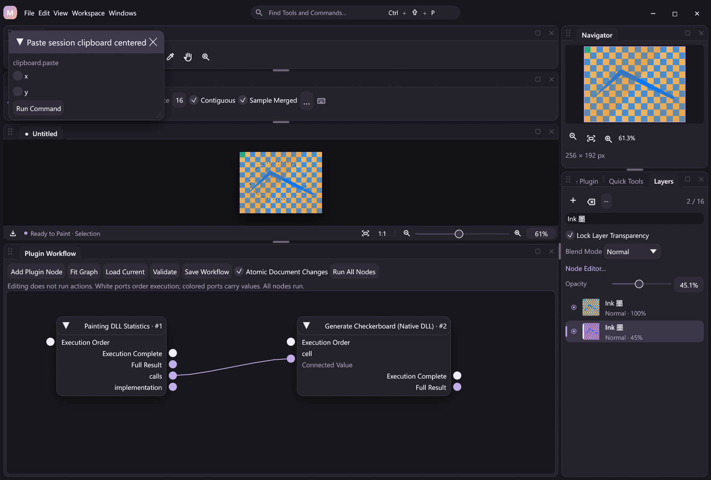

# Session clipboard

The first clipboard increment provides bounded internal transfers through the same registered actions used by command search, configurable bindings, plugin workflow nodes, MCP and headless JSONL. It does not read or replace the Windows system clipboard. Use command search to find the explicitly named **session clipboard** commands; default Ctrl+C/X/V bindings and the system adapter remain pending.

| Action | Behavior |
| --- | --- |
| `clipboard.copy` | Copy raw active-layer pixels in the selection bounds |
| `clipboard.copy_merged` | Copy the rendered composite in the selection bounds |
| `clipboard.cut` | Copy raw active-layer pixels, then clear selected coverage |
| `clipboard.paste` | Insert a new normal layer centered in the current selection bounds, or canvas |
| `clipboard.paste_in_place` | Insert a new normal layer at the original document coordinates |
| `clipboard.state` | Read availability, dimensions, origin, source canvas dimensions, bytes and SHA-256 |

Paste actions accept an optional integer `x`/`y` pair from -4096 to 4096. An explicit pair overrides centering/original placement. Clipped placement is supported; an entirely off-canvas result is rejected. Coordinates remain document pixels when source and destination canvas sizes differ. Editing a node graph does not execute these actions. The read-only `core.clipboard` public resource uses `clipboard.state` and generates the `state.core.clipboard` node.

## Pixel and layer contract

Positive selection coverage defines the cropped bounding rectangle, preserving transparent padding inside that rectangle. No active selection copies the entire canvas. An active empty selection rejects copying, cutting and automatic centered placement. All-transparent source pixels are valid clipboard content.

Raw copy ignores layer visibility, layer opacity, blend mode and filters. Copy Merged samples the rendered composite and rejects rendering errors before replacing the clipboard. Source pixels remain unchanged. Straight alpha is multiplied by selection coverage once, rounded to the nearest integer. Fully selected pixels preserve exact storage, including hidden RGB; excluded pixels become transparent black. The independent painting DLL performs extraction and placement through a typed optional ABI tail.

Cut uses the existing native selection blend when clearing the source. Fractional coverage is applied once. Alpha-locked source layers reject cutting; copying is allowed. Cut creates one document undo entry when pixels change. Undo restores pixels without replacing the clipboard.

Paste inserts a visible, unlocked, full-opacity normal layer directly above the active layer. It copies raw clipboard pixels without blending or clipping them through the current selection. It deselects the current mask and makes it available for Reselect. Layer insertion, graph synchronization and deselection share one structural undo entry. Linked image graphs preserve existing layer/filter identities; enabled free graphs reject insertion until the layer stack is linked explicitly.

## Limits and resource ownership

One immutable payload belongs to a Session, with a maximum of 4096 × 4096 straight-alpha pixels (64 MiB). It survives document replacement within that Session, but is not stored in projects, settings or document undo. `clipboard.state` never exposes the pixel buffer or changes revision. Its digest binds the version marker, width, height, origin, source canvas dimensions (little-endian u32), and row-major little-endian ARGB words. Hashing happens once when publishing a payload, using a reused 16 KiB staging buffer.

Transfers are cold operations. Extraction allocates one cropped result; paste allocates one destination layer. Cut additionally stages a cropped clear buffer. Atomic checkpoints share payloads through `Arc`; rollback restores the previous payload and document/history together. Live and checkpointed payloads may coexist until a transaction/contact ends. Existing document/history limits still apply. No transfer, hashing or clipboard lookup is added to pointer MOVE. A local release measurement of unrestricted extraction took approximately 0.7 ms at 1024² and 13 ms at 4096², excluding allocation, host hashing/history and rendering. These are machine-specific kernel measurements, not end-to-end latency guarantees. Run the ignored `selection_transfer_cost` test explicitly to measure another machine.

## Events and verification

Successful direct transfer events carry a small optional `source.context.clipboard` descriptor with the payload digest and dimensions. Pixel payloads are not duplicated into event metadata. Paste/cut document outcomes use existing compressed tile deltas/references, with one event per direct command. Older events omit the optional context and retain their original hashes.

Verified replay restores the recorded document outcomes without invoking the transfer DLL or consulting/replacing the live clipboard. A copy event audits a resource transfer; it does not make clipboard bytes recoverable from a recording. An exported project retains pasted pixels, not the ephemeral clipboard. [Selection-to-layer Copy/Cut](layer-editing.md#layer-via-copy-and-cut) is available without replacing the clipboard. System clipboard and explicit payload interchange remain subsequent increments in the [editing plan](photoshop-essentials.md).

Try [the JSONL example](../examples/automation/clipboard.jsonl). Rebuild/stage the painting DLL and restart before using the new transfer capability; older tables remain usable for previous selection features and explicitly reject transfers.
