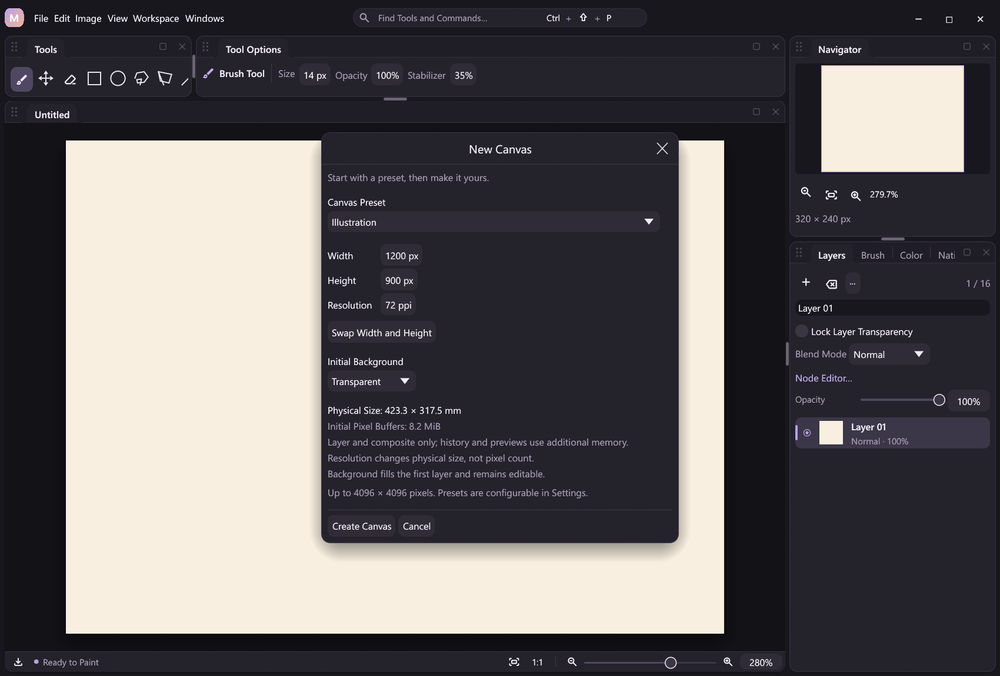

# New canvases and document resolution

**File → New Canvas (Ctrl+N)** starts with an illustration, square, A4 or JIS B5 preset. Choose a preset, enter pixel, millimeter or inch dimensions, swap width/height, set pixels per inch and select a transparent, white or custom RGB background. A shared read-only plan reports the resolved pixel dimensions, physical millimeters and initial layer/composite buffer cost before Create. History, textures, recording and previews require additional memory.



All canvases remain bounded to 1–4096 pixels per side. Resolution is an integer from 1–2400 pixels per inch (PPI); the legacy default is 72. A4 uses 2480 × 3508 at 300 PPI and B5 uses 2150 × 3035 at 300 PPI. Pixel dimensions are rounded practical sizes, so their computed millimeters are approximate. Presets do not bypass image bounds.

Physical dimensions convert independently using square PPI: inches × PPI, or millimeters ÷ 25.4 × PPI. Positive half-pixel values round up; a result outside 1–4096 fails rather than clamps. Pixel inputs must be integers, including integer-valued JSON numbers such as `72.0`. Both dimensions are required; creation has no source aspect ratio to lock. Unsupported units, null values, fractional pixels and invalid background/resolution values fail before pixel allocation.

Pipeline preflight also checks complete literal creation parameters before any earlier step executes. Parameters supplied by result references are validated after resolution, preserving the shared pipeline's explicit partial-completion behavior for dynamic failures.

Switching units in a valid desktop draft preserves its resolved pixels. Changing PPI while entering physical dimensions keeps those dimensions and changes the proposed pixels; changing PPI in pixel mode leaves pixels fixed. Choosing a preset resets the draft to its canonical pixel dimensions and PPI. Units are temporary dialog choices: stored presets remain integer pixels plus PPI, so existing preferences need no migration.

The background initializes actual editable pixels on the first ordinary layer. It is not a locked Photoshop Background layer or a permanent display/compositing color. Erasing those pixels can reveal transparency. `initial_background` records the creation choice; later edits do not change that provenance. Imports without PNG density and older projects use transparent creation provenance and 72 PPI by default; this does not imply that their existing pixels are transparent.

## Central preferences

Search Settings for `new_canvas`, **New Canvas Presets** or **Default Preset**. Choose a default in the settings UI; edit the bounded preset collection in the same settings JSON editor. Names supplied by artists remain user text and are not translated. The built-in labels translate at presentation boundaries. Saving preferences does not edit an open document; canceling the settings preview restores the previous preferences.

```json
{
  "version": 1,
  "new_canvas": {
    "default_preset": "comic",
    "presets": [
      {"id":"comic","name":"My comic page","width":2150,"height":3035,"resolution_ppi":300,"background":"#FFFFFF"}
    ]
  }
}
```

There must be 1–32 presets, unique valid IDs, a default ID present in that list, names up to 128 UTF-8 bytes without control characters, supported dimensions/resolution and a background of `transparent` or `#RRGGBB`. Preferences preserve supported unknown root fields when saved. The [settings schema](reference/settings.schema.json) describes individual fields; Rust validation also enforces cross-field and uniqueness rules.

## Shared actions and state

| Contract | Behavior |
| --- | --- |
| `canvas.new.plan` | Read-only required `width`, `height`; optional `unit` (`px`, `mm`, `in`), `resolution_ppi` (72), `background` (`transparent`). Returns resolved width/height, `document_info`, `estimated_initial_pixel_bytes`, source `revision` and `drawing`. It does not allocate a canvas, finish a contact or change revision/history/recording. |
| `canvas.new` | The same parameters and validation as the plan. Replaces the document and its undo history, clears its file target and resets view. This lifecycle boundary is excluded from atomic document groups. |
| `canvas.info` | Read-only width/height, resolution and creation provenance, exact optional PNG density and known physical dimensions; also available as `canvas.state.document_info`. |
| `canvas.resolution` | Required `resolution_ppi`. Metadata-only change with one undo/outcome; replaces imported density with square metric pixels without resampling. |
| `core.document_info` | Public plugin state and schema-derived workflow node for document properties. |

For example, create a white page, then change its physical interpretation without resizing it:

```json
{"action":"canvas.new","args":{"width":1200,"height":1800,"resolution_ppi":300,"background":"#FFFFFF"}}
{"action":"canvas.resolution","args":{"resolution_ppi":600}}
{"action":"canvas.info","args":{}}
{"action":"history.undo","args":{}}
{"action":"replay.verify","args":{}}
```

The same registered actions work through JSONL, MCP, attached desktop clients and workflow nodes. Creating or editing a workflow does not run it. The resolution command is available in Image, searchable and bindable, using the shared parameter form. See the [automation example](../examples/automation/document-setup.jsonl).

Physical creation without `resolution_ppi` deliberately uses explicit 72 PPI, so subsequent PNG output includes metric density. Pixel calls omitting PPI retain the legacy implicit 72 PPI metadata and PNG bytes. Both paths start fresh density metadata rather than inheriting an open document's raw PNG density. Plan results describe the rounded raster, not an exact print-layout promise. The initial pixel-buffer estimate is width × height × 8 bytes (one layer and one composite), not a peak-memory estimate.

```json
{"action":"canvas.new.plan","args":{"width":210,"height":297,"unit":"mm","resolution_ppi":300}}
{"action":"canvas.new","args":{"width":1,"height":0.5,"unit":"in","resolution_ppi":150,"background":"#FFF9EF"}}
```

The A4 plan resolves to 2480 × 3508 pixels without allocating them. The [physical creation example](../examples/automation/physical-creation.jsonl) uses a smaller page for runnable drawing and export.

Both setup mutations reject an active pointer contact rather than implicitly finishing it. The desktop finishes its current input before opening the dialog and guards Create with document identity and expected revision: external edits while the dialog is open require reopening it. Successful local fit-zoom updates from window resizing advance the draft guard without accepting intervening document changes. Preset changes, orientation/background drafts and cancellation never publish provisional pixel/history outcomes.

New canvases start a separate recording with a genesis and creation outcome, rather than appending another document to the previous recording. Resolution and creation provenance persist in project composition metadata, undo/redo, atomic checkpoints and verified outcome replay. Default metadata is omitted from legacy serialization, retaining old recording hashes. A failed journal append restores the preceding document and history, including failed `canvas.new` replacement. New-document creation itself has no cross-document Undo. Use a saved project or recording to retain previous work.

## Explicit boundaries

[PNG density](png-density.md) now round-trips exact axes/units through import/export, snapshots and recorded-state PNG output. Unknown units or zero axes have no known physical size. There is no ICC/color-space or print-layout claim. [PNG export sizing](export-sizing.md) accepts physical dimensions and percentage scaling without resizing this document. [Image Size](canvas-editing.md#image-size-and-resampling) also accepts physical dimensions and resamples source layers at their current density; changing document resolution does not resample pixels. Presets, unit conversion and this dialog add no native DLL dependency or per-pen-MOVE lookup, serialization or raster work.
