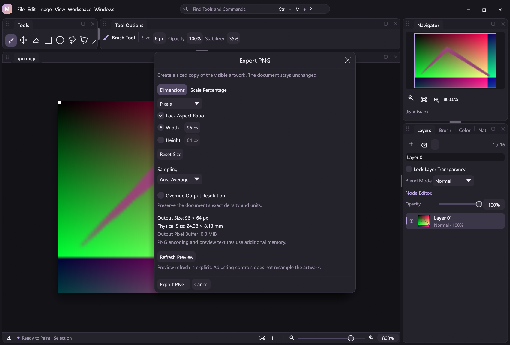

# PNG export sizing

**File → Export PNG** opens Canvas-owned options before the save dialog. Choose pixel, millimeter or inch dimensions, preserve the source aspect ratio or set both axes, or use a percentage scale. Select nearest, bilinear or area sampling. Density is inherited exactly by default; an optional output PPI override writes square metric density without changing document resolution.

**Refresh Preview** explicitly samples and encodes the current draft. The cached image is marked stale when options change; adjusting controls never rerasterizes automatically. Export and Cancel remain below the scrolling controls. Spacing and sizes follow the configured appearance metrics. The native save dialog opens only after a valid, current draft is ready to write. Canceling either dialog leaves artwork unchanged.



## Shared contracts

| Action | Behavior |
| --- | --- |
| `canvas.export.plan` | Read-only output dimensions, method, density/physical size, identity status, output-pixel buffer estimate, revision and drawing status. No sampling or file write. |
| `canvas.export.preview` | Read-only PNG plus the same plan. It shares execution with extended `canvas.snapshot`. |
| `canvas.snapshot` | Existing calls without arguments retain identity output. Optional sizing arguments use the same preview path. |
| `canvas.export` | Required `path` plus sizing arguments. Samples the composited frame, encodes and publishes a PNG, returning its SHA-256 and plan. |
| `canvas.export.open` | Desktop-only options, optional `parameters` object with the sizing arguments. Headless reports `ui_unavailable`. |
| `core.export` | Read-only default plan, exposed as a schema-derived state node. |

The same actions and schemas are available to command search, configurable shortcuts, workflow nodes, JSONL, MCP and attached desktop clients. Editing a workflow does not execute an export. The existing Export command retains its configured binding and opens these options; direct plugin commands can also submit their shared parameter forms.

| Parameter | Meaning |
| --- | --- |
| `width`, `height` | Positive dimensions in `unit`. Pixel values must be integers; physical values round to whole pixels, with positive half values rounded up. |
| `unit` | `px` (default), `mm` or `in`. Physical dimensions require known metric density or an explicit output PPI override. |
| `lock_aspect` | Default `true`: supply exactly one dimension; derive the other from the source pixel ratio. Set `false` and supply both for an independent aspect. |
| `scale` | Positive percentage of both source axes, exclusive of dimensions and physical units. |
| `method` | `area` (default), `bilinear` or `nearest`. Area averages shrinking footprints and uses bilinear on enlarging axes. |
| `resolution_ppi` | Optional integer 1–2400. Overrides output density only, including explicit 72 PPI; omit to preserve exact raw PNG density/units or implicit legacy defaults. |

The plan's `revision` identifies its source state; a successful file command's outer response carries the incremented Session revision.

With neither dimensions nor scale, output retains the source pixel dimensions. Each final side must be 1–4096 pixels. Values that round to zero, exceed limits or produce an out-of-bounds aspect-derived side fail rather than clamp. Aspect locking preserves the **pixel** ratio; inherited unequal X/Y density is still used independently for physical dimensions. The square-pixel desktop preview does not stretch to physical pixel aspect.

```json
{"action":"canvas.export.plan","args":{"width":1200,"method":"area"}}
{"action":"canvas.export.preview","args":{"scale":50,"resolution_ppi":300}}
{"action":"canvas.export","args":{"path":"target/example-output/page.png","width":100,"unit":"mm","resolution_ppi":300,"method":"area"}}
```

Create the example output directory before running the [automation example](../examples/automation/export-sizing.jsonl). The separate [PNG density contract](png-density.md) explains unknown units, raw axes and integer PNG quantization. JPEG/WebP export, color management and physical-unit inputs for New Canvas/Image Size remain planned.

## Source and performance

Export evaluates the visible composed image, including its image graph, opacity, blend modes and filters, then resamples that single frame. It does not resize individual layers, bake the source graph, modify selection masks or clip export to the active selection. Source document dimensions, resolution, file target, layer identities, pixels, dirty flag and undo history remain intact.

Identity sizing borrows the existing composed frame and bypasses the sampler, including when only output density changes. Resizing invokes the cached native sampler already used by Image Size. There is no new DLL ABI, pixel implementation or dependency. The host allocates one resized ARGB output when required, followed by the existing RGBA/PNG encoding buffers. The reported `estimated_output_bytes` covers the output pixel buffer only; source layers/composite, encoder internals, transport/base64 and cached preview textures add separate costs. A 4096-square output pixel buffer is 64 MiB. These cold actions add no pen-MOVE lookup, serialization or file work.

On 2026-11-05, one Release headless run measured a deterministic 2048 × 2048 opaque source with cached DLLs and an already composed frame. `Session.apply` preview took 106.8 ms at identity size, 59.6 ms for 1024-square area sampling and 24.5 ms for 1024-square nearest sampling. Timers include dispatch, sampling when needed, PNG encoding and Base64/JSON construction; preparation, source recording, reference decoding, filesystem I/O, artifact hashing and pen latency are excluded. PNG sizes were 16,780,612 / 3,386,157 / 4,105,310 bytes. These are workload/environment-specific observations, not speedup or responsiveness guarantees.

## Events, files and failures

Plans and previews are read-only: they do not finish an active contact, increment revision or append an operation. They may show provisional pixels while `drawing:true`. File export and opening export options require an idle contact; desktop opens options after finishing its local input. Drafts guard document identity and revision. Successful local fit-view changes may advance the draft guard; external edits require reopening it.

A successful file export publishes one external-effect event and increments Session revision, without adding a document undo entry. The compact event context records path, output dimensions/density, method and SHA-256 of the published buffer, not PNG bytes. Verified outcome replay retains this artifact claim but never reruns DLL sampling or recreates the external file. A digest is an integrity claim for publication time, not a signature or a promise that another process cannot later edit the file.

PNG encoding completes before replacement. Each write reserves a unique sibling temporary file, writes/synchronizes it and replaces the destination through the existing platform helper. Cleanup removes only that operation's temporary file. Validation, native/encoding errors and failed replacement preserve an existing destination. Existing native-project headers, `.mcp` destinations and the current native project target are protected, including renamed project paths. Windows export filenames ending in a dot/space or using stream syntax are rejected, avoiding [Win32 path normalization aliases](https://learn.microsoft.com/en-us/dotnet/standard/io/file-path-formats#trim-characters). Temporary-name cleanup is disarmed immediately after successful publication.

File export is excluded from atomic document groups because filesystem effects cannot be rolled back with document history. Read-only plans/previews can participate in atomic workflows. If journal recording fails **after** a PNG has been published, `export_recording` explicitly reports its path and digest; the file can exist despite the error. This is distinct from a failed file replacement and must not be treated as an automatic retry. `replay.recover_png` retains its existing unscaled current-canvas fallback and reports `verified_recording:false`; it does not invoke export sizing.

Use `scripts/smoke-export.py` for transport, artifact-digest, project protection, replay and four-language options checks. Library regressions also exercise native pixel references, active contacts, missing samplers, compositor errors, failed replacement and journal faults. Actual tablet-driver validation remains a separate gate.
