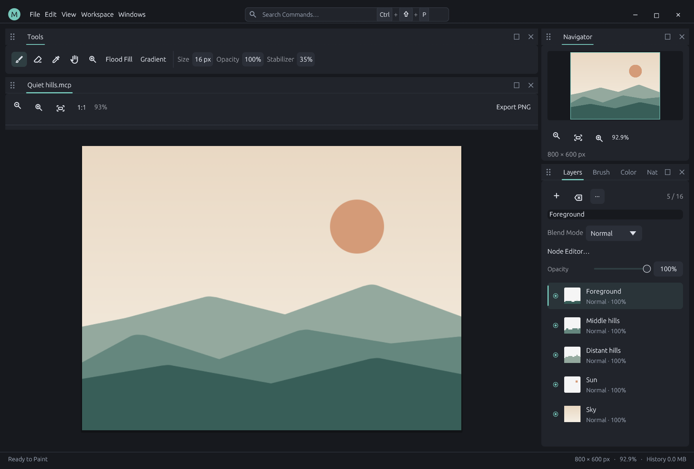
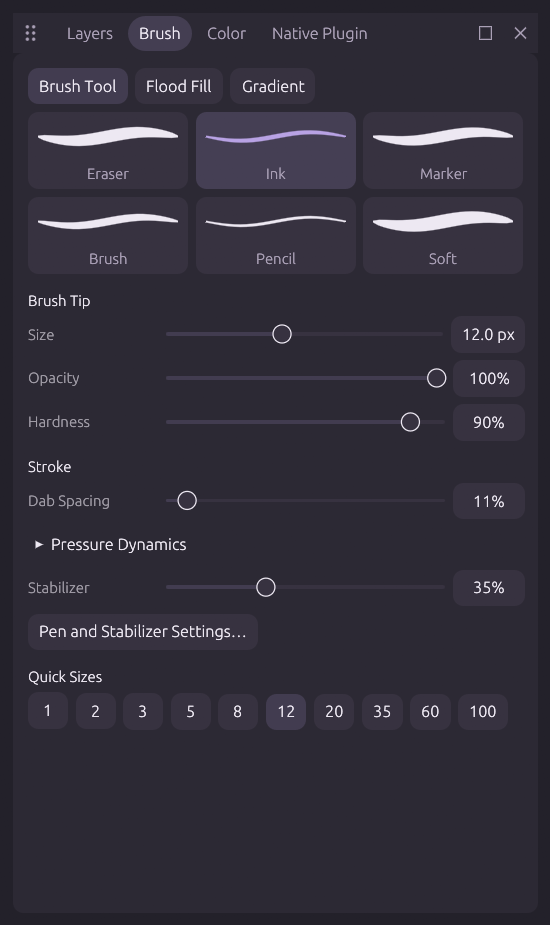

# Interface design

MiCoPi is a drawing studio for anime and manga illustrators. Muted plum, paper white and warm ivory surfaces give the workbench a softer character while keeping the painting surface visually dominant. A lavender accent, clear tab labels and gently tinted selections establish a consistent visual identity. Window controls share a single row with the group grip and tabs.

Each panel group is a rounded floating card with a hairline outline and a soft shadow, separated from its neighbours by the workspace backdrop. The group row sits on its own tinted band above a hairline divider, so tabs read apart from the panel content. The active tab has a restrained rounded highlight contained within its label area; resting tabs are plain labels separated by thin dividers, with a soft hover surface. No overlapping corner cutouts are used on translucent surfaces. Grip, maximize and close controls stay faint until the pointer reaches the group row. Each splitter between cards carries a rounded grab handle that lengthens and takes the accent while hovered or dragged. The canvas sits on a recessed stage inside its card, and the artwork carries a layered paper shadow. A thin zoom strip runs beneath the stage and replaces the workspace status bar: export and the status message (or live pen pressure) on the left; fit, actual pixels, zoom out, a logarithmic zoom slider, zoom in and an editable percentage field on the right. Latin text uses Segoe UI where available, with a semibold face for titles, the active tab and the active layer; CJK text falls back to the localized face. The title row carries a lavender-to-peach brand mark and a pill-shaped command search.

The Tools window is an icon-only strip: brush, Move, eraser, selection tools, flood fill, gradient, eyedropper, hand and zoom by default. It lays out horizontally or vertically to match its shape. A separate Tool Options window beside it shows the active tool with its size, opacity and stabilizer. Search Settings for **Tools Icons** to reorder or hide icons, or edit `ui.tool_order` and `ui.hidden_tools` in `settings.json`; unlisted icons keep their default order. Brush cards show stylized pressure-tapered marks, with an accent tint for the selected preset. These previews use small vector meshes and never call painting plugins or allocate bitmap textures. The command search remains available in the title row with a quiet shortcut hint. Document size and history memory usage are available on the status tooltip in the zoom strip.

## System glass

The desktop bridge removes native caption/dialog borders and sunken client edges
before the first custom frame, and filters subsequent framework style writes.
It retains sizing and system-command/minimize/maximize flags, including Windows' synthesized sizing edge; DWM still owns
shadow, rounded corners and backdrop composition. Activation continues through
the framework with non-client repaint suppressed. Title/icon metadata updates
do not toggle the window's visibility. This avoids exposing an old themed frame
while the compositor switches activation state. Native Snap/device behavior and
activation-frame captures remain separate acceptance gates.

The main window and detached panel groups request Windows system Acrylic by
default. Search Settings for **Window Blur** (`ui.window_blur`) or **Surface
Opacity** (`ui.surface_opacity`, 0.35–1.0, default 0.55). Changes apply to existing
windows without restarting or modifying the saved dock geometry. Opacity controls
the panel tint; the workspace gaps use a lighter tint to expose the system material.
Headers receive one tint pass, rather than stacking the docking library's fill
under the custom group row. Empty library tabs retain layout/hit routing but no
fill, outline or rounded corners in any interaction state; the custom row is the
sole visible tab renderer. The title bar shares the lighter header material;
brighter hairline edges separate the frosted surfaces without bitmap textures.
Existing explicit opacity preferences are preserved. Turning blur off restores
the existing opaque palette. The canvas surround and zoom strip share the glass
material; the Canvas body does not add another tint underneath the surround.
Only the artwork rectangle and its checkerboard stay opaque, alongside text,
widgets and popups, preserving artwork color and contrast without making the
entire canvas workspace a solid slab.

Use the documented [DWM system backdrop API](https://learn.microsoft.com/en-us/windows/win32/api/dwmapi/ne-dwmapi-dwm_systembackdrop_type),
available from Windows 11 build 22621. Older systems, failed native negotiation and
embedded test viewports retain opaque surfaces. Windows owns the blur strength and
may substitute its accessibility/power fallback.
Its observed transparency preference and native negotiation are available through
[Workbench diagnostics](workbench-diagnostics.md). A disabled Windows transparency
setting uses the opaque fallback and is explained beside Window Blur in Settings;
successful DWM negotiation is never presented as composed-pixel verification.
No screen capture, CPU blur,
per-frame native backdrop call, bitmap allocation or new dependency is added;
OpenGL viewports use alpha presentation and the OS compositor supplies the effect.
This does not blur content behind panels inside the same application window.
Native screenshot/driver review and representative GPU cost remain acceptance
gates; automated settings, palette-fallback and native frame tests are separate.

## Spacing and hierarchy

All dimensions below are logical points and follow each viewport's DPI scale. Search Settings for the corresponding UI setting, or edit `settings.json`. Existing explicit values are preserved; these are defaults for new profiles.

| Setting | Default | Purpose |
| --- | ---: | --- |
| `ui.font_size` | 13 | Body and control text |
| `ui.small_font_size` | 12 | Secondary labels and metadata |
| `ui.item_spacing` | 4 | Gaps within a control group |
| `ui.section_spacing` | 12 | Separation between related property sections |
| `ui.panel_padding` | 8 | Content inset within panels |
| `ui.outer_padding` | 6 | Workspace and native-window edge inset |
| `ui.control_height` | 26 | Shared control hit height |
| `ui.tab_height` | 30 | Grip, tabs and group controls |
| `ui.title_height` | 36 | Application title row |
| `ui.icon_size` | 18 | Toolbar icon size |
| `ui.corner_radius` | 8 | Controls and content surfaces |
| `ui.tool_order` | `[]` | Tools icons shown first, in this order |
| `ui.hidden_tools` | `[]` | Tools icons that are not shown |
| `ui.accent` | `#B8A2E4` | Lavender selection and identity color |
| `ui.toolbox_height` | 80 | Preferred control-bar group height |
| `ui.right_panel_width` | 272 | Default property sidebar width |

Property rows share a proportional label column, a flexible slider and a consistent numeric column. Long translated labels truncate with a tooltip. Narrow panels place the slider below its label/value row. Tab labels retain internal padding, while the tab strip scrolls independently of the fixed group buttons. Swatches stop growing at the configured control height. Their local spacing does not leak into neighboring controls.

The graphite, light and warm themes use the same spacing and interaction rules. These changes add no dependencies and leave the document, painting pipeline and native input path unchanged.

The same arrangement is also captured in [light](screenshots/workbench-light.png) and [warm](screenshots/workbench-warm.png) themes. The landscape is a small demonstration document drawn through ordinary gradient, stroke and fill actions.

## Verification

The desktop suite covers multiple window sizes, themes, density settings and all four interface languages. Native smoke checks capture independent windows, verify group geometry and commands, and check painting, replay and restart parity. Screenshots are reviewed from the renderer; interactive native mouse gestures still require a real desktop check.
