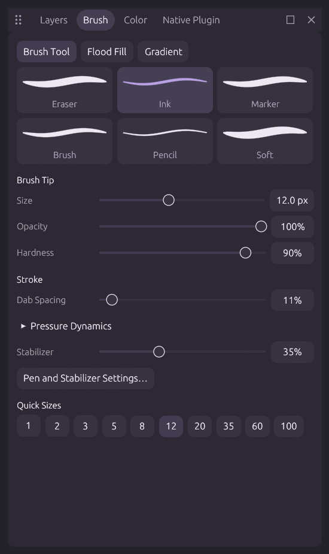

# Interface design

MiCoPi is a drawing studio for anime and manga illustrators. Muted plum, paper white and warm ivory surfaces give the workbench a softer character while keeping the painting surface visually dominant. A lavender accent, browser-style tabs and gently tinted selections establish a consistent visual identity. Window controls share a single row with the group grip and tabs.

Each panel group is a rounded floating card with a hairline outline and a soft shadow, separated from its neighbours by the workspace backdrop. The group row sits on its own tinted band above a hairline divider, so tabs read apart from the panel content. The active tab shares the panel surface and flares into it like a browser tab; resting tabs are plain labels separated by thin dividers, with a soft hover surface. Grip, maximize and close controls stay faint until the pointer reaches the group row. Each splitter between cards carries a rounded grab handle that lengthens and takes the accent while hovered or dragged. The canvas sits on a recessed stage inside its card, and the artwork carries a layered paper shadow. A thin zoom strip runs beneath the stage and replaces the workspace status bar: export and the status message (or live pen pressure) on the left; fit, actual pixels, zoom out, a logarithmic zoom slider, zoom in and an editable percentage field on the right. Latin text uses Segoe UI where available, with a semibold face for titles, the active tab and the active layer; CJK text falls back to the localized face. The title row carries a lavender-to-peach brand mark and a pill-shaped command search.

The tools sit in a compact rounded tray. Brush cards show stylized pressure-tapered marks, with an accent tint for the selected preset. These previews use small vector meshes and never call painting plugins or allocate bitmap textures. The command search remains available in the title row with a quiet shortcut hint. Document size and history memory usage are available on the status tooltip in the zoom strip.

## Spacing and hierarchy

All dimensions below are logical points and follow each viewport's DPI scale. Search Settings for the corresponding UI setting, or edit `settings.json`. Existing explicit values are preserved; these are defaults for new profiles.

| Setting | Default | Purpose |
| --- | ---: | --- |
| `ui.font_size` | 13 | Body and control text |
| `ui.small_font_size` | 12 | Secondary labels and metadata |
| `ui.item_spacing` | 6 | Gaps within a control group |
| `ui.section_spacing` | 16 | Separation between related property sections |
| `ui.panel_padding` | 12 | Content inset within panels |
| `ui.outer_padding` | 10 | Workspace and native-window edge inset |
| `ui.control_height` | 28 | Shared control hit height |
| `ui.tab_height` | 32 | Grip, tabs and group controls |
| `ui.title_height` | 36 | Application title row |
| `ui.icon_size` | 18 | Toolbar icon size |
| `ui.corner_radius` | 8 | Controls and content surfaces |
| `ui.accent` | `#B8A2E4` | Lavender selection and identity color |
| `ui.toolbox_height` | 88 | Preferred control-bar group height |
| `ui.right_panel_width` | 280 | Default property sidebar width |

Property rows share a proportional label column, a flexible slider and a consistent numeric column. Long translated labels truncate with a tooltip. Narrow panels place the slider below its label/value row. Tab labels retain internal padding, while the tab strip scrolls independently of the fixed group buttons. Swatches stop growing at the configured control height. Their local spacing does not leak into neighboring controls.

The graphite, light and warm themes use the same spacing and interaction rules. These changes add no dependencies and leave the document, painting pipeline and native input path unchanged.

The same arrangement is also captured in [light](screenshots/workbench-light.png) and [warm](screenshots/workbench-warm.png) themes. The landscape is a small demonstration document drawn through ordinary gradient, stroke and fill actions.

## Verification

The desktop suite covers multiple window sizes, themes, density settings and all four interface languages. Native smoke checks capture independent windows, verify group geometry and commands, and check painting, replay and restart parity. Screenshots are reviewed from the renderer; interactive native mouse gestures still require a real desktop check.
