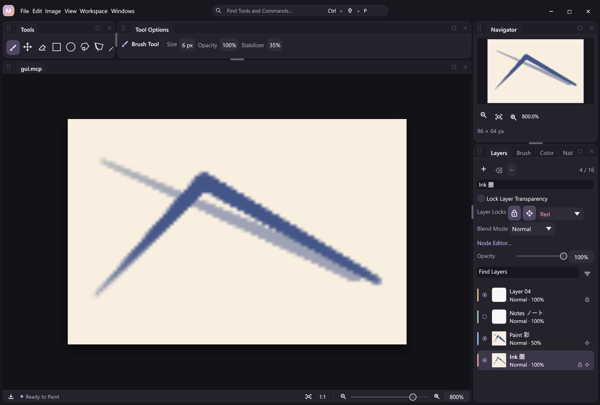
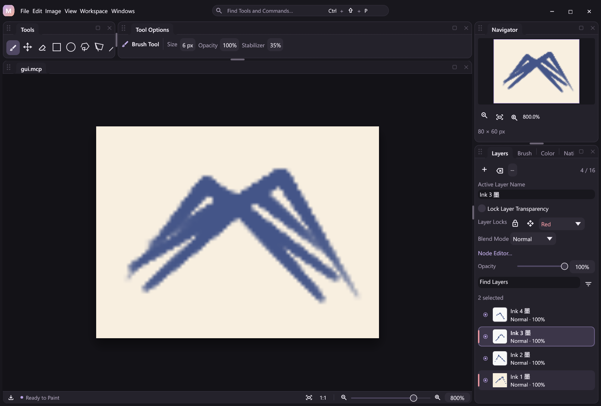
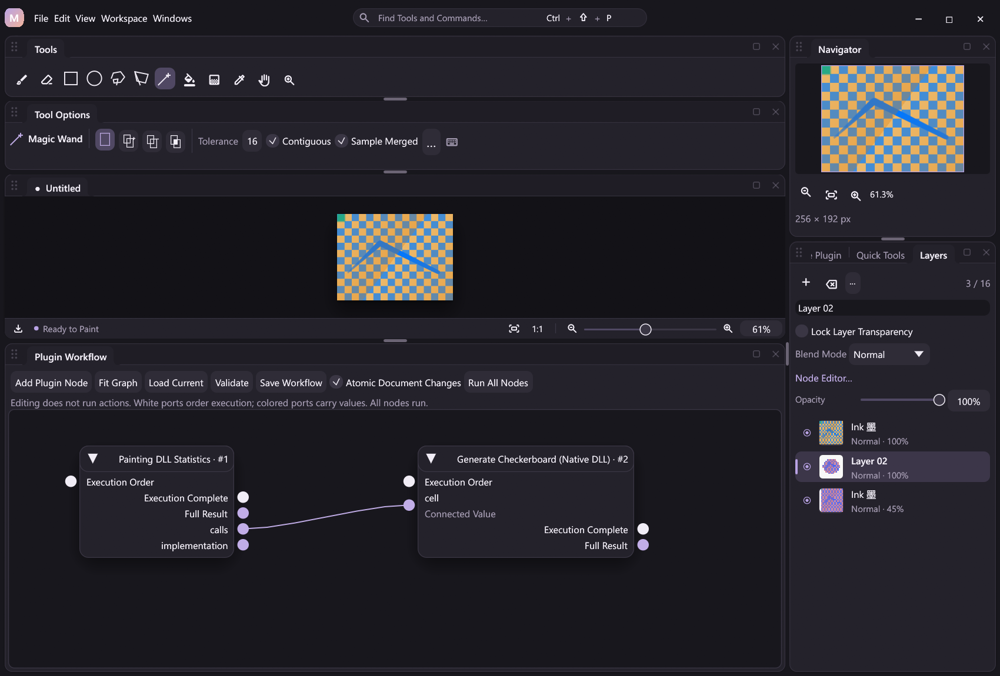

# Layer editing

The first editing increment draws on [PhotoCraft](https://github.com/storytold/photocraft)'s layer organization and exact transform workflows. It is independently implemented through MiCoPi's document, action and native plugin contracts. No PhotoCraft code or dependencies are imported. MiCoPi keeps its typed pen path, CPU/headless operation, host-owned history and explicit workflow execution.

## Desktop

The Layers panel provides an editable **Layer Name**, **Layer Actions** menu and per-row context menus. **Ctrl+J** runs Layer via Copy: an active selection is extracted into a new layer; without a selection it duplicates the current layer. **Ctrl+Shift+J** runs Layer via Cut. The explicit Duplicate Layer command remains a whole-layer operation. Up means toward the top of the visible stack. Reordering preserves the active layer by identity. A duplicated layer becomes active; deleting the active layer selects its nearest remaining neighbor. Custom names are document content and stay unchanged when the UI language changes.

Flips, 180° rotation and offsets operate on the selected visible layer's full canvas-sized pixel buffer. Hidden layers must be made visible before a pixel edit, following the existing plugin edit contract. Offsets are signed integer pixels: positive X is right, positive Y is down. Exposed areas become transparent; out-of-bounds pixels are discarded and can be restored with undo. These operations do not resample colors. The native painting plugin must be enabled for pixel transforms.

On mask-bearing documents, explicit single-layer Duplicate/Delete commands now
carry the owned mask and paint target through one compound history edit. The
default Ctrl+J/Ctrl+Shift+J bindings remain selection-transfer commands
(`layer.via_copy`/`layer.via_cut`) and are still guarded there, including the
no-selection shortcut case. Multi-selected panel controls use `layer.batch`,
whose mask integration also remains pending. See [Mask owner editing](mask-owner-editing.md).

[Layer Groups](layer-groups.md) adds isolated or [Pass Through](pass-through.md) nesting, typed hierarchy commands and an actual-composition node view. Existing leaf commands preserve membership; explicit hierarchy moves handle reparenting. Merge Group bakes an explicitly targeted isolated subtree, including its nested Pass Through children; a Pass Through target requires an external backdrop and rejects standalone baking. Grouped Merge Visible retains hidden content and group skeletons; see [Group baking](layer-groups.md#bake-groups-and-visible-artwork).

**Ctrl+E** now runs **Merge Layers**: multiple selected rasters use [selected-only merging](selected-merge.md), while a singleton keeps Merge Down. Noncontiguous and cross-parent targets are supported without consuming unselected rasters. The optional **Review Selected Merge…** window shows captured targets and placement before an explicit commit; the default shortcut remains immediate. Selected-only baking can change visible stacking/backdrop interactions, so use the plan or review when inspecting that boundary.

## Public actions

`canvas.state.layers` exposes `id`, `name`, `active`, lock flags, `color_label` and existing appearance properties. Layer IDs are scoped to one document and remain stable across reorder and save/reopen. A new document starts its own identity space. IDs are never a global document selector.

| Action | Arguments |
| --- | --- |
| `layer.rename` | `name`, optional `layer_id` or `index` |
| `layer.duplicate` | optional `layer_id` or `index`; always the whole layer |
| `layer.via_copy` | no arguments; active selection, or whole active layer |
| `layer.via_cut` | no arguments; active selection required |
| `layer.move` | `to` (zero-based destination), optional `layer_id` or `index` |
| `layer.delete` | optional `layer_id` or `index` |
| `layer.select`, `layer.set` | accept `layer_id` alongside the existing `index` selector |
| `layer.query` | optional name `query`, `color_label`, `visible`, `locked`, `alpha_locked`, `pixel_locked`, `position_locked`, `selected`; read-only AND filters |
| `layer.selection.set` | required unique `layer_ids`, optional selected `active_layer_id`; sets the layer selection |
| `layer.batch` | required `action`, unique `layer_ids`, optional action-specific `args`; one atomic batch undo/outcome |
| `layer.merge` | no arguments; current multi-selection, or Merge Down for a singleton |
| `layer.merge_selected`, `layer.merge_selected.plan` | required 2–16 unique stable raster `layer_ids`; execute, or read-only selected-only plan |
| `layer.merge_selected.open` | the same explicit IDs; optional desktop review with headless unavailability |
| `layer.flip_horizontal`, `layer.flip_vertical`, `layer.rotate_180` | no arguments; current layer |
| `layer.translate` | required integers `dx`, `dy`, each from -4096 to 4096; current layer |

Omitting both ordinary layer selectors targets the active layer. If both are supplied they must identify the same layer. Existing index-based clients remain supported; automation that retains a target across structural edits should use stable IDs. Selected-only merge uses its explicit `layer_ids` set. To target a transform by identity, use an atomic `pipeline.run` with `layer.select` followed by the transform. Document edits share undo, outcome replay and atomic pipelines; targeting changes and read-only plans keep their separate history behavior. Presentation-only review requires the desktop and is excluded from document-atomic execution. Shared schemas expose these contracts to CLI, MCP and workflow nodes.

Example JSONL (IDs here belong to a freshly created document):

```json
{"action":"canvas.new","args":{"width":640,"height":480}}
{"action":"layer.rename","args":{"layer_id":1,"name":"Ink"}}
{"action":"layer.duplicate","args":{"layer_id":1}}
{"action":"layer.move","args":{"layer_id":1,"to":1}}
{"action":"layer.translate","args":{"dx":12,"dy":-8}}
```

New documents use a linked image stack: inserting, duplicating, moving and deleting layers updates the applied composition chain. Filters follow stable identities and duplication copies the source layer's filters. Graph and layer blend modes stay synchronized. In legacy/free graphs, image sources keep referring to the same layer after structural edits, but explicit wiring retains its own order and new layers must be connected manually. Deleting a free-graph referenced layer is rejected; remove or retarget its source node first. See [Image Node Editor](node-editor.md).

The final layer cannot be deleted. Existing limits remain 16 layers, 4096 pixels per side, 64 Mi pixels across a document and a 64 MiB undo budget. Linked structural edits also respect the 64-node graph limit. Names must be nonblank, single-line and at most 512 UTF-8 bytes.

## Scope and verification

Implemented layer editing covers stable identities, rename/duplicate/reorder/delete, consolidation and exact pixel transforms. Canvas resize/crop has a separate [geometry contract](canvas-editing.md). [Raster masks](raster-mask-editing.md) support painting/effects and [document-wide geometry](mask-canvas-geometry.md); plain [single-layer owner duplication/deletion](mask-owner-editing.md) carries masks with explicit target and compound-history rules. [Group creation and hierarchy movement](mask-group-editing.md) retain all existing owners and raw masks without A8 sample changes. [Subtree deletion](mask-group-delete.md) consumes the requested group and descendant owner masks with explicit target/selection fallback and one compound Undo/outcome. [Subtree duplication](mask-group-duplicate.md) copies descendant owners into independent raw buffers under ordered fresh IDs and mapped targets/selection. [Owner affine Free Transform](owner-affine.md) adds exact raster sets and independent raw masks with one captured recipe/Undo; runtime validation is pending CI. Group-mask/projective owner geometry, ungrouping, batch edits, Layer via Copy/Cut, merging and transfers remain guarded. Complete mask integration, clipping masks, off-canvas storage and PSD interchange remain future work in the [roadmap](../ROADMAP.md). The Windows clipboard adapter is implemented with native interoperability verification pending; see [Clipboard](clipboard.md). PhotoCraft's GPU/web frontend and wider module architecture are not adopted.

Regression coverage checks graph remapping, undo/redo pixels, stable ID allocation, failed atomic groups, saved projects, old verified journals and new replay frame parity. Native transform tests compare asymmetric images and overlapping translations with an independent out-of-place oracle. Buffer pointer checks verify reorder and ordinary delete/undo reuse pixel allocations; atomic checkpoints may share removed undo buffers and can require a copy on restoration.

## Transparency lock

`layer.set` accepts optional `alpha_locked` with either the existing index or stable ID selector. It defaults to false. A property change that combines lock, opacity or blend properties creates one composition undo entry. Duplicates inherit their source lock; new layers start unlocked. Locking preserves raw pixel alpha during painting and color processing. Layer removal, history navigation and project replacement remain structural operations. See [Painting tools](painting-tools.md) for behavior, shortcuts and native compatibility.

## Pixel/position locks, labels and discovery



`layer.set` also accepts `pixel_locked`, `position_locked` and `color_label`. Flags default to false; labels are `none`, `red`, `orange`, `yellow`, `green`, `blue`, `violet` or `gray`. Changes to these fields can combine with visibility, opacity, blending or transparency locking in one composition undo/outcome, without copying layer pixels. New organization fields require an idle contact before mutation; the typed contact's write permission stays stable. Names and labels persist with projects, structural history, atomic checkpoints and verified outcome replay. Default fields are omitted from stored metadata, preserving old recording hashes.

| Boundary | Pixel lock | Position lock |
| --- | --- | --- |
| Brush/eraser, clear, fill and direct pixel filters | Reject | Allow |
| Cut and Layer via Cut | Reject | Allow |
| Single-layer pixel Move/Nudge, affine/repeat, flips/rotation/offset | Reject | Reject |
| Selection-mask-only move/transform | Allow | Allow |
| Copy, Copy Merged, selected Layer via Copy, new-layer Paste and Stamp Visible | Allow source reads | Allow source reads |
| Whole-layer duplicate or transformed copy into a new layer | Allow source reads | Allow source reads |
| Destructive merge/flatten | Reject consumed pixel-locked or alpha-locked layers | Allow, preserving the retained layer's position flag |
| Rename, appearance/graph metadata, layer reorder/delete, history navigation | Allow | Allow |
| Document-wide resize/crop/trim/rotation/flips and resolution | Allow | Allow |

These locks protect individual layer editing; they do not prevent explicit changes to document coordinates or act as a full structural lock. Copying a whole layer inherits flags and label. A transformed whole-layer copy keeps the name/label but starts unlocked; selected extraction, paste and stamp create unlocked, unlabeled layers. A destructive merge keeps its retained stable ID, name, color and position flag. A hidden locked layer does not block merging other visible layers, but Flatten explicitly consumes hidden layers too. The host rejects protected writes before finishing input, sampling, mutable pixel loans or clipboard publication. Undo and replay restore recorded outcomes independently of current locks.

The Layers panel offers a name search and color/visibility/lock filters, restrained row color markers, lock feedback and combined property controls. Filtering only changes the panel's visible rows: it does not hide artwork, select another layer, reorder storage or change document history. An excluded active layer remains editable in the active-layer properties, with a clear hint and reset control. The filter draft is local to that document's UI; automation uses the same predicate through `layer.query`.

`layer.query` matches a case-insensitive Unicode substring of public layer names and combines every supplied filter with AND. Search is single-line and at most 512 UTF-8 bytes. `locked` means any transparency, pixel or position lock; `color_label:"none"` explicitly matches unlabeled layers. Default public names remain English generated labels such as `Layer 01`; artist names are never translated. The response contains `total`, `matched`, `layers`, source `revision` and `drawing`, with rows in storage order and stable IDs. Queries do not finish contacts, increment revision or append outcomes; they remain usable during pressure input. `core.layers` exposes the unfiltered query as public state and a schema-derived node. Workflows can bind a found ID to a later action; editing the workflow does not execute either operation.

```json
{"action":"layer.set","args":{"pixel_locked":true,"color_label":"violet"}}
{"action":"layer.query","args":{"query":"ink","pixel_locked":true,"color_label":"violet"}}
```

See the [organization example](../examples/automation/layer-organization.jsonl) and [native pixel-access contract](native-plugins.md#layer-pixel-access). [Raster-mask editing](raster-mask-editing.md) describes the available painting, document geometry and single-owner subsets; complete integration and clipping masks remain planned in the [editing checklist](photoshop-essentials.md).

## Multiple selected layers and explicit batches



The Layers panel distinguishes the active painting layer from the selected set. Plain click selects one layer, Ctrl-click toggles membership, and Shift-click selects a range in the currently visible filtered rows. Ctrl+Shift adds that range. Selection cannot become empty; the active layer is always a member. Hidden filtered selections remain selected and are included in an explicitly requested batch. Painting, pixel selections, Move and Free Transform retain their existing active-layer behavior.

`layer.selection.set` accepts 1–16 unique stable IDs and an optional `active_layer_id` from that set. Without an explicit active ID, it retains the active member or chooses the last supplied ID. Public `selected_layer_ids` is always in storage order, and every layer row exposes a `selected` boolean separately from `active`. `layer.query` also accepts a `selected` filter; its top-level selected IDs describe the entire selection even if a name/property filter excludes those rows. `core.layers` and the active-document context expose the same state to workflows and AI clients.

Layer selection changes are recorded and revisioned but do not create pixel undo entries. Sparse composition metadata persists multi-selection through projects, rollback and outcome replay; a singleton active selection is implicit and omitted, retaining legacy recording hashes. Creation and ordinary duplication/paste select the new layer. Reordering retains selected identities. Removing an active member prefers the nearest surviving selected layer, with the lower storage index winning ties; when none survives, the usual nearest remaining layer becomes the singleton selection. Ordinary metadata undo keeps its existing active-layer behavior and normalizes restored selection to include that active layer; batch undo restores its exact before/after active selection.

`layer.batch` deliberately requires explicit IDs rather than silently widening existing single-layer commands. It supports `layer.set`, `layer.duplicate`, `layer.delete`, `layer.move`, `layer.clear`, `layer.flip_horizontal`, `layer.flip_vertical`, `layer.rotate_180` and `layer.translate`. `args` uses the selected action's ordinary parameter contract, excluding individual target selectors; names are edited separately on the active layer. Invalid IDs, duplicates, empty sets, unsupported arguments, locks, final-layer deletion, capacity and graph constraints are checked before edits. Batches require idle drawing and non-drawing contacts. Existing single-target commands keep their existing behavior.

Targets normalize to original storage order independently of the input order. Deletion removes higher indices first. Duplication copies each original once and selects the copies, preserving the active source's counterpart when present. Batch Move treats its targets as a stable block: `args.to` is the block's final lowest index, from zero through the number of remaining layers. Other batches preserve the active layer and selection. Pixel operations reuse the existing native handlers, selection clipping and lock checks.

One changed batch publishes one revision, one compact verified outcome and one undo group; no-op batches add no undo entry. The history group holds the existing metadata, removed-layer ownership and changed tiles instead of cloning whole images. History pruning waits until the bounded group closes. As with an existing single edit, the newest undo entry can exceed the 64 MiB retention target; it remains recoverable while older entries are pruned. Runtime or recording failure restores pixels, layers, selected IDs, active layer and undo/redo. Atomic workflow groups can contain batches; editing a batch node never executes it. Replay restores verified outcomes without executing commands or DLLs. General-purpose pipelines still retain their existing per-operation undo granularity; see [Atomic Operations](atomic-operations.md).

```json
{"action":"layer.selection.set","args":{"layer_ids":[1,3],"active_layer_id":3}}
{"action":"layer.batch","args":{"action":"layer.set","layer_ids":[3,1],"args":{"color_label":"violet","pixel_locked":true}}}
{"action":"layer.query","args":{"selected":true}}
```

See the [batch example](../examples/automation/layer-batch.jsonl). Mask-aware batches, clipping masks and off-canvas storage remain separate planned work. Explicit [multi-owner Move/affine](owner-affine.md) uses dedicated validated staging/history; it does not enable general batches on mask-bearing documents.

## Merge, flatten and stamp

The Layers menu, each layer's context menu and Edit menu expose these shared actions. Shortcuts remain configurable in Settings.

| Action | Default shortcut | Result |
| --- | --- | --- |
| `layer.merge` | Ctrl+E | Merge the current explicit multi-selection, or Merge Down for a singleton |
| `layer.merge_selected` | Unbound | Bake 2–16 explicit raster IDs over transparency at their lowest common parent; retain the top target's ID/name |
| `layer.merge_down` | Unbound | Bake the active/targeted layer and its immediate lower neighbor into one normal raster layer, retaining the lower layer's ID/name |
| `layer.merge_visible` | Ctrl+Shift+E | Bake the visible stack, retaining the top visible layer's ID/name and leaving hidden layers intact |
| `layer.flatten` | Unbound | Bake the rendered image into one visible normal layer, removing all other layers and replacing its image graph with a linked raster stack |
| `layer.stamp_visible` | Ctrl+Alt+Shift+E | Copy the current composite into a new top layer with a fresh ID, retaining all source layers |

Merge Down accepts the usual optional `index` or `layer_id`; selected-only merge requires unique `layer_ids`; Merge Layers and the visible/rendered-stack actions take no arguments. All accept the action envelope's expected revision. Their schemas are discoverable through `app.describe`, automatically become workflow nodes, and run through JSONL, MCP and GUI attachment. An older profile explicitly binding `layer.merge_down` to Ctrl+E retains that binding. See [selected-only merge](selected-merge.md) and [the existing merge example](../examples/automation/layer-merge.jsonl).

Pixel baking uses the existing native compositor; it must be loaded. Rendering and graph validation finish before source layers are replaced. Filters on baked branches are removed once, while hidden/surviving branches retain their filter and node identities. Each operation creates one structural undo entry. History owns the removed buffers; untouched hidden layers retain their allocations. Atomic batches restore pixels, graph, active layer, allocator and history after a later failure. Verified replay restores recorded results without rerunning the compositor.

Selected-only merge projects selected leaves and intermediate group gates, excludes the common parent/ancestors and retains every folder. Local/intermediate hidden flags contribute zero; common-parent/ancestor visibility stays outside the bake. Explicit hidden targets are consumed and must pass pixel/alpha-lock checks. The plan reports globally hidden targets, intervening unselected rasters, lifted targets and destination, with `changes_stacking` describing structure rather than guaranteeing appearance. The result is Normal/255/visible, retains the top target's stored name/color/position flag and becomes the sole selected raster. One required output buffer and the projected/final 64-instruction budgets are checked before publication. See [Merge selected layers](selected-merge.md).

The supported contracts are explicit:

- Merge Down requires both neighboring layers to be visible, without pixel or transparency locks. A pair above other layers must use Normal blending; backdrop-dependent modes require Merge Visible or Flatten Image. The pair is baked in isolation, so 8-bit alpha quantization can affect subsequent compositing over a lower backdrop.
- Merge Visible retains hidden layers, their locks, raw pixels and filters. With one visible layer in an ungrouped document it is a no-op; with none it fails. In grouped documents it bakes even one effectively visible raster, retains all group records/hidden branches and moves the result to root so group effects are not applied twice. Its visible result matches the previous composite; later revealing hidden content can interact differently with the baked result.
- Flatten Image discards hidden layers and the editable image graph, with undo support. It **preserves canvas transparency** rather than inserting a white Photoshop Background layer. It is the explicit path for baking a free graph.
- Merge Down, Merge Visible and Stamp Visible require linked composition, even when a free graph is disabled. Destructive merges reject pixel-locked or alpha-locked source layers; stamp leaves locked sources untouched.
- Stamp keeps sources visible. On a transparent canvas, displaying the stamped composite above its sources can increase opacity; hide the sources when a single baked appearance is desired.

Missing compositors, failed renders, invalid IDs, unsupported graph/blend combinations and layer/pixel limits fail before layer replacement. The existing native ABI and project/replay formats are unchanged.

## Layer via Copy and Cut



`layer.via_copy` and `layer.via_cut` take no arguments and target the active layer. They are registered document-atomic operations with the same typed state result as `canvas.state`. Command search, configurable shortcuts, the Edit menu, Layers actions/context menus, action workflow nodes, MCP and headless JSONL share these handlers. The context menu selects its target by stable layer ID inside an atomic pipeline. Editing a workflow never executes the transfer.

With an active selection, Copy extracts raw selected pixels into a visible, unlocked, full-opacity normal layer directly above the source. Cut also clears selected coverage from the source. It does not sample layer visibility, opacity, blend mode or filter results; the source's properties/filter branch remain unchanged. Selection coverage multiplies copied straight alpha once, and source clearing uses the existing native selection blend once. Excluded pixels preserve exact source storage; fractional edges retain the defined selection blend behavior. The new layer has no copied filter branch. These are pixel extraction operations, not a promise that cutting fractional edges into two overlapping layers preserves the original composite under every blend mode.

An active all-zero mask rejects the operation. An all-transparent source is valid and creates an explicit blank selected layer. Cut rejects a pixel-locked or alpha-locked source. Copy may read it, creating an unlocked result. Both commands deselect after extraction, retaining the old mask for Reselect. They leave the Session and Windows clipboards unchanged.

Without an active selection, Copy uses the existing whole-layer duplicate primitive, including source name, lock, visibility, opacity, blend mode and copied linked filter branch. Cut requires an active selection. Enabled free image graphs reject selected extraction because a new layer would need explicit wiring; linked graphs synchronize the new normal layer while preserving existing source/filter identities.

All selected transfer buffers and the prospective graph are validated before modifying pixels. Native extraction/placement reuse the size-checked transfer ABI; Cut reuses its cropped scratch buffer for the native clear result. The host records changed source tiles, layer insertion and deselection in **one history entry**. Undo restores both source and structure; redo reapplies both. No intermediate clear edit is pushed or pruned. Existing document/layer/graph/history limits apply, and no additional work is added to pointer MOVE. Pressure/stabilization contacts finish through the existing typed path before sampling source pixels.

Atomic failures and journal-write failures restore pixels, selection, stable IDs and history. Projects persist the new layer and recorded result; verified replay restores outcomes without running transfer DLLs or consulting a clipboard. See [the transfer example](../examples/automation/selection-to-layer.jsonl).

The command names follow [Adobe's layer creation commands](https://helpx.adobe.com/photoshop/desktop/create-manage-layers/create-layer-compositions/create-layers-and-layer-groups.html). An older profile that explicitly binds Ctrl+J to `layer.duplicate` retains that binding; the new implicit default yields to explicit built-in/plugin keys. Change `layer.via_copy` / `layer.via_cut` in the searchable shortcut settings to adopt or customize the new commands. Whole-layer Duplicate remains separately bindable.
