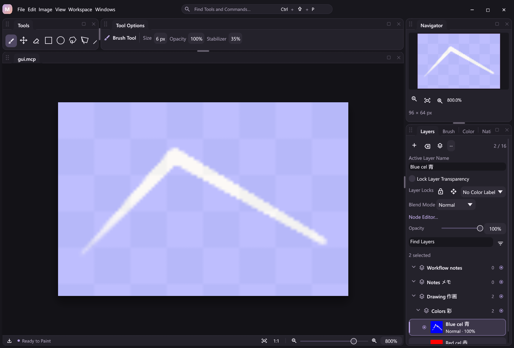
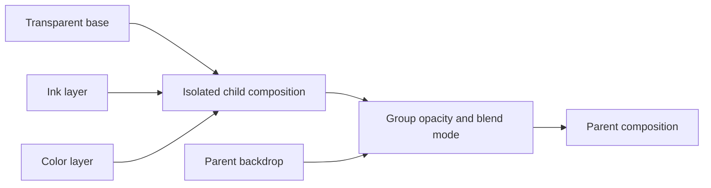
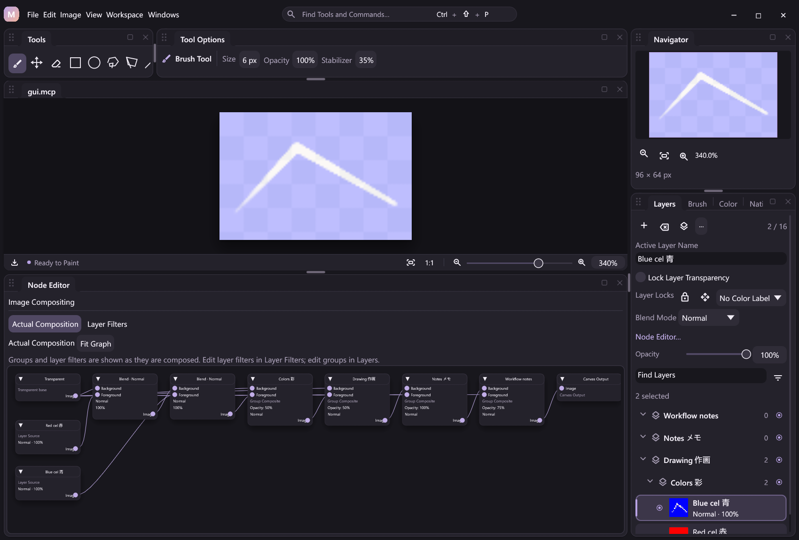

# Layer groups and isolated composition

Groups are bounded, stable-ID containers over MiCoPi's raster layers. They do not allocate another image buffer. A group composites its children in isolation, applies its opacity once, then blends that result into its parent. Nested groups repeat the same rule. This is independently implemented within MiCoPi's document, plugin, action and replay contracts; no PhotoCraft code is imported.

Two opaque overlapping children inside a 50% group produce approximately 50% alpha over transparency. Applying 50% to each child separately would produce approximately 75% alpha in the overlap and is deliberately not the group model. Groups support the existing Normal, Multiply, Screen, Overlay, Darken, Lighten, Add and Difference modes. Photoshop Pass Through is a separate, currently unsupported mode.

## Artist workflow

Select sibling raster layers and use **Group Selection (Ctrl+G)**. Group headers expand or collapse their children without changing selection. Inspecting a group's properties is separate from the active raster painting target; the inspector names the **Painting Layer**. Clicking a raster returns to its properties. **Select Group Layers** explicitly selects descendant rasters; an empty group has no raster selection.

Group controls provide names, visibility, opacity and blending, plus child creation, duplication, reparenting, ungrouping and explicit **Delete Group and Contents**. **Ungroup Active Layer's Parent (Ctrl+Shift+G)** targets the active raster's parent; a group's context action uses its explicit ID. Shortcuts remain configurable, and older explicit bindings take precedence over new defaults.

Dragging group opacity previews the control locally and submits one command on release. A numeric edit commits on Enter or focus loss. External document changes retain the draft and require an explicit reset rather than applying it to changed content.

New layers normally insert beside the active raster in its parent. An explicit parent creates a child of that group or a root layer. Whole-layer duplication and paste insert beside their source/active raster. A duplicated group receives new container and raster IDs while retaining child names, flags and filter branches. Collapse state and property-inspector focus are presentation state; artist names are document content and are not localized.

Filtering uses the registered query and retains ancestor context. Matching a group name without other filters includes its descendants. Other property filters match raster layers and retain their group headers. Active filters temporarily reveal matching descendants; clearing the filter restores the collapse choices. Filtering and collapse never hide artwork, change selection or execute a document edit.

## Shared commands and state

Group and raster ID namespaces are separate. A typed entry reference is `{"kind":"layer","id":1}` or `{"kind":"group","id":1}`. Zero denotes the root only in `parent_id`; it is never an allocated ID. Children and root references are stored from bottom to top. Query rows are displayed from top to bottom with headers before their descendants.

| Action | Arguments and effect |
| --- | --- |
| `group.query` | The same name/property filters as `layer.query`; read-only hierarchy, own/effective visibility, descendant IDs and context rows |
| `group.create` | Required `members` typed references, optional `name` and `parent_id`; siblings form a new group at their lowest sibling position; empty members append an empty group |
| `group.create_selected` | Optional `name`; groups the selected sibling rasters |
| `group.set` | Required `group_id`, optional `name`, `visible`, `opacity` (0–1), `blend_mode` |
| `group.move` | Required typed `items`, `parent_id` and final sibling `index`; reparent/reorder complete entries |
| `group.ungroup` | Required `group_id`; lift children into the parent and remove the container's appearance |
| `group.ungroup_parent` | No arguments; ungroup the active raster's parent |
| `group.duplicate` | Required `group_id`; copy the complete subtree beside its source |
| `group.delete` | Required `group_id`; delete the container and descendants, retaining at least one document raster |
| `group.select_layers` | Required `group_id`; select descendant rasters without creating pixel undo; reject empty groups |
| `layer.add` | Optional `parent_id`, with zero for root; omitted means beside the active raster |

`canvas.state.groups` and public `core.groups` expose the hierarchy. Raster rows separately report local `visible`, inherited `effective_visible` and `parent_id`. `layer.query` can filter either visibility field. Group visibility does not overwrite child flags, and group opacity does not change child opacity or stored pixels. The same commands, schemas and state are available in command search, schema-derived workflow nodes, MCP and headless clients. Editing a workflow never executes it.

The [runnable group example](../examples/automation/layer-groups.jsonl) combines pressure strokes, nested groups, explicit reparenting, subtree duplication, inherited visibility and PNG/replay verification.

The model supports 16 raster layers, 16 groups, eight levels of group nesting and a 64-instruction effective composition budget. Names are nonblank, single-line and at most 512 UTF-8 bytes. Creation, duplication, moves, source-filter changes and project loading validate membership, cycles, depth, IDs, storage order, pixel capacity and the actual effective graph. The effective graph budget can be reached before the separate layer/group counts.

Group edits require an idle drawing or non-drawing contact. Inherited visibility is cached when metadata changes; typed pen input reads that cache instead of walking the hierarchy. Pixel algorithms, pressure and stabilization stay in their existing native plugins. Painting and Free Transform still target the active raster, not an entire group.

## Structural and composition boundaries

Flat raster storage remains the depth-first leaf order of the tree. Reordering moves owned pixel buffers rather than cloning images. `group.move` rejects duplicate references, ancestor-plus-descendant targets, cycles and invalid final child slots. Legacy flat layer moves cannot cross parent boundaries or split subtrees; the grouped UI uses explicit sibling operations instead.

Ungroup removes the group's visibility, opacity and blending; it is not an appearance-preserving bake. Group deletion follows existing structural deletion policy and may remove locked descendants, with undo. Pixel baking keeps its separate lock guards. Merge Down requires adjacent raster siblings and retains their parent. Stamp Visible adds a root raster from the real composite; Flatten bakes the real composite and removes the hierarchy. Merge Visible with groups, explicit Group Merge, multi-layer transforms, raster/clipping masks and Pass Through remain planned.

The stored image graph remains the stable raster/filter branch model. A cached effective graph compiles those branches with the group tree and a shared transparent base. The Node Editor defaults to **Actual Composition**, showing this real topology. **Layer Filters** edits the source branches separately, with hierarchy-conflict guards. Disabling node effects bypasses filters while retaining group isolation and appearance. Free compositing cannot be combined with groups; ungroup before switching to that mode.

`graph.read.graph` is the source branch graph; `effective_graph` is the current actual composition. Group records expose `node_id` for their generated blend gate. The generated topology is read-only and is rebuilt through group commands. It must not be submitted as a replacement source graph.

## Persistence, undo and native compatibility

Composition metadata stores an optional version-1 group tree and separate group allocator. Legacy documents omit both defaults, preserving old recording hashes. Stored trees validate unique membership, parent relationships, exact raster leaf order and allocator bounds before restoration. Group IDs are monotonic across committed Undo/Redo; failed transactions restore the allocator.

A changed structural or property group edit has one structural/composition undo and one verified outcome. Atomic workflows restore pixels, structure, active raster, selected IDs, both allocators and history after failure. Partial journal writes retain the last verified prefix. Replay restores recorded outcomes and composite pixels without calling the compositor or recreating commands. The newest undo entry follows the existing retention policy and may exceed the 64 MiB target while older entries are pruned.

A compositor error is rejected before outcome publication. Rollback copies the existing verified surface tiles into the committed display cache, restores the exact dirty flag and clears pending composition, so restoring or recording the rejected attempt does not call a still-failing renderer. Rendering errors remain distinct from journal storage failures; callers can retry after the renderer recovers.

The compositor's v1 callback prefix is unchanged. A complete optional `CompositorApiFeatures` tail advertises `COMPOSITOR_TRANSPARENT`; kind 4 supplies transparent zero. Old prefix-only DLLs retain flat composition and are rejected before installing groups or transparent-node graphs. Old hosts can use the extended DLL for their original four-kind plans. Native group composition retains one dirty-region call and a fixed 64-word scratch array, with no full-image intermediates. See [Native Plugins](native-plugins.md).

## Verification

`scripts/smoke-groups.py` compares JSONL, MCP and desktop outputs, verifies projects and plugin-independent replay, and captures the four supported UI languages. Group integration tests cover nested opacity/blending, inherited visibility, contact rejection, buffer identity, copies, cycles/depth/budgets, grouped source graphs, failed transactions, journal recovery and legacy defaults. Native tests use independent blend references, preserve legacy quantization, and check dirty stride/padding, aliases and invalid instructions before writes. Hardware tablet compatibility remains a separate physical-device check.
