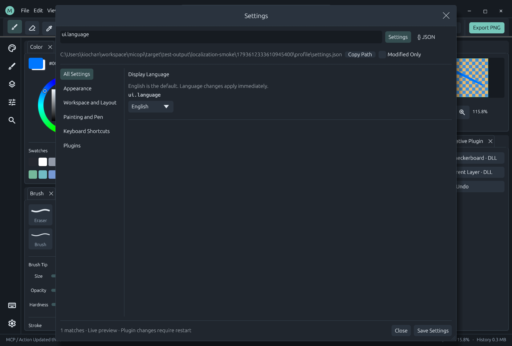

# Localization

MiCoPi uses English as its default and canonical source language. Supported display locales are en (English), zh-CN (Simplified Chinese), ja (Japanese) and ko (Korean).



## Select a language

Open Settings with Ctrl+, and search for Display Language or ui.language. Changes preview immediately; Save Settings persists the selection. Closing or canceling restores the last saved preferences. The dropdown uses each language's native name so it remains recognizable after switching.

```json
{"version":1,"ui":{"language":"en"}}
```

Configurations without language default to English. Unsupported codes and non-string values are rejected by settings validation. settings.update with an explicit settings path can also update ui.language in the live GUI. Keybindings and unknown root configuration fields are preserved.

## Scope and stable contracts

The workbench, menus, dialogs, settings descriptions, command search, shortcuts, tooltips, layer labels and node controls use an embedded English catalog and external translation catalogs. Search accepts English IDs and translated names in all loaded languages, independent of the active locale. Existing Chinese/pinyin search aliases remain available.

Action/state IDs, configuration keys, keyboard chord syntax, node type IDs, port names, schema types, file paths and user documents never change with display language. CLI/MCP contracts and technical diagnostics use English. Third-party text without a bundled translation remains as supplied; MiCoPi does not send plugin text to an online translation service. When the Chinese catalog is loaded, legacy Chinese manifest titles are recognized for compatibility with customized installations.

Documentation and new canonical source messages are written in English. Historical screenshots may show earlier UI languages; they do not define a protocol contract.

## Catalogs

Only `locales/en.json` is embedded in the executable. It defines canonical English messages and the default fallback. Chinese, Japanese and Korean are external UTF-8 JSON files: `zh-CN.json`, `ja.json` and `ko.json`. They are not compiled into the executable. The language dropdown continues to offer these locales even when a file is absent; missing entries fall back to English/original source text.

At startup the desktop loads files from `<executable-directory>/locales/`, then applies per-profile overrides from `<config-directory>/locales/`. Later entries override earlier ones, so profile files can contain just the messages you want to customize. Identical directory paths are read once. `--config-dir` chooses the profile directory. `--locales-dir <directory>` replaces the executable locale directory, useful for pointing a development executable at this repository's `locales/` folder.

```powershell
# Development: edit the repository JSON files while the app is running.
micopi.exe --locales-dir C:/workspace/MiCoPi/locales --config-dir C:/MiCoPiProfile
```

For example, create `<config-directory>/locales/zh-CN.json` containing:

```json
{"Canvas Size":"调整画布大小","Apply":"确认应用"}
```

No restart or rebuild is required for changes to external files. A background thread checks file size/modification time every 500 ms, parses changed files and retries failed files every two seconds and publishes an immutable snapshot at a UI frame boundary. The channel holds one queued snapshot; a newer snapshot is coalesced into one worker-side pending update. File I/O and JSON parsing do not run in pen MOVE or UI rendering callbacks. Changing language still previews immediately; idle windows request periodic redraws so edits become visible without mouse movement. Open command search refreshes its translated terms on a catalog update.

Each file is limited to 2 MiB and must be a JSON object of nonempty string keys and values. UTF-8 BOM is accepted. Format placeholders must match their English source key, including names and precision specifiers. A syntax/type/placeholder/read error retains that file's last valid catalog and reports a diagnostic in the status strip. Other valid files can continue updating. Deleting a file removes its overrides; values fall back to a lower-priority file or English. An invalid file at first startup contributes no translations. Editing the built-in English catalog still requires recompilation; an external `en.json` is ignored.

Release builds install the three external language files beside the executable. The build script preserves existing files in `dist/locales` to avoid overwriting local edits; remove or replace an old file explicitly when adopting a newer full catalog. Fresh distributions receive the current repository files. There are no downloads or online translation services. Headless CLI/MCP contracts stay English and do not start the desktop watcher.

Static labels use lookup at presentation boundaries before layout. Rich text is translated before styles are applied. Formatted labels preserve the already formatted numeric/path arguments; translation never treats user data as format syntax. Keep every placeholder exactly, including names and precision specifiers. Avoid adjacent unseparated placeholders and escaped braces in translatable templates; use explicit static labels for ambiguous formatting. UI input text, file paths and editable JSON are not translated.

Windows fonts provide CJK fallback: Microsoft YaHei for Chinese, Yu Gothic/Meiryo for Japanese and Malgun Gothic for Korean, with existing installed alternatives. The application does not redistribute these fonts or enlarge the package with a font bundle. Missing optional system fonts use remaining font fallbacks; install the corresponding Windows language fonts if the OS cannot display those scripts.

## Add or change translations

Plugins can declare their own external catalogs in the manifest's `locales` map. The same watcher loads them for active packages and retains last-good translations on invalid edits. Package messages are scoped by contribution owner, so identical English keys can have different translations in different plugins without replacing host labels. Profile files can override a package message with `@plugin/<package-id>/<English message>`. The combined size of accepted external files is limited to 16 MiB. See [Plugin system](plugin-system.md) for the manifest format and reload lifecycle.

1. For a new message, write an English source key and add it to the English catalog (requires a rebuild). Add that key to the distributed translation catalogs; local override files may remain partial.
2. Add natural translations for visible UI text. Keep technical IDs, paths and code unchanged.
3. Preserve all format placeholders. Translate before constructing styled RichText; use the shared desktop presentation helper for labels, buttons and hints.
4. Include translated names in search when adding new metadata-backed settings or nodes.
5. For translation-only edits, save the external JSON and inspect the running application. Run catalog/settings/search tests and inspect real GUI screenshots in all four languages, at narrow and wide sizes.

```powershell
cargo fmt --all -- --check
cargo test --locked
python scripts/smoke-localization.py
```

The tests enforce catalog key/placeholder parity, English defaults, locale validation, configuration preservation, localized command search and numeric/path formatting. The smoke test uses a disposable profile, verifies unchanged canvas PNG bytes while switching languages and closes only its own GUI process.
