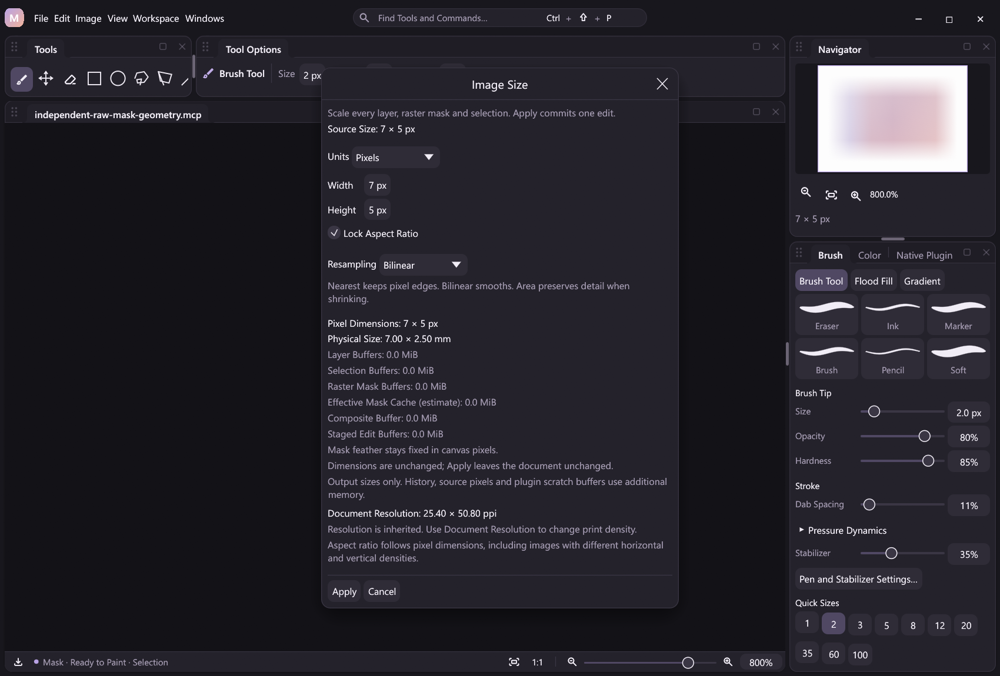

# Raster masks and document geometry

Document-wide geometry builds on [raster mask editing](raster-mask-editing.md) and the
[native A8 sampler](native-plugins.md#optional-raw-a8-sampler). Complete owner
Move/Free Transform, group/subtree/batch structural edits, merges and clipboard integration remain
separate roadmap work.



The actual Image Size dialog shows separate pixel-selection, raw-mask and
effective-cache estimates. This deliberately small verification fixture keeps
costs below the displayed 0.1 MiB precision; estimates describe output bounds,
not total process memory.

## One document coordinate system

Canvas framing, image sizing, document rotations and flips transform every raw
layer and group mask, including hidden, disabled and unlinked masks. The link
flag describes owner-relative editing; it does not exempt a mask from a change
to the document's coordinate system. Stable mask/owner IDs, target selection,
layer multi-selection and properties remain intact.

Raw RGBA and raw A8 are staged separately. Existing pixel selections and the
previous Reselect selection follow their own coverage paths; mutable document
masks are never encoded into selection metadata. Effective density/feather
coverage is regenerated after publication rather than sampled as source data.

| Action | Mask behavior |
| --- | --- |
| `canvas.resize` | Reframe all raw planes with the same nine-anchor offsets |
| `canvas.crop` | Copy the same in-bounds rectangle from all planes |
| `canvas.rotate_90_cw`, `canvas.rotate_90_ccw` | Permute all planes and exchange dimensions and physical axes |
| `canvas.rotate_180` | Permute all planes without changing dimensions |
| `canvas.flip_horizontal`, `canvas.flip_vertical` | Mirror every plane in document coordinates |
| `canvas.image_size` | Sample raw masks with the chosen nearest, bilinear or area method |
| `canvas.trim_bounds` | Analyze current visible composed artwork without changing stored planes |
| `canvas.trim` | Recompute bounds, then crop every raw plane to that frame |

New RGBA space is transparent. New raw-mask space is revealing white (`255`),
and new pixel-selection space is zero. Thus expanding a hidden mask retains its
old hidden content while permitting later painting in the new frame. Cropped
content remains available through Undo. Layers' pixel/transparency/position
locks retain their existing distinction from document-wide coordinate edits.

Quarter turns exchange the existing exact physical axes, including square
canvases with unequal X/Y PNG density. Crop, expansion, flips and image sampling
retain their existing density policy. Source layer filters keep their identity
and numeric parameters; they are evaluated against the resulting raw sources.

## Feather is recomputed in canvas pixels

Mask density, enable, link and numeric feather radius are retained. Image Size
does not scale feather radius or introduce an anisotropic radius. Plans report
`raster_mask_feather_policy: "fixed_canvas_pixels"`.

The deterministic feather kernel has fixed H/V pass order and byte rounding.
Rotating raw data and recomputing coverage can therefore differ from rotating
the previous effective image. For radius 1 and raw `2 × 2` samples
`[165, 4, 135, 79]`, clockwise rotation of old effective coverage yields
`[114, 113, 85, 71]`; recomputation from rotated raw samples yields
`[115, 113, 84, 71]`. This operation promises raw geometry and canonical effect
recomputation, rather than exact permutation of the previous displayed image.
New crop edges also use the normal clamp-to-canvas effect policy.

## Read-only plans

`canvas.geometry.plan` shares frame and anchor validation with mutations:

```json
{"action":"canvas.geometry.plan","args":{"operation":"resize","width":1600,"height":1200,"anchor":"center"}}
{"action":"canvas.geometry.plan","args":{"operation":"crop","x":20,"y":30,"width":1000,"height":800}}
{"action":"canvas.geometry.plan","args":{"operation":"rotate_90_cw"}}
```

Supported operations are `resize`, `crop`, `rotate_90_cw`, `rotate_90_ccw`,
`rotate_180`, `flip_horizontal` and `flip_vertical`. Resize requires width and
height, with optional anchor. Crop requires x/y/width/height. Rotations and flips
accept no frame fields. Literal errors reject before earlier pipeline effects;
source-dependent crop bounds and budgets are resolved against the actual frame.

The result exposes source/target dimensions, destination offsets, identity,
physical information, revision, drawing state, layer/pixel-selection/raster-mask
counts and separate buffer estimates. `contact_active` includes native Hand
contacts even when `drawing` is false. Required outputs become schema-derived
workflow ports. `requires_a8_sampler` and `a8_sampler_available` report the new
native dependency without sampling pixels or ending a contact.

`canvas.image_size.plan` retains `mask_count` and `estimated_mask_bytes` for
current/Reselect pixel selections. Its additive `raster_mask_count`,
`estimated_raster_mask_bytes` and `estimated_effective_mask_bytes` describe
document masks. Its staged estimate includes raw A8 outputs. Both planners use
`fixed_canvas_pixels` feather policy; Image Size supports existing physical
unit input and exact-density conversion.

Estimates are dense output bounds. They exclude retained source/history,
compositor/native scratch and derived coverage from `estimated_staged_bytes`;
composite and effective-cache estimates are reported separately. Uniform masks
still consume their full logical frame area for admission. The existing
64-million raster-pixel and separate 64 MiB raw-A8 limits remain independent.
Plans are not guarantees that future file I/O, journal writes or allocations
cannot fail.

## Native capability and atomic publication

Nonidentity masked geometry requires the optional painting DLL's complete
`micopi_a8_sampler_v1` table. Older A8 painting DLLs remain loadable and can
paint supported documents, while missing sampling capability rejects before
publishing geometry. Identity frame/image requests retain their no-op path.
Live composition still preflights renderer modes/effects, including hidden and
disabled branches. Outcome playback restores verified surfaces without those
capability checks or DLL execution.

All RGBA outputs, raw mask planes, selections and document information validate
before one Canvas history entry replaces the old buffer set. Missing, duplicate,
reordered or invalid raw-mask bundles reject. The equality check includes raw
mask samples; a same-size edit cannot disappear merely because RGBA is equal.
Publication and Canvas Undo/Redo invalidate effective caches and mark A8 replay
tiles even for square rotations and same-size flips. New contacts receive fresh
private leases.

Mutations require idle Brush and Hand contacts. Read-only plans remain usable
during drawing. Geometry dialogs own local drafts, retain revision/document
guards and dispatch shared actions on Apply; opening or cancelling a draft does
not finish a contact. An unrelated mouse release cannot finalize an external
native contact. Actual owned UP/CANCEL and focus-loss policies remain in force.

Native sampling failure discards temporary outputs. Renderer or recording failure
restores document state, target, revision, allocator and history through the
shared checkpoint path. A changed geometry has one reversible Canvas edit and
verified outcome; accepted no-op commands add no pixel Undo entry. Pipeline,
workflow, JSONL, MCP and desktop clients share these contracts. Editing a
workflow or running a dry run does not apply geometry.

The [runnable example](../examples/automation/mask-geometry.jsonl) creates two
owner masks, paints raw coverage with pressure/stabilization, binds a frame
plan into an atomic resize, then rotates, samples and crops before exporting
the project, PNG and verified recording.

## Remaining work and verification

Plain [single-layer owner copy/delete](mask-owner-editing.md) now has its own
compound structural contract. Owner-specific Move/Free Transform, group/subtree
and batch structural edits, Layer via Copy/Cut, merges/stamp/flatten, cut/paste
and group-mask application
remain guarded where integration is incomplete. Clipping masks remain planned.
See the full [design matrix](raster-masks-design.md#structural-and-geometry-rules)
and [roadmap](../ROADMAP.md).

Delivery validation compares independent raw RGBA/A8/selection references,
same-size cache and replay behavior, one-step history, native/renderer/journal
failure recovery, old-DLL rejection, project roundtrips and DLL-free outcomes.
Actual completed runs and their limits belong in [Development](development.md).
Synthetic input and captures do not establish physical tablet compatibility.
