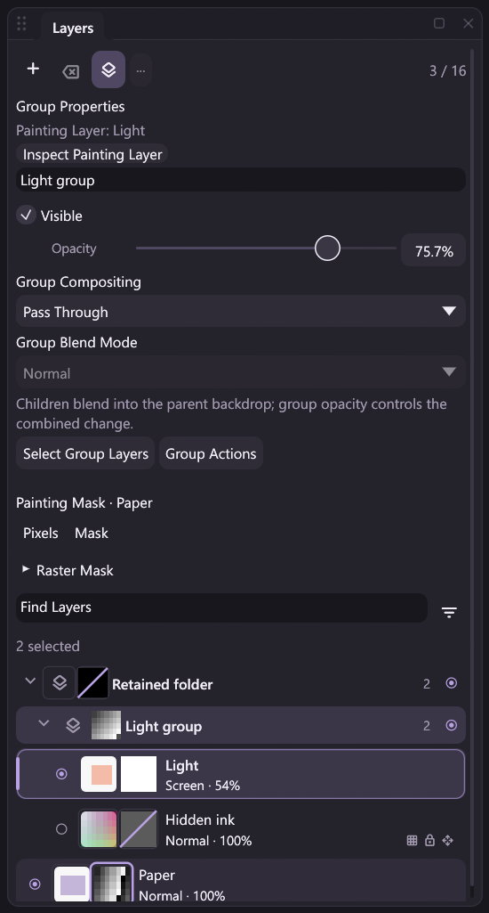

# Raster masks: deleting a group and its contents

The existing `group.delete` action supports mask-bearing documents. It removes
the explicit group's complete subtree and every mask owned by a consumed group
or raster, then publishes one structural Undo/revision/outcome. This extends
[owner-preserving group creation/movement](mask-group-editing.md) and
[single-layer owner editing](mask-owner-editing.md); group
duplication has its [own contract](mask-group-duplicate.md). Ungrouping, baking
and batch layer deletion remain separate work.

The reviewed Release capture shows the restored Pass Through group, its raster
and group masks, retained outer folder and unrelated Paper painting-mask target.
The active raster, selected layers and group inspector remain separate.

## Scope and retained content

The command consumes the requested container, nested containers, empty nested
groups and raster descendants. A mask on an empty group is still owned content
and is removed with that group. Dense and uniform masks follow the same rule,
including hidden owners, disabled masks, unlinked masks and nondefault
density/feather. Deletion may consume locked descendants under the existing
structural deletion policy; it does not perform a protected pixel edit.

Removing the final raster is rejected before publication. Deleting an empty
group is permitted while the document retains its raster layers. Unknown IDs
and malformed arguments reject without selecting a different group. Integral
numeric IDs such as `1.0` use the existing bounded integer normalization.

Unrelated masks retain their IDs, owners, properties, raw samples and storage.
Unrelated raster buffers, local flags, source-filter identities/parameters and
group skeletons remain intact. Removing a subtree can change composition and
backdrop interactions. Source-filter node positions can be automatically
arranged when the linked raster stack changes; layout coordinates are separate
from filter identity and effect parameters.

## Painting target, active raster and selection

The Pixels target stays Pixels. An unrelated explicit layer/group mask target
stays selected even when the active raster changes. Only a target naming a
removed mask falls back to Pixels; Undo restores the earlier target.

A surviving active raster retains its identity. If it is consumed, the existing
fallback first chooses the nearest surviving selected raster in original stack
order, then the next surviving raster at/after the old active position, then the
preceding survivor. Surviving selected IDs are retained; if none survive, the
fallback raster becomes selected. Group inspection remains presentation state
and does not replace the explicit document target.

## Admission, history and failure recovery

Both the complete source and staged candidate validate raw storage, ownership,
tree membership/order, count/depth limits, graph budgets and declared renderer
capabilities. Source checks include hidden groups, disabled masks/effects and
Pass Through policy even when deletion would remove those declarations. The
candidate compiles retained rasters with their actual source opacity and masks;
it cannot substitute default opacity after raster indices change.

One successful changed command adds one compound history entry, revision and
verified outcome. Structural mask history keeps removed planes together with
their original metadata/storage slots in a shared immutable record, so several
noncontiguous mask removals restore as one operation. Ordinary deletion moves
owned buffers into history; it does not clone every raw plane. Direct engine
Undo can take ownership of an unshared record. Ordinary `Session::apply` Undo
takes a rollback checkpoint, which pins preexisting structural history; restoring
its removed dense planes therefore makes cold copies before later mutable edits.
Atomic pipelines that begin with Undo have the same checkpoint-isolation cost.
This is outside the typed pointer path. Committed Undo keeps layer, group and mask ID
allocators monotonic; failed atomic execution restores their exact checkpoint
values and history.

Undo restores consumed groups, rasters, mask samples/properties, active/selected
IDs and target. Redo repeats the recorded removal. Renderer failure restores the
previous compiled composition and visible surface. Partial journal-write failure
restores the document/history and keeps the old event count/head. Other rejected
attempts can add a zero-change failure audit. Atomic workflow rollback remains
different from grouping several commands into one Undo operation.

A journal storage fault stops further document mutations, including Undo. There
is no public in-place recording reset: recover the current PNG/valid archive
prefix where possible and start a new session, following [Replay](replay.md).
The failure regression explicitly simulates recovered storage only after
checking the unchanged document/history/head, to inspect the retained Undo
record; that fixture does not advertise automatic retry or product recovery.

## Compact outcomes and persistence

Deletion records the removed identities in metadata; it does not serialize the
removed A8 samples again or change any surviving raw A8 tile. Its outcome has
zero A8 tile changes. Undo must record restored planes when they reappear.
Hierarchy/RGBA storage changes and display pixels still have their existing event
costs. Raw masks retain the separate stable-ID byte namespace and never use
RGBA/composite tile indices.

MICOPI04 projects, MCRPLY02 archives and the native ABI remain unchanged. Project
save/open verifies the surviving owner set and raw planes. Verified replay
restores outcomes, including deletion and Undo, without loading DLLs or rerunning
commands, and preserves supported legacy project/recording behavior.

## Actions, schemas and automation

Desktop controls, command search, nodes, JSONL, MCP and headless use the same
`group.delete` handler. The successful result retains Session state and its
existing `group_id`, and guarantees three array properties:

| Property | Order and meaning |
| --- | --- |
| `deleted_group_ids` | Consumed containers in their original stored group-record order, including the requested group |
| `deleted_layer_ids` | Consumed rasters in original depth-first raster-storage order; empty for an empty subtree |
| `deleted_mask_ids` | Consumed owner masks in original mask-metadata order; empty when no consumed owner has a mask |

The result's top-level `revision` matches the published outer response and a
following `canvas.state` query when no operation intervenes. Nested historical
reports and plugin-owned values retain their own semantics; see
[Action Results](action-results.md). The deletion smoke checks published state,
the one-event boundary and verified outcome together.

These are typed workflow output ports, rather than opaque private state. Pipeline
references can select array entries with `/0`. A deleted ID is no longer a valid
mutation target; Undo restores it before a subsequent action can use it. Editing
or dry-running a workflow never deletes artwork. An atomic sequence that deletes,
undoes and then edits restored content retains complete rollback isolation.

All deletion routes require idle Brush and Hand contacts and preserve samples
when rejected. Panel controls, static commands, dynamic argument drafts and
Commands palette admission retain that guard before finishing local contacts or
flushing pending name edits. Recording boundaries can flush sample chunks while
the native contact stays active; continuity counts recorded and pending samples.
The typed per-MOVE path adds no JSON serialization, registry lookup, file I/O or
whole-image copy.

## Remaining work and validation scope

Ungrouping, layer batches, owner pixel Move/Free
Transform and rotations, Layer via Copy/Cut, merges/stamp/flatten, clipboard
mutations and group-mask Apply remain guarded where integration is incomplete.
Clipping masks remain planned. The full [mask design](raster-masks-design.md) and
[roadmap](../ROADMAP.md) remain open.

Regression sources cover interleaved mask slots, empty groups, target/selection
fallbacks, retained storage/filter semantics, one-step history, source/candidate
capabilities, failure rollback, contacts, schemas and DLL-free persistence. Actual
completed checks and limitations belong in [Development](development.md);
synthetic input does not establish physical tablet compatibility or pen latency.

Run the [group-deletion example](../examples/automation/mask-group-delete.jsonl)
with matching default plugins. It deletes and restores a masked subtree, retains
the ancestor's independent mask, binds deleted IDs only after Undo restores them,
and exports a PNG, project and verified replay archive.
