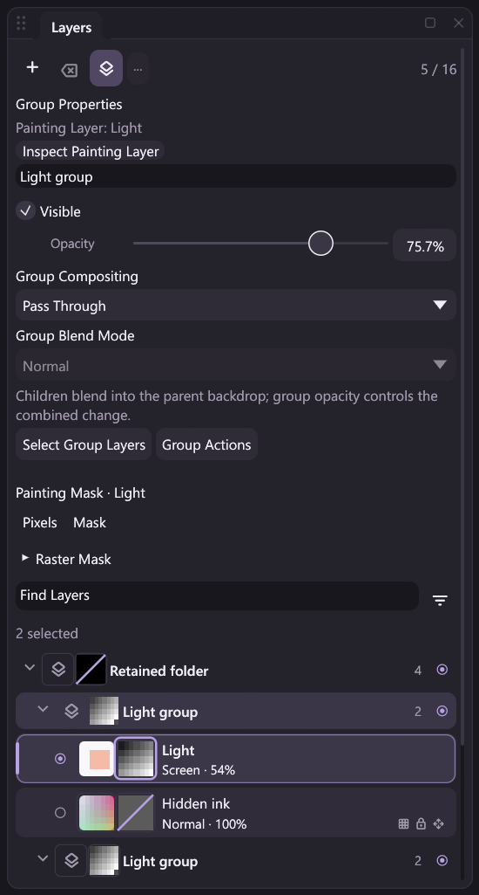

# Raster masks: duplicating a group and its contents

The existing `group.duplicate` action copies a complete group subtree on
mask-bearing documents. It creates fresh group, raster and owned-mask IDs,
independent raw storage and one compound Undo/revision/outcome. Desktop controls,
command search, nodes, MCP and headless clients share the registered handler.
This extends [group creation/movement](mask-group-editing.md),
[subtree deletion](mask-group-delete.md) and [single-layer owner editing](mask-owner-editing.md).

The reviewed Release capture shows the fresh Light group above its retained
source, two selected copied rasters and the copied Light mask as the painting
target. Hidden/locked flags and mask thumbnails remain visible; the source and
its parent retain their own masks. The scrollable list continues below the frame.

## Placement, source data and identity order

The copied root is inserted immediately after the source under the same parent.
All descendants participate, including empty/hidden groups and nested Isolated
or Pass Through boundaries. Their local names, visibility, opacity, color blend
modes, compositing policy, locks, labels and source filters are retained. Outside
ancestors and unrelated group skeletons are retained rather than duplicated.

Raster buffers and dense A8 planes are copied once into independent storage;
uniform A8 storage remains uniform. Masks retain enable/link/density/feather and
exact raw samples at the same canvas coordinates. New raw-mask content revisions
start at zero. Source and unrelated pixels, masks and allocations remain intact.
An unlinked mask is still copied with its owner; this does not enable owner Move
or Free Transform. Filter branches receive fresh copied node IDs, while retained
filter IDs/type/parameters remain attached to their original raster identities.
Linked-stack node positions may arrange when the raster stack changes.

Fresh IDs have three distinct orderings:

| Identity | Allocation order |
| --- | --- |
| Groups | Copied root first, then breadth-first descendant discovery in child order; append new records after existing group records |
| Rasters | Source subtree's depth-first raster order |
| Masks | Original mask-metadata order, which is ascending mask ID; remap both owner kind and ID |

These arrays describe different traversals. Do not zip group, raster and mask
arrays into a supposed source-to-copy map. Use public hierarchy/owner state to
identify each new owner and its mask. Group and raster numeric namespaces remain
explicitly tagged. Public hierarchy rows can follow depth-first tree order;
`group_ids` still guarantees allocation order, including a branching subtree
where breadth-first and depth-first orders differ.

Duplicating a subtree can change the visible result. The new sibling has its own
opacity/coverage boundary and may see a different backdrop, especially with Pass
Through children. This preserves editable source data and evaluates the new
stack; it does not promise appearance-preserving duplication or bake a snapshot.

## Painting target and raster selection

Pixels stays Pixels. If an explicit mask target belongs to any copied raster or
group, including an empty descendant, the target remaps to that mask's fresh
copy. Every unrelated explicit mask target is retained, even when the active
raster changes.

For a nonempty subtree, select all copied rasters in depth-first order. If the
source active raster is inside the subtree, its copy becomes active; otherwise
the last copied raster becomes active. A copied hidden raster can therefore be
active, while ordinary painting still honors effective visibility. An empty
subtree preserves active/selected raster identities while applying the same mask
target rule. Singleton selection retains the existing compact metadata encoding.

## Admission, cost and history

Planning checks the complete source raw storage/ownership/capabilities and the
complete candidate tree, editable graph and generated coverage graph before
allocating image copies. This includes hidden/disabled declarations, actual
source-mapped raster opacity, owner uniqueness, depth/order, all count/identity
limits and separate raw/effective A8 budgets. The 64-instruction effective graph
budget can be reached before the 16-raster, 16-group or 32-mask count limits.
Uniform raw planes still count their full logical canvas area against the 64 MiB
A8 budget. Existing canvas/pixel limits remain unchanged.

Empty copies consume no raster IDs; a copy without owned masks consumes no mask
IDs. Those operations remain possible at the corresponding exhausted allocator
sentinel if all other admission checks pass. Every copy still needs fresh group
IDs. Failed planning does not consume identities or allocate output images.

Publication adds one structural history entry, revision and verified outcome.
It combines inserted raster buffers, fresh A8 slots, hierarchy, selection and
target. Undo removes the copies; Redo restores their exact IDs/data. Committed
Undo keeps all three allocators monotonic. Atomic/render/journal failure restores
the exact checkpoint allocators, raw content, history and visible surface.

Structural history shares immutable multi-plane records with checkpoints.
Restoring a preexisting saved record through Session Undo/Redo can clone its
affected dense planes because Session keeps a rollback checkpoint; Redo of a
previously undone copy is one such cold restoration. Direct engine restoration
can move unshared allocations. Later writes cannot mutate a pinned checkpoint.
Atomic rollback is separate from grouping several commands into one Undo.

The copy outcome records fresh A8 planes, without rerecording unchanged source
planes. Removing fresh IDs on Undo needs no A8 sample changes; Redo records their
restoration. RGBA copies, display changes, metadata, history and recording have
their existing additional costs. No dependency, native callback, ABI, project or
archive format changes are introduced. The typed pointer path adds no per-MOVE
JSON, discovery, file I/O or whole-image copying. These are implementation bounds,
not measured pen latency or physical tablet compatibility claims.

Renderer failures restore the committed composite. A partial journal append
retains the old head/count and document/history. Storage faults keep the existing
stopped-recording policy; there is no public in-place reset. Recover a PNG/valid
prefix where possible and start a new Session as described in [Replay](replay.md).

## Schemas, workflows and contacts

Successful results retain full Session state and guarantee these properties:

| Property | Meaning |
| --- | --- |
| `source_group_id` | Explicit source root |
| `group_id` | Fresh copied root |
| `group_ids` | Fresh groups in allocation order |
| `layer_ids` | Fresh rasters in copied depth-first order; empty for an empty subtree |
| `mask_ids` | Fresh masks in original source-mask order; empty when no copied owner has a mask |

The existing top-level Session revision is the published revision. Required
schemas expose copied IDs as typed workflow outputs. For example, connect
`group_id` to `group.set.group_id` and `layer_ids` to a later selection action.
Pipelines can select individual entries with references such as
`copy#/result/mask_ids/0`. A consumer must handle empty arrays rather than
assuming a copied owner has a mask or raster. Integral scalar group selectors
such as `1.0` use the same bounded ID normalization.

Editing or dry-running a workflow does not copy artwork. All mutations remain
idle-only for Brush and Hand contacts. Panel, static and argument-draft routes
reject before completing local contacts or committing pending name edits.
Recorded and pending pressure samples retain continuity across rejection.
Verified project/archive outcomes restore raw copied owners without executing
DLL commands or loading a compositor.

The [runnable duplication example](../examples/automation/mask-group-duplicate.jsonl)
paints stabilized pressure coverage, copies a masked group, binds fresh root/
raster/mask IDs to later edits and exports a PNG, project and verified archive.

## Remaining work and verification scope

Ungrouping, layer batches, selected-pixel movement, layer rotations,
Layer via Copy/Cut, merges/stamp/flatten, clipboard mutations and group-mask Apply
remain guarded where mask integration is incomplete. Clipping masks remain
planned. The full [mask design](raster-masks-design.md) and [roadmap](../ROADMAP.md)
remain open.

[Owner affine Free Transform](owner-affine.md) separately addresses exact raster
sets and their linked masks; group-mask, projective and copied owner transforms
remain guarded.

Regression sources exercise ordered IDs, raw independence, targets/selection,
partial opacity, compound history, logical limits, failure isolation, contacts,
typed bindings and DLL-free restoration. Actual completed checks and limitations
belong in [Development](development.md); available fixtures do not imply a
pending run, screenshot or hardware validation has passed.
