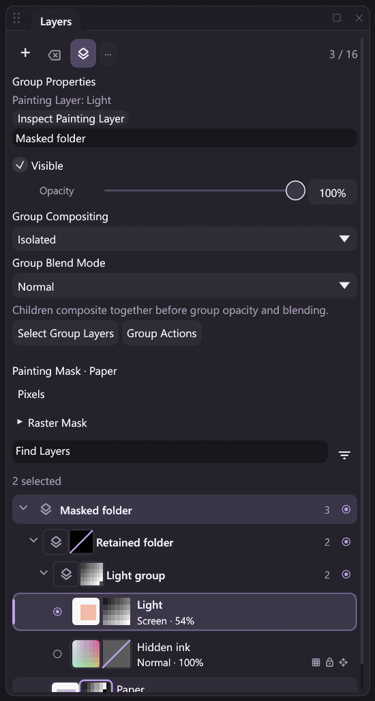

# Raster masks: owner-preserving group creation and movement

The existing `group.create`, `group.create_selected` and `group.move` actions
support documents with layer/group raster masks. These operations change the
hierarchy while retaining every existing owner and raw plane. They extend
[single-layer owner editing](mask-owner-editing.md) and [mask canvas geometry](mask-canvas-geometry.md).
Group/subtree copying, deletion, ungrouping and baking remain separate work.



The reviewed Release capture shows existing masked owners wrapped under a new
container. Group inspection, the active painting raster and an unrelated explicit
Paper mask target remain distinct. Artist-owned names stay untranslated.

## Supported hierarchy changes

| Action | Mask-aware scope |
| --- | --- |
| `group.create` | Create an empty container or wrap explicit sibling layer/group entries |
| `group.create_selected` | Wrap the currently selected sibling raster layers |
| `group.move` | Reparent or reorder explicit layer/group entries, including complete masked subtrees and empty groups |

This is Layers hierarchy movement, not pixel movement on the canvas. Creating a
container adds a fresh group ID but no mask automatically. Existing masks keep
their IDs, owners, enable/link/density/feather properties, raw samples and canvas
coordinates. Mask count and its allocator are unchanged. Hidden, disabled and
unlinked masks participate in the same ownership/capability checks.

Creating a nonempty group retains the selected siblings' stacking order and
replaces their lowest sibling position with the container. An empty group appends
to its explicit parent, or to root when the parent is omitted. A nonempty group
defaults to the members' shared parent. Explicit `parent_id: 0` means root.
`group.create_selected` uses the selected raster IDs without adding other
descendants. Empty groups have no raster descendants to select.

`group.move` uses an index in the destination sibling list after the requested
entries are removed. It rejects duplicate entries, ancestor-plus-descendant
targets, cycles, unknown parents and invalid final slots. A selected group entry
moves its complete subtree as one unit; it does not duplicate or remove the
group's mask. The flat raster array remains the tree's depth-first leaf order.

Raw RGBA buffers and raw A8 planes are retained rather than resampled or copied.
Source-filter identities, types and parameters follow stable raster IDs. When
raster order changes, the linked-stack editor may automatically arrange node
positions; generated layout coordinates are distinct from filter semantics.
The active raster and selected set retain their IDs even when indices change.

The explicit paint target stays unchanged, including an unrelated layer/group
mask. Moving its owner beneath a hidden parent can make that target unavailable
for a new paint contact; the command does not silently select a different mask.
Inherited visibility is refreshed in the existing cache.

## Composition is evaluated in the new hierarchy

Local visibility, opacity and color blend modes remain attached to their owners.
Group opacity and mask coverage are compiled once at each boundary, using the
actual source opacity after reordering. Isolated and Pass Through policies keep
their existing [composition contract](layer-groups.md) and [backdrop rules](pass-through.md).
Disabling source filters still retains the hierarchy and masks.

An owner-preserving tree change can alter the visible result. A new Isolated
boundary or a different parent changes backdrop and inherited opacity/coverage
interactions. This feature retains source storage and applies the new tree; it
does not promise appearance-preserving reparenting or bake the previous result.

## Admission, publication and history

Both the current source and candidate tree/graph are checked before publication.
Checks include raw-mask storage and owner validity, typed tree membership,
stable-ID/count/depth limits, depth-first raster order, native capabilities and
the effective instruction budget. Hidden/disabled declarations remain part of
renderer admission. Existing limits are 16 raster layers, 16 groups, eight
nesting levels and 64 effective instructions; the instruction budget can be
reached before separate owner counts.

A successful changed operation publishes one structural history edit, revision
and verified outcome. Creation records its metadata; a raster permutation uses
the existing buffer-owning permutation history. Undo restores the tree, order,
active/selected layers and target. Committed Undo keeps group IDs monotonic,
while failed atomic execution restores the exact checkpoint allocator/history.
Native-render and partial-journal failures restore the committed buffers,
compiled composition and visible surface.

The group operation does not change raw A8 samples, so its outcome has no A8
tile changes. Hierarchy metadata, reordered RGBA storage and the display surface
can still contribute event data. Masks remain in their separate stable-ID byte
namespace. MICOPI04/MCRPLY02 formats and native ABI remain unchanged, and verified
replay restores recorded results without executing hierarchy commands or DLLs.
Failed attempts can record a zero-change failure audit; a failed journal append
keeps the previous event count and head. Atomic pipeline/workflow rollback is
separate from grouping multiple commands into one Undo operation.

## Shared commands and result schemas

Desktop controls, command search, workflow nodes, MCP and headless clients share
the registered handlers. No new action IDs are introduced. Successful
`group.create` and `group.create_selected` results guarantee `group_id`, while
retaining their Session-state fields. The required schema property permits a
typed workflow output to supply a later `group.move.parent_id`.

For an existing root stack with raster IDs 1, 2 and 3:

```json
{"action":"pipeline.run","args":{"atomic":true,"steps":[
  {"id":"parent","action":"group.create","args":{"members":[{"kind":"layer","id":1},{"kind":"layer","id":2}],"parent_id":0,"name":"Sketch"}},
  {"id":"move","action":"group.move","args":{"items":[{"kind":"layer","id":3}],"parent_id":{"$ref":"parent#/result/group_id"},"index":2}}
]}}
```

Query IDs before retaining a target across edits. Group/raster ID namespaces
remain explicitly tagged by `kind`. Bounded integer schemas accept
mathematically integral JSON numbers such as `1.0` for scalar IDs, parents,
indices and typed entry IDs. Normalization retains strict unknown-field/type
validation and detects mixed-format duplicates such as `1` and `1.0`.
`group.set`, group selection and inspection use the same numeric-ID rule.
An omitted parent is distinct from an explicit root where the action defines
different defaults; invalid values do not fall back to another group.

Editing or dry-running a workflow does not create or move a group. Read-only
queries retain their own contract. Presentation-only group inspection still
reports headless unavailability; document creation/movement is window-free.

The runnable [masked-group example](../examples/automation/mask-groups.jsonl)
paints pressure/stabilized coverage, changes nested parents, restores Undo/Redo,
binds a fresh container ID and exports a project, image and verified recording.

## Contacts, drafts and costs

All three mutations require idle Brush and Hand contacts. Shared admission
rejects before finishing a live contact. Static commands, group/panel pending
dispatch and dynamic argument drafts retain that guard. Opening/cancelling a
draft does not execute it, and unrelated releases do not terminate an external
contact. Recording boundaries may flush raw sample chunks while the native
contact remains active; continuity includes recorded and pending samples.

Opening the command palette in Commands mode, escaping or explicitly cancelling
it preserves the contact. Selecting one of these guarded group mutations also
preserves the contact when admission rejects it. Executing an unrelated command
and opening Bindings mode retain their existing finish/cleanup behavior. Canvas
modal checks include the command palette so a release there cannot create a
second painting path.

Hierarchy planning is cold bounded metadata/graph work. Raster permutations move
existing buffers; raw masks and effect planes do not need new image-sized copies.
Existing composition, history, recording and display costs still apply. This
adds no dependency, native callback or per-MOVE JSON/lookup/hierarchy traversal.

Group/subtree duplication and deletion, ungrouping, batch layer edits,
Layer via Copy/Cut, owner pixel Move/Free Transform and rotations, merges,
flatten/stamp, clipboard mutations and group-mask Apply remain guarded on
mask-bearing documents where incomplete. Clipping masks remain planned. The
full [mask design](raster-masks-design.md) and [roadmap](../ROADMAP.md) stay open.

Regression sources cover source/candidate admission, raw and buffer preservation,
numeric/schema bindings, partial-opacity composition, one-step history, failed
render/recording/atomic recovery, contact continuity and DLL-free persistence.
Completed runs and their limits belong in [Development](development.md);
synthetic input does not establish physical tablet compatibility or pen latency.
