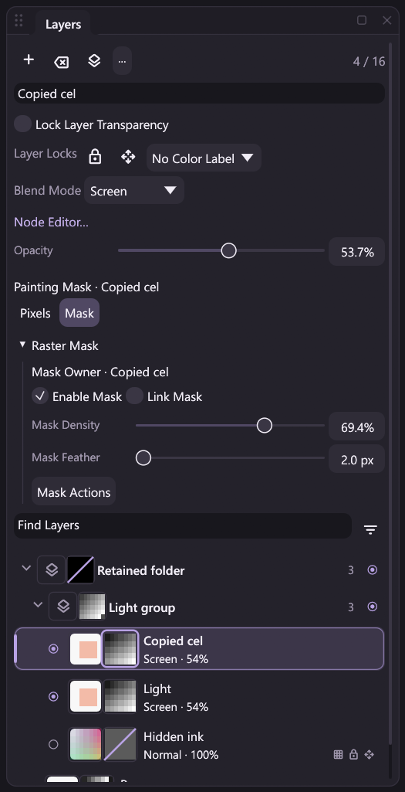

# Raster-mask owners: single-layer copy and delete

The registered `layer.duplicate` and `layer.delete` actions handle an individual
raster layer and its owned A8 mask as one structural edit. They also work when
that raster is inside an existing group or has no mask among other masked
owners. This extends [mask painting](raster-mask-editing.md) and
[document geometry](mask-canvas-geometry.md); it does not complete group, batch,
transform, merge or clipboard mask integration.



The reviewed Release capture shows the copy beside its retained source, with
separate raw-mask thumbnails and the copied mask as the explicit painting target.
Artist-owned names remain untranslated in all four interface languages.

## What is copied or removed

`layer.duplicate` reads one explicit `layer_id` or the existing active-layer
fallback. It inserts a fresh raster immediately above its source, in the same
parent, and makes that copy the sole selected and active layer. A multi-layer
selection does not widen this single-target action.

ID and index selectors honor mathematically integral JSON numbers, including
`2.0`. Supplying both still requires the same layer. These values are decoded
under the existing bounded integer schema rather than falling back to active;
the same rule covers selected-layer ID arrays, their optional active target,
layer movement and explicit new-layer parent selection.

The copy retains the source pixels, local visibility, opacity, blend mode,
custom name, color label and locks. Linked source filters are copied under
independent graph identities. If the source owns a mask, that mask receives a
fresh mask ID and the new layer owner while retaining enable/link/density/feather
properties and exact raw samples. Hidden owners, disabled masks and unlinked
masks are copied too. Dense samples are copied once into independent writable
storage; a uniform mask remains a scalar constant. Effective coverage is derived
for the new ID, rather than shared as a mutable source cache.

`layer.delete` removes only that raster, its source-filter branch and its owned
mask, if any. Unrelated layer/group masks, filters, raster buffers and folders
survive. Removing the last child does not silently delete its folder or group
mask. Active and selected-layer fallback retains the existing layer-editing
policy. The final raster still cannot be deleted. Existing free-graph reference
restrictions are unchanged.

## Paint target is explicit

Raster selection and the selected painting mask are separate state:

| Operation and previous target | Resulting paint target |
| --- | --- |
| Copy while Pixels is selected | Pixels |
| Copy while painting the source owner's mask | The fresh copied mask |
| Copy while another layer/group mask is explicitly selected | That unrelated mask |
| Delete the owner of the selected mask | Pixels |
| Delete while Pixels or an unrelated mask is selected | The previous target |

The Layers painting-owner feedback continues to identify an unrelated mask even
when the active raster changes. Undo restores the previous active layer,
multi-selection, target, owners, properties and samples together.

## One publication, Undo and verified outcome

The host first validates source storage, candidate owner IDs, layer/group graph
topology, renderer capabilities and independent raster/A8 budgets. Candidate
compilation receives the copied source's actual opacity, including partial
opacity inside groups. Hidden/disabled branches remain part of capability
preflight. An invalid candidate rejects before copied pixel/byte storage is
allocated or document state is published.

One history edit combines the raster toggle, optional mask toggle and composition
metadata. Deletion moves removed buffers into Undo ownership; duplication copies
only the chosen source buffers. Unrelated storage is retained. New/copied/restored
planes receive the required replay damage, deleted effect caches are removed,
and storage changes invalidate private contact leases.

A successful single-layer action publishes one revision and one verified outcome.
Ordinary Undo keeps allocated layer/mask IDs monotonic; a failed atomic pipeline
restores the exact checkpoint allocators and history. Renderer failure and partial
journal-write failure roll back document data, selection and targets. Failed
attempts can append a zero-change failure audit; a recording-write failure retains
the previous journal head. A workflow dry run leaves document state unchanged
and can append a successful zero-change audit. Atomic pipeline failure rollback
remains distinct from grouped Undo of a batch.

MICOPI04 projects and MCRPLY02 recordings keep their existing formats. Verified
outcomes restore recorded raw A8/RGBA and display surfaces without loading DLLs
or executing copy/delete commands. Default legacy document/recording behavior
retains its separate compatibility contract.

## Commands, nodes, MCP and headless

The actions retain the full Session-state result and add required schema fields:

| Action | Guaranteed result fields |
| --- | --- |
| `layer.duplicate` | `source_layer_id`, fresh `layer_id`, `mask_ids` |
| `layer.delete` | `deleted_layer_id`, `deleted_mask_ids` |

Mask-ID arrays contain zero or one stable ID, and are empty for an unmasked
source. They never require nullable-ID guessing. The same result fields become
workflow output ports and can supply later pipeline arguments:

```json
{"action":"pipeline.run","args":{"atomic":true,"steps":[
  {"id":"copy","action":"layer.duplicate","args":{"layer_id":2}},
  {"id":"name","action":"layer.rename","args":{"layer_id":{"$ref":"copy#/result/layer_id"},"name":"Cel copy"}}
]}}
```

After discovering that the source owns a mask, an AI/client can likewise bind
`copy#/result/mask_ids/0` to a later mask action. An unmasked source produces an
empty array, so callers must respect that distinction. Editing or dry-running a
workflow does not perform the copy. See the
[runnable owner example](../examples/automation/mask-owners.jsonl).

## Contacts and desktop drafts

Both actions require idle Brush and Hand contacts, for masked and unmasked
documents. Shared handlers return `stroke_active` before finishing a live contact.
Layers pending dispatch, static commands and dynamic argument forms preserve
that admission. Opening/cancelling a guarded argument draft and unrelated mouse
releases do not finish an external contact. Pending local name drafts remain
drafts while contact admission is rejected. Actual owned UP/CANCEL and existing
focus-loss behavior retain their input contracts.

Use the registered Duplicate Layer/Delete Layer commands or the single-target
Layers controls. Multi-selected Layers controls use `layer.batch`, which remains
guarded on mask-bearing documents. **Ctrl+J** still maps to `layer.via_copy`; that
separate selection-transfer action remains guarded here, including its
no-selection shortcut case. Ctrl+Shift+J/`layer.via_cut` is also separate.

## Costs and remaining boundaries

This is cold host-owned structural copying/removal. It adds no native ABI or
dependency, and no per-MOVE JSON, registry discovery, instance creation or
whole-image copying. Duplication needs one chosen RGBA output and, when dense,
one owned A8 output; retained sources, history, effects and recording have their
existing additional costs. Uniform masks still count their full logical area
for the 32-mask/64 MiB raw-A8 limit.

[Group creation and hierarchy movement](mask-group-editing.md) separately retain
all existing owners, raw planes and targets through one structural Undo/outcome.
[Group/subtree deletion](mask-group-delete.md) removes all consumed raster/group
owner masks through one compound history entry. Group/subtree duplication,
ungrouping, structural layer batches, Layer via
Copy/Cut, owner Move/Free Transform and layer rotations, merges/stamp/flatten,
clipboard mutations and group-mask Apply remain guarded where incomplete.
Clipping masks remain planned. The full [mask design](raster-masks-design.md)
and [roadmap](../ROADMAP.md) remain open.

Regression sources cover raw/metadata independence, target rules, compound Undo,
allocator limits, live contact continuity, rollback, schema bindings, project
roundtrips and DLL-free playback. Completed checks and limitations are recorded
in [Development](development.md); synthetic input does not establish physical
tablet compatibility or measured pen latency.
