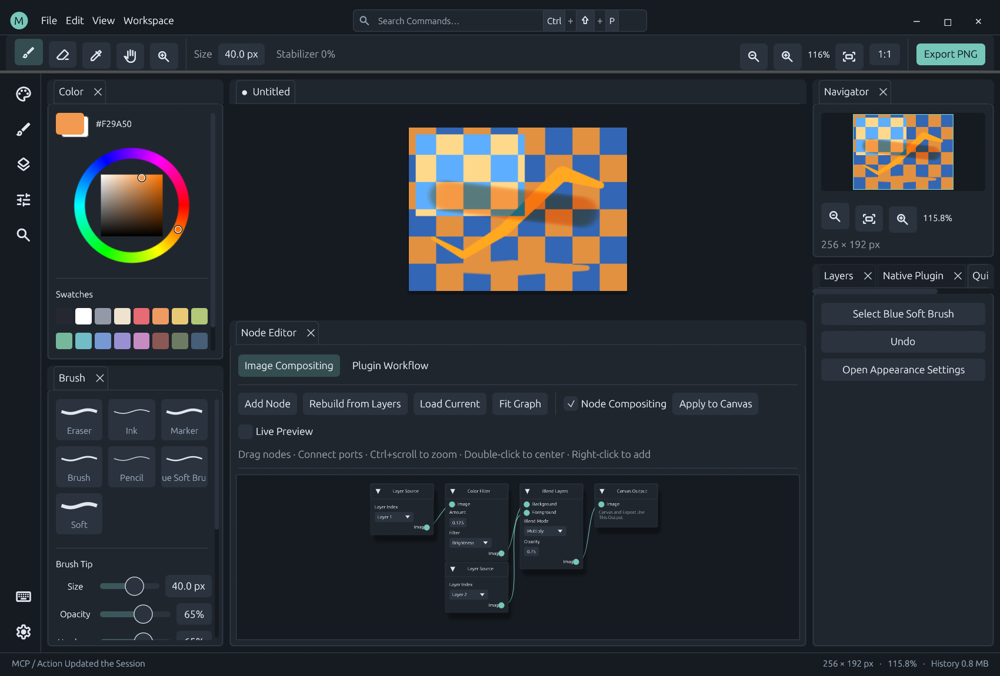

# Image Node Editor

The egui-snarl editor shares the workbench's theme, configurable spacing and docking. Each document stores an image graph and a separate plugin workflow graph.



## Editing

Open View > Node Editor, the Layers panel button or the command palette. The panel initially docks below the canvas and can be moved, grouped or floated. Select **Image Compositing**.

1. Rebuild from Layers creates a draft of the current layer stack.
2. Add Node or right-click to choose registered layer, filter, blend or output definitions.
3. Drag output ports to inputs. Filters accept one image; blending accepts background and foreground.
4. Edit parameters and Apply to Canvas. Optional Live Preview applies valid changes after a 300 ms pause. Moving positions alone does not force recompositing.
5. Disable Node Compositing and apply to restore the normal layer stack. Source pixels remain intact.

Drag headers to move nodes, Ctrl+scroll to zoom, double-click empty space to center, and use Fit Graph to see the graph. Right-click a node to delete it. Closing the editor does not disable effects. Unapplied drafts remain only in the current UI; projects store applied graphs. External edits or undo require Load Current before overwriting the graph.

Only layers connected to the output participate in enabled graph rendering. Source nodes honor layer visibility and opacity. Add a source and connection for a newly created layer. Blend modes on ordinary layers control normal stacking; image graphs use their blend nodes.

## Nodes and limits

| Node | Behavior |
| --- | --- |
| Layer | Read a source layer without changing pixels |
| Filter | Invert, grayscale, brightness, contrast or saturation |
| Blend | Normal, multiply, screen, overlay, darken, lighten, linear dodge or difference |
| Output | The unique canvas and export result |

Invert/grayscale strength is 0..1; brightness/contrast/saturation are -1..1; blend opacity is 0..1. Filters preserve alpha; blending uses straight-alpha source-over. Fully transparent composited pixels are canonicalized to zero. Spatial filters such as blur are not implemented.

An image graph has at most 64 nodes, 128 edges and one output. Cycles, duplicate inputs, missing required inputs, invalid layer references and parameters are rejected before changing the document. Unconnected drafts are allowed, but all nodes must remain structurally valid. Only dependencies of the output are compiled for rendering.

## Actions and plugin registration

- graph.catalog: image schema, supported filters/modes and registered node definitions.
- graph.read: applied graph, default layer graph, renderer availability and errors.
- graph.set: validate and apply as an undoable metadata edit.
- graph.open: emit the editor-open UI effect; headless does not create a window.
- layer.set: edit ordinary layer properties, including blend mode.
- document.nodes and compositing.graph: public state resources.

```json
{"action":"graph.set","args":{"graph":{"enabled":true,"nodes":[{"id":1,"node_type":"compositing.layer","kind":"layer","index":0,"position":[0,20]},{"id":2,"node_type":"compositing.filter","kind":"filter","filter":"invert","amount":1,"position":[240,20]},{"id":3,"node_type":"compositing.output","kind":"output","position":[480,20]}],"edges":[{"from":1,"to":2,"input":0},{"from":2,"to":3,"input":0}]}}}
```

Image definitions come from plugins/compositing/manifest.json and use binding.kind=image with a kernel operation and parameters_schema. Legacy graphs without node_type migrate to compositing.* IDs when applied. New aliases use existing kernel semantics; a new image algorithm requires extending the compositor implementation. JSON workflow nodes and image-buffer nodes have separate typed domains. See [Workflow Nodes](workflow-nodes.md).

The independent compositor DLL receives one dirty rectangle, immutable source layers and typed instructions. It processes the region without a full image allocation per node. Normal stacking retains its fast path. Graph properties and positions support undo/redo; MICOPI02 projects retain original layers and graphs and can read MICOPI01. See [Compositor Plugin](../plugins/compositing/README.md).
