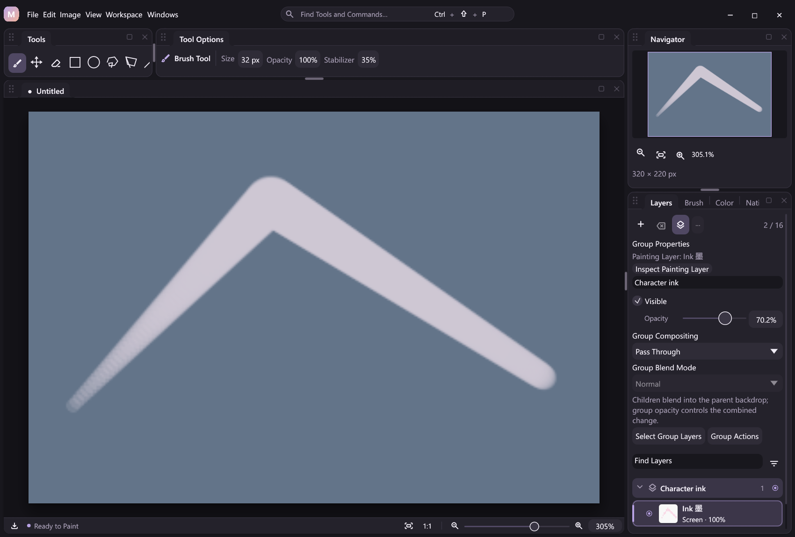
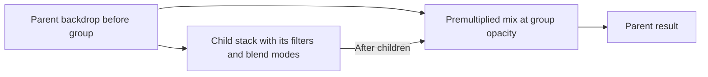

# Pass Through groups

Pass Through lets a group's children blend against the accumulated parent backdrop. The group then applies opacity once to the combined change. It is a separate group compositing policy; the 26 [color blend modes](blend-modes.md) keep their existing names, IDs and arithmetic. These are explicit MiCoPi rules inspired by familiar painting workflows, without a claim of bit-for-bit Photoshop parity.

New groups remain **Isolated** by default. Existing isolated projects retain their pixels and serialized defaults.



Adobe's [group blending guide](https://helpx.adobe.com/photoshop/desktop/create-manage-layers/apply-layer-effects/set-layer-opacity-and-blending-modes.html) is a functional reference for letting grouped children interact with lower layers. MiCoPi keeps its existing isolated default and specifies its own byte rounding below; no Adobe or PhotoCraft source is imported.

## Artist workflow

Inspect a group in the Layers panel and choose **Group Compositing > Pass Through**. Child blend modes now interact with artwork below the group in its parent. Adjust group opacity to fade the combined change. **Group Blend Mode** is disabled while Pass Through is active; its stored isolated mode is retained. Switching back to **Isolated** restores that mode.

For example, a Multiply child inside an isolated group first blends against that group's transparent base and lower children. In Pass Through, it also sees the accumulated lower siblings of the group. An isolated ancestor still defines an isolation boundary: Pass Through does not reach outside that ancestor.

Group inspection is separate from the active raster painting target. `group.inspect {"group_id":1}` opens the desktop properties for an explicit group ID without selecting its descendant rasters. The queued request is bound to the document identity, so opening another document cannot apply it to an unrelated group. Headless clients receive `ui_unavailable` and can use `group.query` and `group.set` directly. Painting, pressure and stabilization continue through the existing typed raster-tool path.

## Composition and opacity

Let `before` be the accumulated parent result immediately below the group. An isolated group composites its children over transparent zero, then applies its own color blend mode and opacity at the parent boundary. A Pass Through group instead starts its children at `before`, producing `after`, then interpolates the premultiplied `before` and `after` results once:



At full opacity the result is exactly `after`; at zero opacity it is exactly `before`. Opacity is not distributed among children. Empty and hidden Pass Through groups leave the parent unchanged. Child visibility and opacity flags remain local properties. Disabling node effects bypasses filters while preserving group policies and appearance.

Nested groups repeat these rules at each boundary. An isolated child inside Pass Through still composites its own children independently before blending into the current backdrop. A Pass Through child inside an isolated group sees that isolated group's current internal backdrop. Each enclosing opacity controls its completed change once.

The Mix instruction uses the stored byte opacity `t = round(opacity * 255)`. For input alpha bytes `ab` and `aa`:

```text
W = ab * (255 - t) + aa * t
output alpha = round_half_up(W / 255)
output channel = round_half_up((cb * ab * (255 - t) + ca * aa * t) / W)
```

The endpoint weights return the exact input words. Other weights produce canonical zero when rounded output alpha is zero. RGB divides by the unrounded `W`, retaining premultiplied interpolation when alpha is small. Integer arithmetic defines the rounding without a floating-point tie correction. Partial-opacity rounding can differ from an isolated gate even when the ideal color equations coincide; the isolated path retains its original alpha scaling and rounding.

## Shared actions, state and image nodes

Use a current group ID from `group.query` or a creation result:

```json
{"action":"group.set","args":{"group_id":1,"compositing":"pass_through","opacity":0.5}}
```

Set `compositing` to `isolated` to restore the retained group `blend_mode`. Both fields may be supplied through the shared schema; `blend_mode` controls the isolated boundary and remains stored while Pass Through is active. The same property action supports commands, schema-derived workflow nodes, MCP, headless execution, Undo/Redo and verified outcomes. Editing a workflow does not execute it.

Group records expose `compositing`, `mergeable` and `merge_error`. The hierarchy result exposes `pass_through_available`, requiring both transparent group bases and Mix support; `graph.read`, `graph.catalog` and public `compositing.graph` expose the independent `renderer_mix` capability. Capability availability and current merge eligibility are separate: contacts, final topology, budgets and rendering are still validated when executing an operation.

The Node Editor's **Actual Composition** view shows the real before/after group gates. The registered `compositing.mix` image node is **Backdrop Mix**, with `before` and `after` image inputs and `opacity` in 0–1. It is also available in explicit free graphs. Linked Layer Filters retain the raster/filter branch model; generated group topology remains read-only. Group trees and free compositing cannot be combined. See [Image Node Editor](node-editor.md).

## Baking boundaries

**Merge Group** rejects a Pass Through target because its children can depend on the outside backdrop. Switch the target to Isolated, or use **Merge Visible**, **Stamp Visible** or **Flatten Image** to bake the complete current result. An isolated group containing nested Pass Through children can be merged: its internal backdrop is bounded by the selected isolated group.

Grouped Merge Visible retains hidden raster branches and group skeletons, including Pass Through folders that become empty. Empty folders contribute no change. Revealing preserved hidden content later can interact differently with the baked root image, as with existing grouped baking. Ungroup removes the container's policy and opacity; it is not an appearance-preserving bake. See [Layer Groups](layer-groups.md).

## Persistence and native compatibility

Version-1 group trees remain isolated; the default `compositing` field is omitted from persistence. First opting into Pass Through promotes the tree to version 2. Explicitly switching back to Isolated retains version 2; Undo restores the historical policy and tree version, including version 1 before the opt-in. Unsupported versions and a Pass Through policy in a version-1 tree reject before restoration. Existing isolated metadata and recording hashes retain their defaults.

The existing compositor Features tail adds `COMPOSITOR_MIX` (`1 << 1`); `COMPOSITOR_TRANSPARENT` remains bit 0. Native kind 5 reads prior instruction slots `a=before` and `b=after`, with `mode=0` and finite `amount` in 0–1. The instruction and 16/24/32-byte x64 callback layouts remain unchanged. Old DLLs retain their supported isolated behavior and reject new Mix-dependent operations before publication. Hidden policies, disabled effects and disconnected explicit Mix nodes still require capability support.

Composition retains one dirty-region callback, fixed 64-word per-pixel scratch and no image-sized node intermediates. Generated Mix gates count toward the existing 64-instruction budget. Outcome replay restores recorded metadata and verified surfaces without executing the compositor; ordinary editing/rendering of these projects requires a supporting host and DLL. See [Native Plugins](native-plugins.md).

## Verification boundaries

The [automation example](../examples/automation/pass-through.jsonl) compares isolated and parent-dependent appearance, fades the completed change, restores the retained Screen mode and bakes an isolated group with identical pixels. From a portable package directory:

```powershell
New-Item -ItemType Directory -Force target/example-output | Out-Null
.\micopi-cli.exe run examples/automation/pass-through.jsonl --plugins plugins --config-dir target/pass-example-profile
```

It writes four PNGs into the output folder and uses an isolated profile. The first and baked isolated PNGs match exactly; the Pass Through results use the incoming parent backdrop instead of the retained Screen mode.

Native regression suites exercise exact endpoints, all alpha pairs at boundary weights, random colors, byte-weight conversion, dirty strides, aliases and rejection before writes. Session and desktop suites exercise nested policies, version transitions, merge restrictions, capability preflight, history, render/journal rollback, inspection and translated controls. `scripts/smoke-pass-through.py` provides transport and replay checks. Performance diagnostics are local measurements; physical tablet compatibility remains a separate hardware check.
