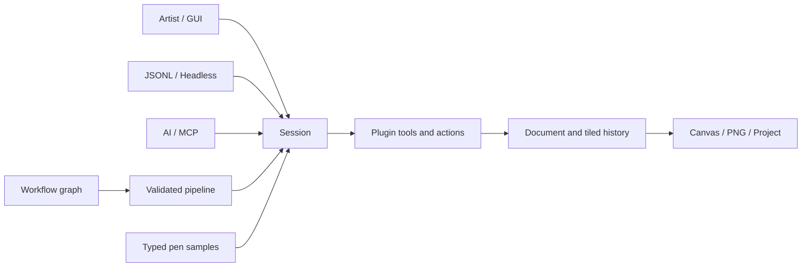
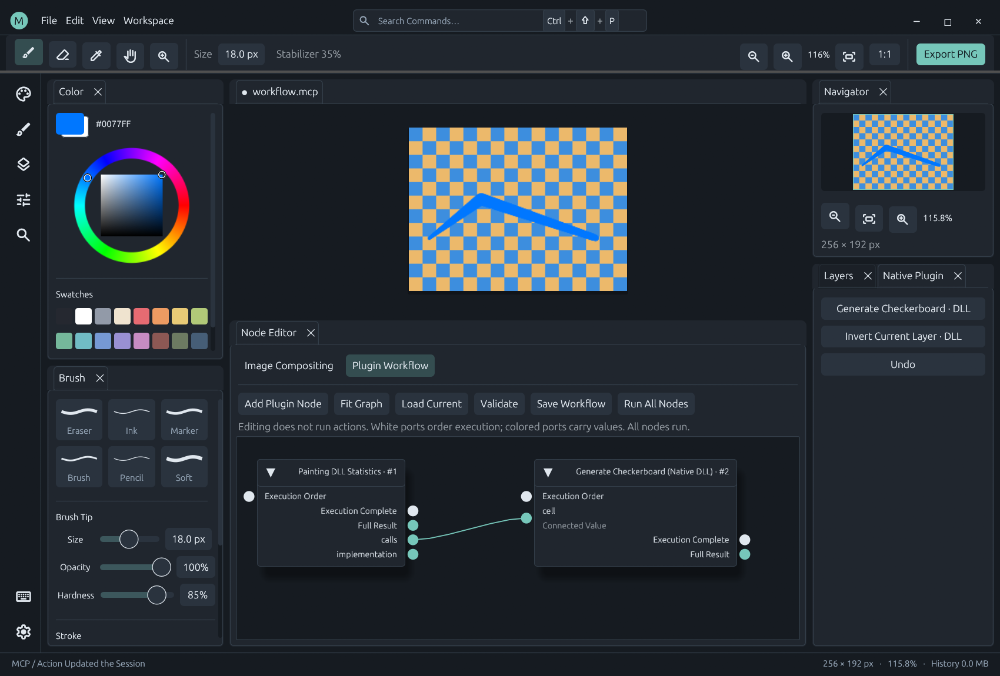
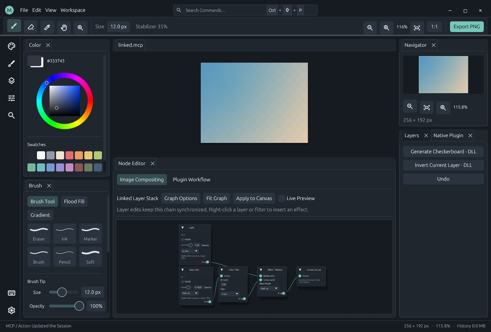
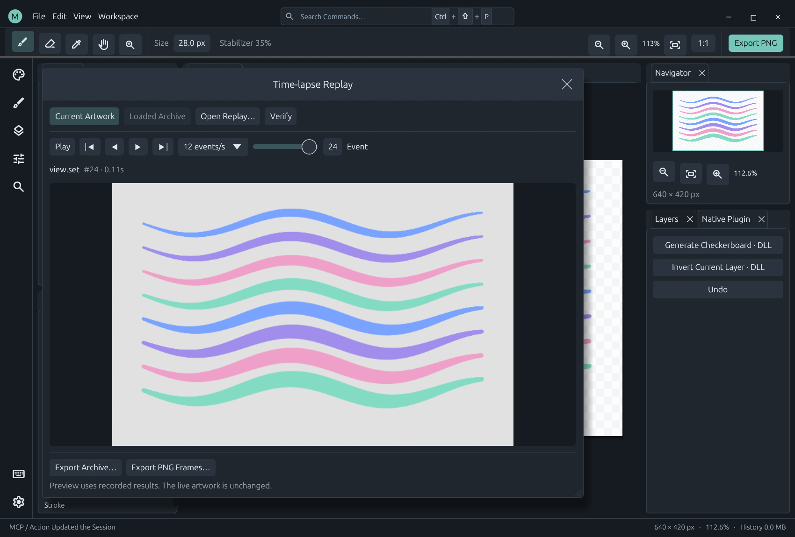

# MiCoPi: Painting First, Open to Automation

MiCoPi is a small native painting application built in Rust. Its central idea is that a good mark on a canvas and a programmable application should share the same foundation. Artists, plugins and AI clients operate on one document model, with different interfaces suited to their work.

The project takes inspiration from the immediacy of SAI, the panel flexibility of Photoshop and the discoverability of an editor. It does not aim to reproduce every feature of those applications. The current implementation is deliberately focused: responsive strokes, a configurable workspace, non-destructive composition and an explicit extension contract.

*An actual 0.19 development build. The checkerboard and pressure-sensitive stroke are produced through the same native plugins used by the desktop and automation tests.*

## 1. Protect the drawing path

Pen input is continuous and latency-sensitive. It should not pay for command discovery, JSON conversion or workflow compilation at every point.

MiCoPi routes drawing through a typed native tool interface. The painting DLL retains pressure, stabilization, interpolation and stroke state. The host lends the affected pixel region and records touched undo tiles. Display updates upload changed rectangles instead of replacing the whole canvas texture.

This is an implementation rule, not a claim of a particular frame rate or a guarantee for every tablet driver. Changes to the hot path should be measured and checked against pixel and history behavior.

## 2. Keep the host small and the boundaries clear

The host owns documents, history, validation, plugin lifecycle and presentation. Independent DLLs own tool and image-processing algorithms. Plugin packages live under `plugins/`; the C ABI SDK lives under `crates/plugin-api/`.

The desktop uses native Rust UI components and OpenGL presentation. Headless execution excludes the desktop stack. There is no required WebView, embedded browser, bundled language model or online translation service.

Smallness also means restraint: dependencies, full-image copies and background services need a concrete reason. A plugin system is not permission to move overhead into every brush sample.

## 3. Give every interface the same execution model

A mouse click, a command palette entry, a JSONL script and an MCP client should produce the same operation against the same Session. The GUI is a view and input adapter, not a second document engine.

The abstraction is shared; the transport is chosen for the job. Orchestration uses schema-described actions and typed result references. Continuous drawing keeps its specialized typed path. Neither needs a duplicate implementation of painting or history.

## 4. Make AI integration explicit and inspectable

AI-ready means an AI client can discover actions and schemas, inspect public state, create or patch a workflow, validate a plan and execute it through documented interfaces. It does not mean the application contains an autonomous assistant or sends artwork to a remote service by default.

Plugins expose named public state rather than sharing private memory. AI clients use stable IDs, parameter schemas, revision guards and execution reports. Display language never changes protocol identifiers or file paths.

Validation and dry runs help catch static mistakes. They do not predict every runtime error. Sequential execution retains completed operations after failure; atomic document groups roll back the group. The workflow UI defaults to atomic execution, while API clients opt in explicitly. These semantics should be visible to both people and automation; see [Atomic Operations](atomic-operations.md).

*A DLL-contributed state node supplies a typed parameter to an action. Editing this graph does not run either operation; execution is a separate user or API action.*

## 5. Treat nodes as a common language, with honest semantics

Image graphs describe non-destructive layer sources, filters, blending and output. Workflow graphs describe state queries and operations. Both are discoverable through plugin metadata, but image buffers and JSON values remain separate typed domains.

An image graph evaluates the dependencies of its output through a region compositor. A workflow executes all its nodes in topological order, with explicit ordering edges for side effects. These different semantics are documented rather than hidden behind similar-looking boxes.

*Source pixels remain available while the composition graph controls display and export.*

## 6. Keep the workspace under the artist's control

Panels can dock, float, split and form tab groups. Spacing, sizes, colors and shortcuts are configurable and searchable. English is the default language; Chinese, Japanese and Korean are supported without changing the execution contract.

Appearance and input preferences belong in `settings.json`. Dock layout is stored separately. Plugin definitions remain editable packages. A workspace should be easy to understand, change and recover without requiring the artist to edit source code.

## Current boundaries

MiCoPi currently targets Windows 10/11 x64 and one document per Session. It does not yet provide Wintab, off-canvas layer storage, clipping masks or a watercolor engine. [Raster masks](raster-mask-editing.md) support painting/effects and [document-wide geometry](mask-canvas-geometry.md); owner Move/Free Transform, structural edits, merging and clipboard integration remain incomplete. [Layer groups](layer-groups.md) use the same document, composition, action and replay foundation. Session and Windows image clipboard commands are implemented; native cross-application interoperability validation remains pending on the restricted test host. Native DLLs execute in process: their lifecycle and protocol are validated, but they are not sandboxed against crashes or memory errors. Actual pen-driver compatibility still requires hardware testing.

These are present capabilities and constraints. The [roadmap](../ROADMAP.md) separates intended work from implemented behavior; the [architecture](architecture.md), [SDK contract](native-plugins.md) and [workflow contract](workflow-nodes.md) describe the implementation in detail.

## Record operations as verifiable outcomes

Document operations share an append-only [replay journal](replay.md), including pen samples, plugin outcomes and undo/redo. Each event binds its predecessor and before/after state. Playback applies recorded tiles instead of executing commands again, so plugin changes and external side effects cannot alter the recorded picture. The typed input path batches recording work at stroke/segment boundaries. Integrity checking is distinct from digital signatures or authorship claims.

