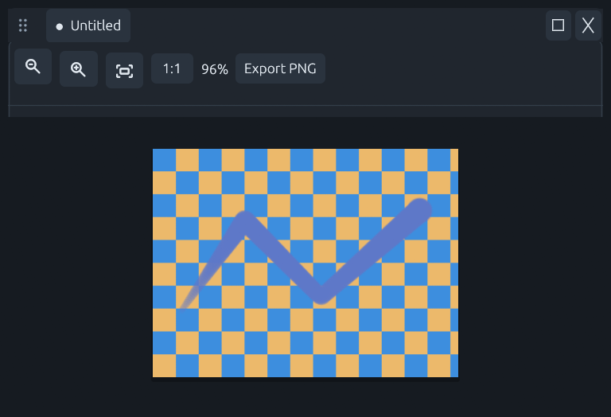
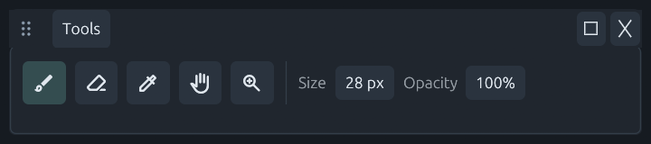
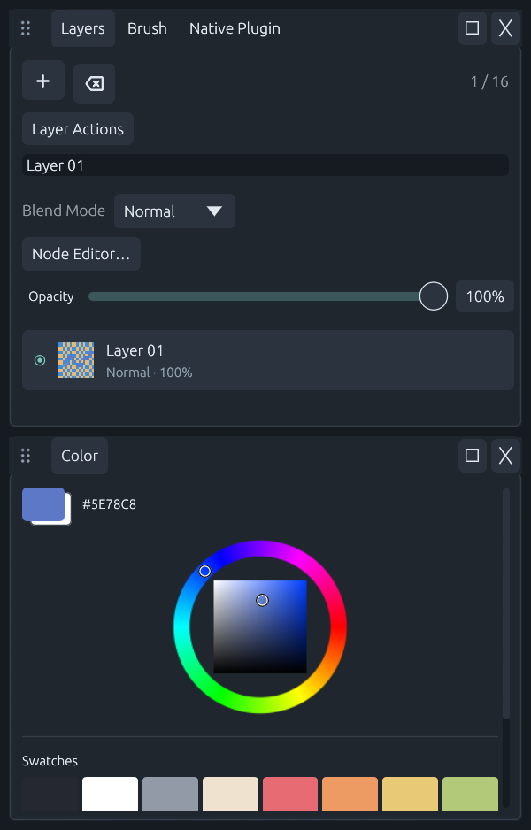

# Plugin windows and commands

Window contributions are owned by feature packages under `plugins/`: canvas, toolbox, color, brush, navigator and layers. The workbench provides shared layout, input routing, settings and command infrastructure. It does not own another painting document.

Each registered panel automatically contributes `window.<panel-id>.show`, `.hide`, `.focus`, `.float`, `.dock_left`, `.dock_right`, `.dock_top`, `.dock_bottom` and `.tab` actions. Native windows also register `.minimize`, `.maximize` and `.restore`. Tab grouping takes a `target` panel ID. `window.command` exposes the same operations with optional target, split fraction and floating desktop bounds. Disabled plugins do not register their windows or commands. Native DLL panel contributions use the same registration path.

`window.list` and the `workbench.windows` public state report available contributions, the last request/result and any desktop-reported actual layout. A desktop command initially returns `queued: true, applied: false`; clients inspect state for presentation completion. A headless runtime returns `presentation_unavailable` and never creates or claims to have moved a window. Presentation commands cannot participate in atomic document groups.

Every action is available to the desktop command palette and shortcut editor under a `plugin.<action-id>` binding ID. These IDs are distinct from existing Photoshop-style UI shortcuts. Plugin commands default to unbound, retain configuration while their plugin is unloaded, and join ordinary conflict validation when registered. Invalid plugin shortcut conflicts disable plugin bindings with an explanatory status while keeping commands available. Parameterized commands open an argument editor; edits do not execute actions. Execution uses schema validation and a document revision guard for mutations.

GUI rendering uses feature-owned, host-compiled adapters; drawing algorithms continue to use DLLs and the typed pen ABI. The canvas, toolbox, color, brush, navigator, layers, compositing, workflow, replay and workbench adapters live alongside their feature packages and use registered tools/actions. This is not an ABI that passes Rust or egui objects into arbitrary DLLs. Native plugins can contribute independent command-backed button panels through the existing descriptor API. Headless builds exclude egui rendering entirely.

## Workspace behavior

The default layout uses an independent Tools bar above a large Canvas window, with Navigator and property tabs on the right. Both Tools and Canvas can float, dock on any side, join a tab group or be hidden. Floating surfaces are **native operating-system windows** rendered by egui immediate viewports. Tools and Canvas each have their own top-level Windows handle and can move independently to other displays. Tab groups and split trees can share a native window. The main workbench remains the owner of the Session. Hiding Canvas keeps the document, pixels, undo history and plugins alive. The Windows menu lists registered contributions; tab context menus expose docking and grouping commands.





One Session owns document execution. Windows share the existing dirty-region document texture; moving a window does not copy a painting surface. Each HWND has an independent bounded Windows Ink queue and original window procedure. Pen positions are converted from that window’s physical client pixels through its own viewport scale; pressure, eraser flags and coalesced sample order are retained. Focus loss/capture cancellation ends the affected contact. Pressure and stabilization still use the typed DLL input path. The root workbench handles layout and input routing; feature UI source lives in `plugins/<feature>/panel.rs`. Settings and the command argument editor live in `plugins/workbench/`. Native DLLs can register command-backed panels, but arbitrary egui widgets are not dynamically loaded across the C ABI.

## State and event contract

`window.list.actual` reports open, active, floating and viewport-local logical-point bounds for each registered window. Floating entries also expose `native`: viewport identity, HWND, focus, minimized/maximized flags, current desktop bounds, pixels per point and the canvas image rectangle. HWNDs are transient process-local observations; do not persist them as automation targets. Use stable panel IDs for commands. Desktop coordinates may be negative on monitors to the left or above the primary display. Missing bounds are null. Requests are deferred to the UI frame and `last_result.status` becomes `applied` or `failed`. A successful queue response is not proof of presentation completion. `applied` means the layout/viewport request was accepted; wait for `actual.native.hwnd` when a client needs the newly created native window. At most 128 pending presentation requests are accepted; overflow fails before mutating request state. Layouts allow up to 32 surfaces and 128 unique windows.

Drag, split and resize changes settle for 750 ms before dispatching `workspace.layout.apply` with the normalized layout. This coalesces pointer movement into a command instead of recording every frame. The same action accepts a workspace snapshot from automation. It is a desktop presentation command, excluded from atomic document groups, with explicit headless unavailability. Presentation commands and observed window metadata participate in the existing compressed outcome journal; floating-point JSON parsing preserves exact values for hash verification.

Legacy workbench panel contributions are adapted in memory to independent feature packages. The original manifest is not rewritten. Before migrating a legacy workspace, the application creates `workspace.before-plugin-windows.json` once. Existing floating and intentionally hidden windows are retained; the old main left color/brush area is consolidated with property tabs.

## Configuration and invocation

Search Settings for **Control Bar** to set floating width and preferred docked height. Existing UI padding, tab height and control metrics determine window spacing and minimum split sizes. All registered actions appear in command search and shortcut settings; parameterized actions expose schema-driven argument controls and require explicit Run.

Examples for an attached GUI (replace `session.json` with its endpoint path):

```powershell
micopi-cli call window.command '{"panel":"canvas","operation":"float","x":160,"y":180,"width":900,"height":620}' --attach session.json
micopi-cli call window.command '{"panel":"toolbox","operation":"dock_top","target":"canvas"}' --attach session.json
micopi-cli call window.color.tab '{"target":"brush"}' --attach session.json
micopi-cli call window.list '{}' --attach session.json
```

Check the queued request via `window.list` before issuing dependent layout operations. Use `app.describe` to discover complete schemas and `workbench.windows` for plugin-visible state.

Native window placement and size use the existing workspace snapshot and quiet-period event compression. Maximized/minimized frames preserve the normal restore rectangle. Closing the main application retains the existing unsaved-document confirmation. Drag a group grip over another workspace or native viewport to dock it; dragging an individual tab out detaches only that panel.

`window.capture` takes `panel` and `path` and writes that native viewport directly from the OpenGL renderer, independent of window occlusion. Inspect `window.list.last_capture` for saved/failed completion. Screenshot capture is an explicit presentation/file effect and is unavailable in headless execution. The native smoke check verifies both dark and light render output without capturing the surrounding desktop.

## Owned palettes, group movement and native sizing

Floating canvases are owned by the main application window. Other floating panel windows are owned by the floating canvas, or by the main window when the canvas is docked/hidden. This keeps palettes above the application when its windows are activated. They do not use system-wide topmost placement. Ownership is reattached before an obsolete viewport is destroyed when docking or hiding a canvas.



Every docked or floating tab group uses one row: **grip · tabs · maximize/restore · close group**. There is no second floating title bar. Drag the six-dot grip to move the group, drag tabs within the row to reorder them, or drag a tab outside the row to detach it. Double-click a tab, or use **Group Actions > Float Panel Group**, to detach its complete tab group. In a floating window containing splits, each grip moves only its own tab group; the remaining groups stay in place. Right-click a grip or tab for docking and grouping commands.

Maximize expands a docked group inside the workbench and restores the previous layout on the next click. In a native window it uses OS maximize/restore. The row's close button hides only that leaf's tabs, preserving sibling groups. An OS close request hides the entire native window. Tab height, control height, item spacing and panel padding remain configurable in Settings.

`window.list.actual[].tabs` exposes leaf membership and `.header` exposes viewport-local logical rectangles for the grip, tab area and buttons. These observations support automation and do not enter document pixels.

Header clicks are covered by egui pointer-input tests. The native smoke check validates the single-row geometry and the underlying maximize/restore and leaf-close commands. Synthetic Windows button messages can be discarded on isolated desktops when the hardware pointer is outside the viewport; physical native clicking and dragging still require an interactive desktop check.

`window.command` accepts optional `scope: "group"` or `scope: "tabs"` (default `"panel"`). The row controls use `"tabs"`, which always means the current leaf. For a docked panel, `"group"` also means all tabs in its leaf. For a floating panel, `"group"` means the entire native window, including nested splits. Group float and directional dock operations preserve tab order, active tabs and split fractions. Group hide removes its members together. A group tab merge explicitly flattens its tabs into the target leaf. Targets within the source group are rejected before changing the layout. Individual tab moves accept an optional zero-based `index` in the destination leaf. `drag: true` continues a pointer gesture into a newly floated native window while the primary mouse button remains down.

Generated actions also expose `.float_group`, `.hide_group`, `.dock_left_group`, `.dock_right_group`, `.dock_top_group`, `.dock_bottom_group` and `.tab_group`. They use the same command palette, shortcut, schema and MCP pipeline as individual panel commands. `window.list.actual[].group` contains the member panel IDs.

```json
{"action":"window.command","args":{"panel":"layers","operation":"float","scope":"group"}}
{"action":"window.command","args":{"panel":"layers","operation":"dock_right","scope":"group","target":"canvas"}}
```

Native placement requests and observed geometry have separate ownership. Only creation or an explicit layout command changes the viewport builder's requested position/inner size. OS resize and DPI events update observed normal geometry for workspace persistence without issuing another resize. The native move/size loop also blocks quiet-period layout commits until the gesture ends. This prevents old asynchronous size observations from fighting a live border drag.

## Drag a group back into a workspace

Drag the dotted group title bar over a destination pane. Directional guides and a translucent preview show the docking result; the moving group displays the operation and destination name. Release over an edge/guide to attach the complete split tree. Release on the center guide or tab strip to merge its tabs. Empty workspaces accept the whole tree. Esc cancels docking; ordinary border resizing never initiates it. Releasing away from a guide keeps the window floating.

Native move-loop observations use desktop physical coordinates, converted through the destination viewport's pixel scale. Dock hit testing ignores the dragged window and skips cloaked/pass-through windows. Release resolves to a registered `window.command` with `scope: "group"` (or `workspace.layout.apply` for an empty main workspace), preserving existing atomic/presentation boundaries and replay behavior.

`window.drop` exposes the same hit testing and dispatch for automation: pass `panel`, physical desktop integer `x`/`y`, and optionally `target` to identify a destination viewport for background automation. Without a target hint, it resolves the visible window under the point. Read `window.list.last_drop` for `queued`, `resolved`, `no_target` or `no_source`; then inspect the ordinary command completion/layout state. Headless execution explicitly reports presentation unavailability. The smoke test uses a target hint because isolated rendering sessions cannot reliably control the hardware pointer; native move tracking, cancellation and negative coordinate fallback are covered by unit tests.

The visibility check follows the [DWM cloaking attributes](https://learn.microsoft.com/en-us/windows/win32/api/dwmapi/ne-dwmapi-dwmwindowattribute) so a window composed on a different desktop is not treated as a visible docking target.
