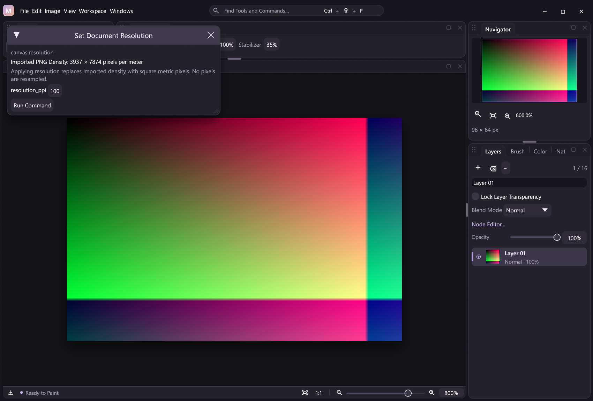

# PNG density and physical dimensions

PNG import, export, snapshots and recorded-state PNG output retain `pHYs` density. This is a physical-size/aspect-ratio contract, not ICC color management, print layout or a guarantee of how another viewer displays the file.

The implementation follows the [PNG physical pixel dimensions specification](https://www.w3.org/TR/png-3/#11pHYs). It preserves independent X/Y counts and the `meter` or `unspecified` unit. Valid axis counts range from 0 to 2,147,483,647. Zero counts and unspecified units remain intact for round trips; they do not establish a known physical size. Non-square density does not stretch the desktop's square-pixel canvas preview.

## Document metadata and commands

`canvas.info`, `canvas.state.document_info` and plugin state `core.document_info` expose:

| Field | Meaning |
| --- | --- |
| `resolution_ppi` | Editable nominal integer, 1–2400. Imported metric X density is rounded/clamped for this control; this scalar does not replace the original axes. |
| `png_density` | Optional exact imported `{xppu,yppu,unit}` record. |
| `resolution_source` | `png` when an exact imported record exists, otherwise `document`. |
| `physical_size_known` | Whether millimeters and per-axis PPI can be interpreted. |
| `resolution_ppi_x`, `resolution_ppi_y` | Per-axis PPI, present only when physical size is known. |
| `width_mm`, `height_mm` | Physical size, present only when known. Metric imports use their exact independent axes; document-defined sizes use nominal PPI. |
| `resolution_explicit` | Optional flag indicating a deliberately specified document resolution, including 72 PPI. |

For an imported metric record with both axes positive, PPI is `pixels_per_meter × 0.0254`; millimeters are `pixel_count × 1000 / pixels_per_meter`. Unknown physical size omits the corresponding values rather than inventing a print size. The nominal UI control remains available to set a known resolution.

**Image → Set Document Resolution** and `canvas.resolution` replace an imported record with square, metric document resolution. This does not resample pixels or masks. The parameter form shows the imported axes/unit and explains the replacement. Undo restores the original record; atomic rollback, native projects and verified outcome replay retain it too. Schema-derived state/action nodes, JSONL and MCP use the same contracts.

Document quarter turns swap imported X/Y axes in the same structural undo, including square uniform canvases whose pixels happen not to change. Layer-only rotation does not change document density. Flips, framing/crop and Image Size retain density; changing pixel dimensions therefore changes physical size. Free Transform likewise leaves document density intact.

## Encoding and compatibility

An imported raw record is emitted unchanged. Otherwise an explicit document resolution, or a nondefault legacy document resolution, writes square pixels-per-meter values rounded with `(ppi × 10000 + 127) / 254`. PNG stores integer counts, so reopening a generated metric PNG can report a slightly different exact PPI. Native projects keep the exact nominal integer.

An implicit legacy/default 72 PPI document has no density chunk and retains the exact previous PNG encoder path and bytes. An explicitly supplied `canvas.new.resolution_ppi:72` or `canvas.resolution:72` writes density. New metadata fields are omitted when absent/default, preserving old project/recording metadata and verification fixtures. Older hosts are not guaranteed to understand new density-bearing recordings.

Live PNG snapshots, exports, replay snapshots, PNG frame sequences and recovered image output share one encoder. Replay takes density from each recorded state's composition metadata, not the current document. Playback does not execute DLLs to restore a recorded image. PNG byte comparisons across *different* resolutions now differ legitimately; pixel comparisons remain exact.

## Bounded import and costs

PNG is recognized by signature, including renamed files. Before installing a decoded document, an 8 KiB streaming buffer checks every chunk through IEND, CRCs, IHDR dimensions, consecutive IDAT chunks, and density length, unit, range, duplication and ordering. Late or malformed ancillary density is rejected even if a general raster decoder would ignore it. Trailing bytes after IEND are rejected.

Supported imports are bounded to 4096 pixels per side, 256 MiB total encoded bytes, 4 MiB across ancillary chunks (including their framing), and 65,536 chunks. The decoder has a 256 MiB allocation budget; this is not a whole-process peak-memory guarantee. The strict pass reads the compressed file before the raster decode, adding cold I/O and CRC work. It does not allocate image-sized scratch or add work to pen MOVE. Existing JPEG/BMP decoding remains separate; their density is not imported in this phase. Animated PNG is still treated as a static image by the existing decoder, subject to these limits; no animation-editing capability is claimed.

Density output retains the same fast compression and adaptive filtering as the legacy path. Removing its one 21-byte `pHYs` chunk reproduces the exact legacy PNG, covered by varied-size/alpha/gradient/noise tests.

The pinned `png` crate was already present through `image`; direct encoder access adds no new package or compression backend. CRC scanning reuses the existing `flate2` dependency. No native DLL ABI or pixel algorithm changes are needed.

The [automation example](../examples/automation/png-density.jsonl) compares implicit defaults with deliberate density settings through PNG snapshots. Clipboard transfers remain pixel-only; this file/project contract does not change their external-resource semantics.

Use `scripts/smoke-png-density.py` for JSONL/MCP/desktop density, project/replay and four-language form captures. Core tests also retain old default bytes, unknown units/zero axes, density-boundary values, malformed chunks and failure state. The ignored `png_io_cost` release test measures a defined cold workload; its timings exclude file transport and pen hardware latency.

On 2026-11-05, one Release headless measurement of a 2048 × 2048 deterministic opaque noise image recorded legacy encoding 61.1 ms, density encoding 59.1 ms, strict in-memory scanning 2.3 ms and in-memory decoding 8.3 ms. Encoded sizes were 16,780,612 and 16,780,633 bytes. Source and decoded RGBA buffers each use 16 MiB; encoder/decoder internals, document composition/history, file I/O and recording costs are separate. These single-run observations are workload/environment-specific, not a speedup or pen-latency claim.

[PNG Export Sizing](export-sizing.md) now accepts pixel, physical and percentage output dimensions plus optional density overrides. New Canvas/Image Size physical-unit inputs remain planned in the [editing checklist](photoshop-essentials.md).
