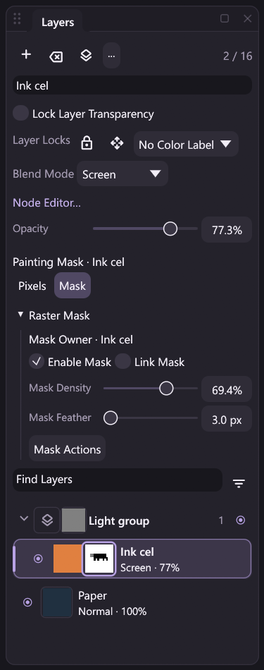

# Raster mask editing

MiCoPi supports a first public raster-mask editing subset: layer and group masks,
pressure-sensitive Brush/Eraser painting, non-destructive density and feather,
selection conversion, raw inspection and raster-layer mask application. The same
registered commands run through the desktop, workflows, MCP and headless clients.



*Reviewed Windows development capture at a 300-logical-pixel panel width. The
border selects the raw mask thumbnail independently of the active raster row.*

**Owner geometry and structural integration are incomplete.**
[Document-wide geometry](mask-canvas-geometry.md) transforms all raw masks with
the canvas, including hidden, disabled and unlinked masks. Mask-bearing documents
support [single-layer owner copy/delete](mask-owner-editing.md),
[group creation/movement](mask-group-editing.md), [subtree deletion](mask-group-delete.md)
and [subtree duplication](mask-group-duplicate.md). [Integer owner movement](raster-owner-movement.md)
and [owner/linked affine Free Transform](owner-affine.md) carry linked raw raster
masks or transform one independently. Group-mask geometry, selected-pixel
transfers, layer rotations, ungrouping, batches and merge/clipboard paths retain
their unsupported-domain guards. The full raster-mask
roadmap item remains unchecked. See [remaining boundaries](#current-boundaries)
and the complete [implementation design](raster-masks-design.md).

## Owners and painting targets

Each raster layer or group can own one canvas-sized A8 mask. Zero hides, 255
reveals, and intermediate bytes give fractional coverage. Owners are explicit
stable IDs: `{"kind":"layer","id":1}` and `{"kind":"group","id":1}` identify
different owners. Masks use their own positive, document-scoped stable IDs.
Committed Undo does not reuse an allocated mask ID; failed atomic execution
restores the previous allocator.

The painting target is either `{"kind":"layer_pixels"}` or
`{"kind":"mask","id":...}`. It is independent of the active raster layer,
multi-layer selection and inspected group. Selecting a group mask does not make
a child raster active. Returning to Pixels paints the current active raster;
it does not implicitly select the previous mask's owner. An explicit layer
selection, including selecting the same active layer again, returns to Pixels.
A multi-selection update without an explicit active layer preserves the target.
Adding a raster layer selects its Pixels target; structural Undo restores the
former mask target along with the previous active layer.

In Layers, the pixel thumbnail and adjacent grayscale mask thumbnail have
distinct target borders. Mask thumbnails sample the **raw** plane, so density,
feather and disable state do not replace that preview with derived coverage.
A disabled mask has an overlaid diagonal mark. The painting-target label names
the affected owner. Group inspection remains separate from the active raster.

The Raster Mask section creates Reveal All, Hide All or selection-derived masks,
switches targets and exposes enable/link, density, feather and mask actions.
Density/feather drags use a local draft and dispatch one property command on
release; stale document/revision drafts are discarded. Controls use configured
appearance spacing and localized presentation labels. Inspecting or drawing the
panel does not execute an editing workflow.

## Painting and whole-plane edits

Brush and Eraser use the existing native pressure curve, size/opacity dynamics,
spacing, interpolation and stabilizer. At DOWN, Brush freezes encoded-RGB
grayscale as `floor((54*R + 183*G + 19*B + 128) / 256)`. Eraser, including a pen
eraser, blends toward white (`255`), revealing the owner's pixels rather than
erasing RGBA alpha. A black brush hides and a white brush reveals.

For native effective dab strength `a`, the A8 update is
`floor((old*(255-a) + target*a + 127) / 255)`. The immutable fractional pixel
selection multiplies dab strength once. It clips mask painting exactly as a
selection input; it does not become the mutable document mask. Painting requires
a visible owner. Painting a disabled mask changes raw samples while its displayed
coverage remains fully revealing until it is enabled.

`mask.fill` and `mask.invert` edit the **entire raw plane**, regardless of the
current pixel selection. They retain enabled/link/density/feather properties.
`mask.from_selection` replaces raw samples with the current fractional selection;
an absent selection rejects rather than meaning Reveal All. `mask.to_selection`
uses raw samples by default, or enabled/density/feather coverage with
`effective:true`. These cold operations are distinct from selection-clipped
painting.

The cached contact fixes the native tool instance, target, selection and A8 loan
permissions at DOWN. It validates capabilities before opening document contact
storage. A lease carries document identity, mask ID, storage slot and epoch;
stale, cross-domain, read-only or reentrant loans reject. RGBA action loans do
not silently write into an A8 target. Pixel-only actions ask the caller to
return to Pixels. The mask plane is separate from the owner's pixel and alpha
locks; applying it to raw layer alpha requires those locks to be unlocked.

## Registered actions and public state

The Layers package registers these eleven commands. Argument schemas reject
unknown fields. IDs use the positive 32-bit stable-ID range.

| Action | Arguments and behavior |
| --- | --- |
| `mask.query` | Optional `mask_id`; inspect metadata, target, dimensions, allocator, capabilities, limits and current document `revision` |
| `mask.create` | Required tagged `owner`; `source` is `reveal_all` (default), `hide_all` or `selection`; `select` defaults to true |
| `mask.delete` | Required `mask_id`; remove the mask and return to Pixels if it was the painting target |
| `mask.set` | Required `mask_id`; optional `enabled`, `linked`, byte `density` (0–255), `feather_radius_px` (0–256); ownership is unchanged |
| `mask.target` | Required tagged `target`; a `layer_pixels` target takes no `id`, while a `mask` target requires one |
| `mask.fill` | Required `mask_id`, byte `value`; replace the complete raw plane |
| `mask.invert` | Required `mask_id`; replace every raw byte with `255 - value` through the native kernel |
| `mask.from_selection` | Required `mask_id`; replace raw samples from the active selection |
| `mask.to_selection` | Required `mask_id`; optional `effective` defaults to false; replace the pixel selection |
| `mask.snapshot` | Required `mask_id`; raw A8 rectangle with optional `x`, `y`, `width`, `height` |
| `mask.apply` | Required `mask_id`; bake effective coverage into a raster owner's raw alpha, then remove that mask |

The `layers.masks` state resource, its `state.layers.masks` workflow node and the
`raster_masks` field returned by `canvas.state` expose metadata and capabilities,
not full mutable sample arrays. For example, shared context discovery
uses `context.read` with `{"resources":["layers.masks"]}`. Query results expose
`capabilities.composition` and `capabilities.effects`; old compositors do not
silently approximate missing effects.

Typed painting also requires the painting DLL's A8-target capability, and an
active pixel selection requires its selection capability. Nondefault density or
feather requires compositor effects support; raw inversion requires that effects
tail even with default properties. Unsupported operations reject before publishing
new samples instead of running an RGBA or host-side pixel fallback.

`mask.query` and `mask.snapshot` are read-only and preserve active contacts,
history, events and document revision. Snapshot defaults are a 64 by 64 rectangle
at `(0,0)`. Requested sides are bounded to 256, origins must lie inside the
canvas, and the returned rectangle clips at the right/bottom edge. Its guaranteed
result fields are `mask_id`, `x`, `y`, `width`, `height`, `encoding:"a8"`, row-major
`samples` and the current document `revision`. At most 65,536 raw bytes are
returned, even for a 4096 by 4096 document.

Mutating mask commands require an idle contact and reject with `stroke_active`
without ending a local or external contact. Their contracts declare document
atomic capability. Ordinary mutations return `raster_masks` and `mask_id`;
`mask.target` guarantees only `raster_masks`. Create guarantees its newly allocated
`mask_id`, making it safe to wire directly into a later node's `mask_id` input.
Apply additionally guarantees `layer_id` and `bake_mode:"raw_alpha"`. Query
guarantees its complete metadata state and revision. Schemas distinguish these
guaranteed ports from optional result fields.

Workflow action nodes such as `action.mask.create` derive from the registered
action schemas; state nodes derive from the state schema. Editing a graph and
dry-running it remain inert. Dynamic result binding resolves IDs only when the
workflow executes. Use the shared `expected_revision` run guard when acting on
a previously inspected document, and `atomic:true` for rollback of a supported
document batch. This is separate from generated image-composition nodes.

## Non-destructive effective coverage

Raw samples remain unchanged when properties change. Disabled masks contribute
constant 255. Enabled masks feather first, then apply density. For radius `R`,
the three integer box radii are:

```text
a = floor((R + 2) / 3)
b = floor((R + 1) / 3)
c = floor(R / 3)
passes = H(a), V(a), H(b), V(b), H(c), V(c)
```

Each pass extends the canvas by clamping to its edge, and rounds its byte mean
half-up: `floor((sum + r) / (2*r + 1))`. A radius-zero pass is the identity.
The total influence is exactly `R` along either axis, not `3*R`. The approximation
is deterministic; it is not a claim to use Photoshop's feather kernel. An
all-white mask stays white at canvas edges.

For feathered byte `f` and density byte `d`, effective coverage is
`255 - floor(((255-f)*d + 127) / 255)`. Density zero reveals everything; density
255 preserves the feathered result. Parameter edits invalidate a complete
effective plane. Painting invalidates only the raw dirty rectangle expanded by
`R`, clipped to the canvas; the native callback reads that output region's
required halo and writes only the requested output.

Layer masks gate the enabled source-filter result and combine layer opacity
once. An Isolated group's mask gates its completed internal result. A Pass
Through group's mask gates the completed before/after change with group opacity
once. Disabling source filters retains these gates. Generated Actual Composition
uses typed coverage ports; editable Layer Filters remain separate source data.

Raw storage is bounded to 32 masks and 64 MiB of logical A8 samples. Derived
effective planes have a separate 64 MiB bound. Uniform planes avoid dense storage
until needed. One cached native effects instance reuses at most 32 MiB of logical
byte scratch plus a 16 KiB `u32` column workspace at the 4096-pixel side limit.
These are separate budgets, not a bound on total application memory, history or
cold staged outputs.

At uniform-mask DOWN, the host reserves native scratch capacity without resizing,
zeroing or evaluating a full-frame feather kernel. It materializes raw and
effective constant storage once using the already prepared uniform coverage.
Later MOVE calls reuse the cached instance, scratch, dirty regions and byte
tiles. They do not serialize JSON, perform discovery/file I/O, create instances
or clone whole-mask storage per sample. Region processing is limited to the
demanded output and halo; a large brush/radius can make that region span the
canvas. Dense cold rebuilds can also require full-frame work.

## Apply is raw-alpha baking

`mask.apply` accepts raster-layer owners only. It stages the owner's raw pixels
with effective mask coverage, removes that mask, and preserves source filters,
layer opacity/blend mode, active layer and the selected-layer set. Group masks
reject because applying them requires a separate subtree-baking operation.
Pixel and transparency locks reject before publication.

The native bake uses `floor(raw_alpha * effective_coverage / 255)` with opacity
255 for the bake itself. RGB is retained while the new alpha is nonzero; zero
alpha produces the existing transparent-zero word. The layer's retained filters
and opacity run later. This is not an appearance-preserving flatten operation.
Even without filters, 8-bit quantization can change the displayed result: raw
alpha 255, coverage 128 and opacity 137 produce live alpha 69 by combining
coverage/opacity first; raw-alpha baking produces 128, then the retained legacy
opacity path produces 68. Undo restores the original raw pixels and mask.

## History, persistence and current boundaries

A mask contact retains the existing per-successful-sample Session revisions and
uses one stroke Undo entry. Verified outcomes use bounded provisional segments,
finalized at the contact boundary; recording boundaries may flush while the native
contact remains active. Each touched 64 by 64 A8 tile is captured once, in a mask-ID
namespace separate from RGBA layers. Whole-plane/property edits use the ordinary
Undo/Redo stack; create-from-selection and its target choice are one grouped
creation edit. Target selection is recorded metadata without its own pixel Undo
entry. Capability, render or journal failure restores samples, metadata, target,
allocator, revision and history through the shared checkpoint path.

[MICOPI04 projects and MCRPLY02 mask events](raster-mask-storage.md) persist raw
planes and metadata. Effective caches and native scratch are derived and are not
serialized. Verified replay restores the recorded A8/RGBA outcomes and display
surface without loading the native tools/compositor or re-executing commands.
Normal live editing/opening still preflights renderer capabilities, including
properties on hidden or disabled masks.

## Current boundaries

[Raster-owner integer movement](raster-owner-movement.md) supports whole layers
with linked masks, independent raw raster masks and pixel-selection outlines.
It preserves unrelated raw planes and commits one compound Undo/outcome.
[Owner affine Free Transform](owner-affine.md) adds exact raster sets and
independent raw raster-mask targets, with one union mapping and captured repeat
scope. Its runtime validation is pending CI.

The following remain guarded with `mask_editing_pending` while mask items exist:
group-mask movement, selected-pixel movement and layer rotations,
ungrouping, owner transfer, batch layer edits,
merge/stamp/flatten and cut/paste. Their mutation plans/previews are guarded too.
Mask-aware layer ordering is supported; the guard is not a promise that every
structural action is disabled or complete. Selection operations, supported
ordinary pixel edits with the Pixels target, inspection, composition properties,
export, project persistence and verified replay retain their own contracts.

Canvas framing/crop, document rotations/flips, Image Size and Trim stage every
raw plane with layers and pixel selections before one Canvas Undo/outcome.
Expansion fills new mask space with revealing white; numeric feather remains
fixed in canvas pixels. Shared geometry/Image Size plans are read-only during
contacts, while mutations reject active Brush or Hand contacts. See the
[geometry contract](mask-canvas-geometry.md) for native capability, separate
budgets, cache damage and byte-rounding details.

Plain [single-layer owner duplicate/delete](mask-owner-editing.md) carries raw
masks, source properties and target rules through one compound Undo/outcome.
[Group creation and hierarchy movement](mask-group-editing.md) retain every
existing owner, raw mask, target and selected/active raster ID, with shared
source/candidate preflight and one structural Undo/outcome. [Group/subtree
deletion](mask-group-delete.md) removes only consumed owner masks, with explicit
target/selection fallback and one compound history edit. [Subtree duplication](mask-group-duplicate.md)
creates fresh independent raw planes and maps owned targets/copied selection under
one compound history/outcome. Owner projective/copy transforms, group-mask
geometry, ungrouping, batch structure, Layer via
Copy/Cut, complete merge/clipboard handling and clipping masks remain planned. The current native,
host, transport and UI fixtures test their stated scopes; synthetic pen input
does not establish physical tablet/driver compatibility. Final delivery evidence
belongs in [Development](development.md) and the [Changelog](../CHANGELOG.md),
without treating pending validation or the full design as completed work.
