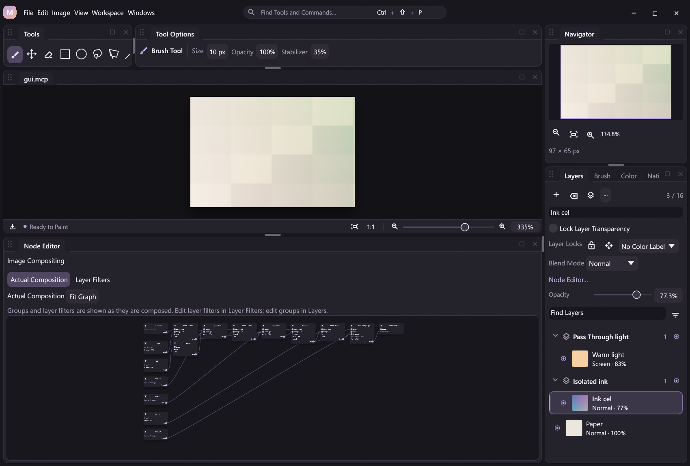

# Raster mask storage and verified outcomes

The document foundation for raster masks is implemented: stable ownership, raw A8 planes, byte-tile Undo, mask-aware image composition, a binary project payload and verified replay. This guide specifies delivery gate 2 of [Raster Masks Design](raster-masks-design.md), following the [native A8 prerequisites](native-plugins.md#optional-native-mask-composition). The first [public editing subset](raster-mask-editing.md) now builds on that foundation.

The public subset includes registered mask actions/state, pressure/stabilized A8 contacts, density/feather effects, Layers target/property controls, [document-wide geometry](mask-canvas-geometry.md), plain [single-layer owner copy/delete](mask-owner-editing.md), [owner-preserving group creation/movement](mask-group-editing.md), [subtree deletion](mask-group-delete.md), [subtree duplication](mask-group-duplicate.md), [integer owner movement](raster-owner-movement.md) and [owner affine Free Transform](owner-affine.md). **Group-mask geometry, selected-pixel transfers, ungrouping, batches and merge/clipboard integration remain incomplete.** The full raster-mask feature item stays unchecked; [temporary editing boundaries](#temporary-editing-boundaries) continue to protect mask-bearing documents from unsupported edits.



This real foundation-stage Release capture predates the editing controls. It shows a loaded regression project with layer, Isolated group and Pass Through group masks, with generated Actual Composition gates. The fitted graph is an overview; zoom in to inspect its typed coverage ports.

## Ownership and limits

`application::Session` remains the mutable document owner. `engine::Document` owns metadata, raw sample storage, history and verified surfaces. Painting and composition algorithms remain in native plugins. Mutable raster planes are independent of the immutable compressed `selection::Mask` used for pixel selections.

`Composition.raster_masks` contains a version-1 `MaskState`:

| Field | Meaning |
| --- | --- |
| `version` | Required; currently `1` |
| `items` | Required list of `MaskMetadata`, sorted by increasing mask ID |
| `next_id` | Required allocator; `0` only for unused default state |
| `target` | `{"kind":"layer_pixels"}` by default, or `{"kind":"mask","id":...}` |

Each item has a positive mask `id` and an explicitly tagged `owner`: `{"kind":"layer","id":...}` or `{"kind":"group","id":...}`. Layer and group IDs occupy different namespaces, so layer 1 and group 1 may each own a mask. An owner has at most one mask. Mask and owner IDs use the existing positive 32-bit stable-ID range; the mask allocator can advance one past that range to represent exhaustion.

Item defaults are `enabled: true`, `linked: true`, `density: 255` and `feather_radius_px: 0`. Those defaults and the default target are omitted when serialized. The entire `raster_masks` field is omitted only when its version, empty items, unused allocator and target are all default. Explicit metadata requires `version`, `items` and `next_id`; unknown fields are rejected. No raw byte samples enter composition JSON.

Committed Undo retains the highest allocated mask ID, including after the last mask is removed. A failed atomic operation restores its exact previous allocator. Verified outcome restoration also restores the recorded allocator exactly, independently of the current document's later allocations.

The bounds are:

- At most 32 masks, with one plane per metadata ID in the same sorted order.
- Canvas dimensions from 1 through 4096 pixels per side.
- At most 64 MiB of logical A8 samples across masks, using checked `width × height × count` arithmetic. This is separate from the existing raster-pixel budget.
- Density stored as a byte and feather radius bounded to 256 pixels; evaluating nondefault properties requires the optional native effects capability.

Every raw mask has the current canvas dimensions. Zero hides and 255 reveals. `SamplePlane::Uniform(u8)` stores a constant plane without a frame-sized allocation; `Dense(Vec<u8>)` stores exactly one byte per canvas pixel. Uniform storage still consumes its full logical sample budget. Raw planes, effective-coverage caches and contact leases are separate responsibilities. Derived coverage has a separate 64 MiB logical bound and is never serialized as raw state.

## Engine edits, contacts and history

Cold engine helpers create/delete masks, update metadata, replace an entire plane and choose a paint target. They validate ownership and dimensions; renderer-dependent mutations also preflight composition/capability requirements before publishing changes. The registered public handlers in `src/plugins/raster_masks.rs` use these helpers through Session rather than maintaining a second writable document.

`begin_mask_stroke(id)` resolves a visible owner and materializes a uniform plane once at DOWN. The host prepares capabilities/options first, then reserves native halo capacity without running a full-frame feather kernel and materializes any constant effective cache once. Its cached `MaskLease` carries document identity, mask ID, direct storage slot and storage epoch. Each new contact advances the epoch, including when an existing dense allocation is reused; a lease from a previous contact cannot become valid again. Storage replacement, removal or restoration invalidates leases independently of content revisions.

`prepare_mask_region` and `mask_region` use scalar lease checks and a direct slot. A scoped `A8Pixels` descriptor carries byte length, dimensions, stride and canvas origin for the synchronous native loan. Callers must not retain its pointer or reenter the document while using it. No per-MOVE metadata serialization, discovery, file I/O or whole-plane copying is introduced. The dense pointer stays stable for that contact.

The existing `Edit` and Undo/Redo stack now have an independent `(mask_id, tile_index)` byte namespace. Each touched 64 by 64 tile is captured once per contact, including exact smaller edge tiles. RGBA layer indices and the composite-surface sentinel are unchanged. Mask edits use content revisions and ordinary document damage regions, while replay has a separate dirty-byte-tile set.

Structural create/delete/replace history owns removed planes through shared immutable history records. It moves dense allocations instead of embedding samples in composition snapshots. Atomic checkpoints share byte cells and history records; they do not clone a full live plane for every operation. Failed publication restores the raw samples, metadata, target, allocator, contact state, history and verified composite. Restoration reuses compatible dense allocations, retains uniform planes and never invokes a renderer or a DLL command. [Subtree deletion](mask-group-delete.md) retains several removed mask slots in one shared immutable structural record. Direct engine Undo takes ownership when unshared. Ordinary Session Undo creates a rollback checkpoint that pins preexisting history, so restoration clones affected dense planes before later mutable edits; an atomic pipeline beginning with Undo has the same isolation cost. These cold restoration copies do not enter the typed pointer path.

Paint-target selection is metadata without a separate pixel Undo entry. Explicit `layer.select` and `layer.selection.set` with `active_layer_id` select layer pixels, including when the same layer is already active. A multi-selection change without an explicit active layer preserves the paint target. Existing RGBA loans reject a mask target with `mask_target_pending`; they do not silently redirect writes into A8 storage.

The typed Session Brush/Eraser route now lends A8 storage using the cached lease and native instance. Pressure, stabilization and frozen fractional selection clipping remain in the painting DLL; Eraser reveals toward 255. Fill/Invert replace the entire raw plane independently of the pixel selection. Queries and bounded snapshots preserve active contacts; mutations reject them without finishing the contact. See [Raster Mask Editing](raster-mask-editing.md) for the eleven actions and their guaranteed workflow result ports.

## Generated composition

Masks require linked layer/filter composition and a compositor with the optional mask capability. The host compiles generated `MaskSource`, `ApplyMask` and `MaskedMix` nodes with typed coverage ports and stable mask IDs. Source Layer Filters remain editable source data; generated Actual Composition is a separate view and cannot be submitted as that source graph.

A layer's enabled mask gates its filtered result and combines with layer opacity once. An isolated group mask gates the completed isolated result. A Pass Through group mask gates the completed before/after change with group opacity once. Disabling source filters preserves the mask and group composition gates. Disabled masks reveal fully. Composition passes fixed-size effective-coverage descriptors through cached slots; it does not materialize uniform masks or rebuild JSON per damage update.

Generated masks retain the existing graph bounds, including 64 nodes and the native instruction/value budget. A flat stack of sixteen masked rasters without extra filter nodes fits the 64-node bound; additional filters or nested boundaries can exceed it and are rejected before mutation. Preflight validates coverage/image port domains, owner identities, dimensions, capabilities and declared modes, including hidden and disabled branches.

Rendering supports native feather-first density effects through the optional 72-byte compositor tail and capability `0x8`; default properties still use the unchanged 40-byte mask prefix. A compositor without effects rejects nondefault properties before live publication, including hidden/disabled masks. The exact three-box approximation, density rounding and support radius are specified in [effective coverage](raster-mask-editing.md#non-destructive-effective-coverage). Raw edits dirty the affected output expanded by exactly the declared feather radius. Parameter changes invalidate a full effective plane. Caches are reusable derived data, independent of raw history and replay.

Raw engine project load/save remains archival and DLL-independent; normal Session project publication preflights renderer capabilities and supported effects. Replay can display a recorded verified surface without evaluating effects. `mask.apply` is a cold staged raw-alpha bake for raster owners, retaining source filters and opacity; it can round differently from live coverage/opacity combination and does not implement group subtree baking.

## MICOPI04 project format

Projects that have ever allocated mask state use the eight-byte ASCII magic `MICOPI04`, including allocator-only state after the last mask is deleted or its creation is undone. A document whose mask state has never been used retains the exact MICOPI02 writer path without a recording and MICOPI03 path with a recording. Existing MICOPI01/02/03 files remain readable. Older project readers reject the new magic rather than silently dropping masks.

All integers below are unsigned little-endian. The existing raster prefix is retained:

```text
magic                         8 bytes: MICOPI04
width, height                 u32, u32
raster_count, active_index    u32, u32
for each raster:
    visible, opacity          u8, u8
    pixels                    width * height * 4 bytes, existing u32 encoding
metadata_length               u32, at most 1 MiB
composition_metadata          metadata_length bytes of UTF-8 JSON
mask_count                    u32, equal to metadata item count
for each mask in metadata ID order:
    mask_id                   u64
    encoding                  u8: 0 = uniform, 1 = dense A8
    payload_length            u32
    payload                   1 byte for uniform; width * height for dense
replay_length                 u64, at most 1 GiB; 0 means no recording
replay                        replay_length bytes
```

Every expected ID must occur exactly once and in order. The loader rejects unknown encodings, wrong sample lengths, missing/extra/duplicate IDs, invalid owners/targets, overflow, excessive logical samples, truncation and trailing bytes. Raw A8 payloads are outside the 1 MiB metadata block. Signature detection and native-project destination protection recognize MICOPI04.

On the cold save path, an all-constant dense plane is written with the same one-byte uniform encoding as a uniform plane. The writer scans without allocating another image or changing the live plane, its pointer, content revision, history or dirty regions. This prevents a no-op/materialized or undone stroke from expanding a uniform project plane to a full frame on disk. Arbitrary dense samples remain raw bytes in this project payload.

Saving validates every plane before creating a replacement file. It writes a same-directory temporary file, syncs it and uses the existing atomic replacement path. An invalid mask state or failed replacement does not overwrite an existing project. Session saves additionally rescan all raw A8 tiles at the full verification boundary and validate the embedded recording's final raw planes against the project when opening it.

## Replay extension

The archive magic remains `MCRPLY02`. Events have an optional `mask_version: 1` marker and separate `mask_changes`, keyed by stable mask ID and tile index. The marker is required when current or previous metadata has used mask state, including allocator-only events. Unused defaults omit both additions, preserving historical event bytes and hashes. Older strict event readers reject the extension instead of ignoring it.

Byte blocks use bounded canonical Base64, uniform one-byte storage, references to earlier A8 changes in the same event and sparse XOR deltas against the same mask/tile in the previous frame. A8 and RGBA reference tables never overlap. The existing archive Deflate compression and journal limits remain in force: 1 GiB per archive, one million events and 512 MiB decoded per event.

Replay state shares immutable byte tile cells. The state digest adds the separate `MiCoPi/A8-state/v1` domain, sorted mask IDs and byte-cell digests only when masks exist. Allocator-only state is still present in metadata. Unchanged A8 grids survive raster-count replacement; a canvas-dimension change requires complete new mask coverage. Metadata removes deleted mask IDs, and new IDs require all their tiles. Edge lengths, duplicate tiles, invalid/forward/cross-namespace references, unsupported markers and backwards allocator movement are rejected before publication.

Playback, checkpoint rollback and embedded-history matching include the raw A8 planes as well as metadata, layers and the recorded surface. Playback restores verified samples and pixels without loading tools/compositor DLLs or executing actions again. Journal failure tests cover partial writes, rewind and continued verification.

## Temporary editing boundaries

[Raster-owner integer movement](raster-owner-movement.md) now stages one linked
RGBA/A8 pair or one independent raster-owned plane. Its raw-only compound history
edit restores bytes without changing composition metadata. Selection-outline
movement preserves every raw mask; selected-pixel and group-mask moves stay guarded.

Existing mask-unaware operations reject a document with mask items before changing it. Session reports `mask_editing_pending`; lower-level document publication and mutable geometric loans also have guards. Rejection happens before completing an active Brush or Hand contact.

[Owner affine Free Transform](owner-affine.md) stages exact raster scopes and independent raw raster masks with a saved scope/recipe and one grouped Undo/outcome. Its runtime validation is pending CI. The guarded families include selected-pixel movement, group-mask movement, owner projective/copy transforms, layer rotation and Layer via Copy/Cut transfers, batch layer edits, ungrouping, merges/stamp/flatten and cut/paste transfers. Corresponding mutation plans/previews are guarded as well. Switching to an unlinked image graph is rejected. Each unsupported boundary is removed only as its operation gains mask-aware atomic staging, history and verified outcomes.

[Document-wide geometry](mask-canvas-geometry.md) is mask-aware: canvas sizing/crop/Trim, document rotations/flips and Image Size stage every raw plane with the new frame, independent of enable/visibility/link flags. Publication and Canvas Undo/Redo invalidate derived coverage and mark the complete raw-A8 replay grid, including same-size permutations. Read-only plans preserve live contacts; geometry mutations require idle Brush and Hand contacts. Legacy mask-unaware geometry publication helpers retain their lower-level guards.

Ordinary permitted pixel edits with the layer-pixel target, read-only inspection, selection operations, supported composition properties, mask-aware layer ordering, export, project persistence and verified replay retain their own contracts. Presence of a mask does not grant RGBA pixel permissions or bypass layer locks. Mask-plane contact permission is separate from RGBA access declarations; applying a mask to raw alpha checks pixel and transparency locks.

## Verification and next gate

Focused regressions cover metadata namespaces/budgets, byte tile boundaries and pointer reuse, structural Undo and monotonic IDs, no-effect preflight, target selection, allocator rollback, constant/dense project equivalence, malformed payloads, graph domains/budgets, exact masked layer/group composition, old wire hashes, byte deltas/references, DLL-free restoration, journal failure and embedded raw-plane matching. They live in `src/engine/raster_mask_tests.rs`, `src/engine/replay/mask_tests.rs`, `src/engine/mask_graph_tests.rs`, `src/engine/mask_composition_tests.rs` and `src/application/raster_mask_tests.rs`.

`scripts/smoke-raster-masks.py` independently writes the binary fixture, compares integer layer/group references across JSONL, MCP and the desktop, checks safe rejections and unchanged raw planes, then verifies saved projects and DLL-free replay. It also tests previous-host rejection when `--baseline-cli` is available and captures English, Chinese, Japanese and Korean Actual Composition views. See [Development](development.md#raster-mask-document-foundation-checks) for measured storage and binary costs.

The editing subset adds native effect/reference/reservation tests, typed contact routing, workflow/result binding, raw-alpha application and compiled target/property tests. Its focused transport check is `scripts/smoke-mask-editing.py`; document geometry has separate raw-reference, contact, failure and transport checks in `scripts/smoke-mask-geometry.py`. Actual delivery evidence is recorded separately in Development. Plain single-layer ownership has separate compound Undo/target/schema checks in `scripts/smoke-mask-owners.py`. Owner-preserving group creation/movement has separate history, zero-A8-change, schema and transport checks in `scripts/smoke-mask-groups.py`. [Subtree deletion](mask-group-delete.md) adds shared immutable multi-plane structural history and guaranteed consumed-ID arrays; its outcome removes identities without repeating unchanged A8 samples. [Subtree duplication](mask-group-duplicate.md) reuses the shared structural records for fresh copied slots and retains independent raw buffers, distinct result-ID orders and mapped targets/selection. The next completeness work replaces outstanding group-mask/projective/selected-pixel geometry, ungroup/batch/merge/transfer guards with mask-aware staging. See [Raster Masks Design](raster-masks-design.md#delivery-and-acceptance-gates) and the [Roadmap](../ROADMAP.md). Synthetic pointer and pixel fixtures do not establish physical tablet compatibility.
