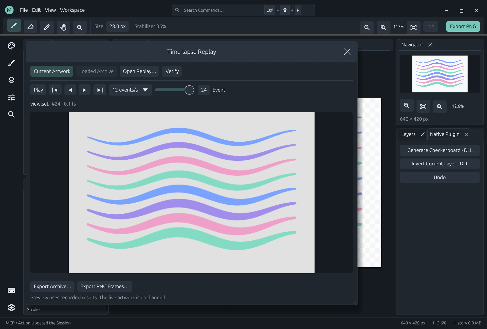
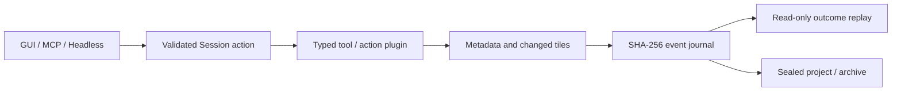

# Verified event replay

Open **View → Time-lapse Replay**, or search for **Time-lapse Replay** in the command palette. Play, pause, step and seek through the recording without editing the live artwork. The viewer supports all four display languages.



## Execution contract



GUI tools, native plugin host callbacks, JSONL, MCP, pipelines and workflow nodes share `application::Session`. A mutating action records its ID, arguments, outcome, elapsed time and resulting document state. Nested leaf actions are recorded in execution order; container outcomes preserve partial failures in sequential mode. Opt into [atomic groups](atomic-operations.md) to roll back a failed batch and record one group outcome. Invalid mutating requests become rejected attempts. Read-only queries and replay controls do not create authored operations.

Direct pen input keeps its typed path into the tool DLL. Raw positions, timestamps, pressure, pen/eraser flags and tool overrides are buffered in bounded 256-sample provisional segments and committed when the contact ends. `canvas.pointer` actions use the same provisional contact and rollback boundary. A storage failure rewinds the entire contact. Each sample remains in the event; journal serialization, hashing and disk writes are **not performed per pointer move**. Pressure and stabilization still run in the painting plugin. Action-based `canvas.stroke` records its points once as action arguments.

Events contain before/after state hashes, metadata, changed 64-pixel layer tiles and changed composited tiles. The [raster-mask foundation](raster-mask-storage.md) adds a separate stable-ID A8 tile namespace; it never reuses the raster-count composite sentinel or RGBA tile references. Metadata includes layers, image/workflow graphs, active tool, brush parameters, view, paths and revision. Synchronization checkpoints capture changes observed between action boundaries. New documents start independent histories. Imported images and old projects start from a snapshot; previous operations cannot be recovered.

Playback applies **recorded outcomes**, rather than rerunning commands. It preserves original rendered pixels even if a plugin is missing or changes, and never repeats DLL calls, file writes or other external side effects. The journal is independent of the bounded diagnostic event ring and undo stack. Undo and redo are themselves recorded.

Plugins must edit through the Session/host API. Arbitrary writes to public engine storage, plugin-private memory, operating-system state and UI-only layout changes are outside the replay contract. Saving performs a full pixel verification boundary. This release retains a mutable document and does not support editing a historical state into a new branch.

## Verification

SHA-256 links each compressed event and its encoded length to the previous hash. Verification checks event sequence, monotonic timestamps, metadata/tile bounds, before/after state hashes, and a sealed footer containing the count and final hash. Modified, missing, reordered and truncated entries are rejected before loading. Project opening also checks that the embedded history's final layers, raw A8 planes and composition match the project. Saving scans every raw plane, including edits observed from public engine callers.

`replay.verify` accepts an independently retained `expected_head`. Keep that value outside the archive to detect replacement of the entire archive. A self-contained hash chain checks integrity and consistency; it is **not a signature**, a human-authorship certificate, or proof that a plugin's algorithm was correct. A complete rewritten archive can have a new, internally consistent chain.

Verification during an active contact labels the provisional prefix and reports pending samples. Stable anchors are available as `committed_head_hash` and `committed_events` in `replay.status`. Buffered samples are not yet persisted. The initial snapshot is event `0`; `replay.status.events` counts subsequent events. `replay.events.total` includes the initial snapshot.

## Files and performance

Application saves write **MICOPI03** `.mcp` projects with a sealed embedded recording when mask state has never been used. Nondefault raster-mask metadata, including retained allocator state after deleting the last mask, selects **MICOPI04** with a bounded binary A8 directory. MICOPI01/02/03 remain readable. Exported **MCRPLY02** `.mcreplay` archives include the initial snapshot and need no project or plugins. MCRPLY01 remains readable. Paths and action arguments are recorded; inspect them before sharing.

Mask-bearing MCRPLY02 events require the optional `mask_version: 1` extension and validated `mask_changes`. Pre-mask strict readers reject these events, including allocator-only metadata, and reject MICOPI04 projects; the archive magic alone does not establish reader compatibility. Documents that never use mask state omit both extension fields and retain their existing wire bytes and state hashes. Raw A8 tile digests enter a separate sorted-ID hash domain only while planes exist. Playback restores mask bytes and the recorded composite without a compositor or painting DLL. Public [mask painting/actions/effects](raster-mask-editing.md), document geometry, single-layer owner copy/delete, group creation/movement, [subtree deletion](mask-group-delete.md) and [subtree duplication](mask-group-duplicate.md) use these verified outcomes. Complete owner transforms, ungrouping, batches, baking and transfer integration remain planned; see [Raster Masks Design](raster-masks-design.md).

The live journal is spooled to a temporary file. Memory holds the current tile state, event offsets and one seek cache; identical tiles share storage, uniform tiles have a compact representation, and metadata fields and sparse XOR changes are stored as deltas, matching layer/composite tiles use backward references, and payloads use fast Deflate compression. Backward seeking rebuilds from the initial snapshot; forward seeking reuses the cache. Viewer textures have a 1024-pixel longest-edge limit. Export and full verification read the bounded archive into memory and can take time on large drawings.

Limits are 1 GiB per recording, one million events, 512 MiB decoded per event, plus document limits of 4096 pixels per side, 16 layers and 64 Mi pixels across layers. Journal storage/limit errors stop further mutation instead of silently continuing an unverifiable recording. Check `replay.status.fault`; use the desktop **Export PNG** button or `replay.recover_png` to recover current pixels, export a valid prefix where possible, and start a new session. Temporary journals are not a crash-recovery feature: save a project or export an archive for durable history.

**Export PNG Frames…** writes numbered PNGs and `manifest.json` into a new or empty directory. It samples visual events, honors `max_frames`, includes the final result and records a state hash for each frame. `fps` describes sequence playback speed, not original wall-clock timing. This release has no built-in MP4 encoder or per-sample video interpolation.

## Automation

The default `plugins/replay/manifest.json` exposes the host-owned recorder as schema-described actions and public state. The actions become workflow nodes and MCP tools; recording itself needs no optional DLL.

| Action | Purpose |
| --- | --- |
| `replay.status` | State, hashes, size, pending samples and recording fault |
| `replay.events` | Paginated inputs, outcomes and hashes |
| `replay.verify` | Verify current/loaded recording; optional `expected_head` |
| `replay.export` | Export a sealed archive |
| `replay.load` | Verify and load a separate read-only preview |
| `replay.seek` | Event metadata and hashes |
| `replay.snapshot` | PNG at an event |
| `replay.frames` | Bounded PNG time-lapse sequence |
| `replay.open` | Desktop replay window |
| `replay.recover_png` | Canvas export independent of a failed journal |

`source` is `current` (default) or `loaded`; `event` defaults to the final committed event. Loading an archive does not replace current artwork. Run this JSONL in one session after creating `target/example-output`; the frames directory must be empty or absent:

```jsonl
{"action":"canvas.new","args":{"width":640,"height":480}}
{"action":"canvas.stroke","args":{"points":[{"x":30,"y":40,"pen":true,"pressure":0.2},{"x":300,"y":200,"pen":true,"pressure":1}]}}
{"action":"replay.verify","args":{}}
{"action":"replay.export","args":{"path":"target/example-output/drawing.mcreplay"}}
{"action":"document.save","args":{"path":"target/example-output/drawing.mcp"}}
{"action":"replay.frames","args":{"path":"target/example-output/frames","max_frames":120,"fps":12}}
```

`src/engine/replay.rs` owns storage and verification; `src/application/replay.rs` owns action boundaries and persistence; `plugins/replay/panel.rs` owns presentation. `scripts/smoke-replay.py` verifies PNG parity, bounded frame export, project persistence and MCP playback without drawing/compositor DLLs.

PNG output retains [document density](png-density.md) from the selected recorded state, including non-square axes and unspecified units. Live and replay snapshots share the encoder. Default absent density retains the legacy byte path; explicitly changing resolution can change PNG metadata bytes while decoded pixels stay identical. This does not execute native plugin commands during playback.
