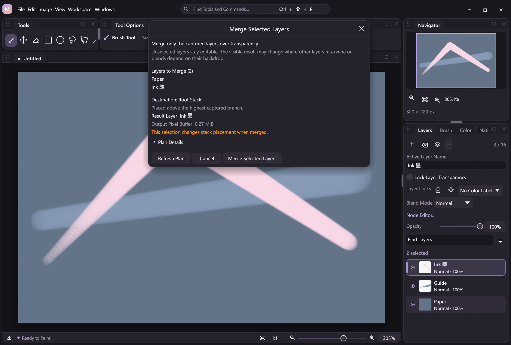

# Merge selected layers

MiCoPi can merge an explicit set of 2–16 raster layers, including noncontiguous layers and layers in different groups. It samples only those targets and the necessary intermediate group gates over transparency. Unselected layers stay editable, and every group folder remains. This selected-only boundary can change the visible composition when unselected artwork intervenes or blend modes depend on an outside backdrop.

The shared operation is `layer.merge_selected {"layer_ids":[1,3]}`. IDs are stable raster IDs from the current document, must be unique and need not match the current UI selection. Input order is normalized to document storage order. Group IDs belong to a different namespace and are not accepted as group targets.

## Desktop workflow

**Ctrl+E** runs the generic **Merge Layers** command. With multiple selected rasters it merges that captured set immediately; with one selected raster it keeps the existing Merge Down behavior. The menu label follows the selected count. Shortcuts remain configurable, and an existing explicit `layer.merge_down` binding retains its meaning.

For an optional inspection step, choose **Review Selected Merge…** in Layers. The nonmodal review shows captured names, destination, retained result, output buffer size, hidden targets and intervening unselected layers. **Plan Details** exposes placement information. It does not render a pixel preview. **Merge Selected Layers** executes the same shared action; Cancel or closing the window leaves the document unchanged.

The review captures document identity, revision and explicit target IDs. Document changes disable committing until **Refresh Plan** succeeds. Refresh re-plans the captured IDs rather than silently adopting a new selection. Replacing the document requires reopening the review. Drawing and non-drawing contacts must finish before committing; the review itself can remain open while the workbench is used.

The default shortcut is immediate; the review is an optional command. Automation can call the read-only plan and mutating operation separately.



*The captured Paper and Ink layers are selected; Guide remains outside the bake. Opening and cancelling this review preserves the artwork. Chinese, Japanese and Korean captures were checked alongside English.*

## Projection and placement

Find the lowest common parent of all target rasters, with zero identifying the root stack. Keep only selected raster references and the intermediate groups needed to reach them. Render this projected forest in its original order, including enabled per-layer filters and intermediate Isolated or Pass Through boundaries. The common parent's own gate and all ancestors are excluded from the bake and remain around the inserted result.

Replace the targets with one direct child of the common parent, immediately above the highest original child branch containing a target. If that highest branch was itself a selected raster, use its former slot after removal. Group branches remain even when they become empty. Relative storage order of unselected raster buffers is unchanged.

For a flat stack stored bottom-to-top:

```text
Before: A selected, U unselected, B selected
After:  U unchanged, Merged(A,B)
```

`U` is excluded from the bake and retains its raw pixels and filters. It now sits below the combined result rather than between the two inputs. Cross-parent targets similarly move into one common-parent child; intermediate group appearances are baked only for the selected contributions.

This is not a full-composite appearance guarantee. Even a contiguous selection can change its interaction with a lower backdrop under non-Normal blending. `changes_stacking` describes structural placement, not whether pixels will visibly differ: false does not guarantee equal appearance, and true does not prove a visible difference. Merge Visible, Stamp Visible and Flatten retain their separate full-composite contracts. See [Layer editing](layer-editing.md) and [Layer Groups](layer-groups.md).

## Visibility and retained content

Explicit hidden targets are consumed too. A locally hidden raster or a hidden intermediate group contributes transparent pixels to the projection. A hidden common parent or higher ancestor remains outside the bake: its gate continues hiding the result, without permanently zeroing the selected content a second time.

The plan's `consumed_hidden_ids` uses global effective visibility, so it includes targets hidden by the retained common parent or ancestors. This list reports consumption, not necessarily an empty raw contribution. Visibility here means local and inherited eye flags, not zero alpha or opacity.

The result retains the topmost selected raster's stable ID, stored name, color label and position-lock flag. It becomes Normal, full-opacity, locally visible and the sole active/selected raster. Pixel-locked or alpha-locked targets reject before rendering, including hidden targets; position locks permit the structural merge and remain on the retained result.

Every unselected raw buffer and surviving filter identity is preserved. All group records remain, including empty folders. Selected filters are removed after their enabled effects have been baked; disabled selected filters are discarded without applying them. Current and Reselect pixel masks are preserved and do not crop the full-frame merge.

## Shared actions and plans

| Action | Contract |
| --- | --- |
| `layer.merge` | No arguments; merge the current multi-selection, or Merge Down for a singleton |
| `layer.merge_selected` | Required unique `layer_ids`, 2–16; execute the explicit selected-only merge |
| `layer.merge_selected.plan` | The same explicit IDs; read-only semantic, placement and allocation plan |
| `layer.merge_selected.open` | The same explicit IDs; desktop-only optional review, with no document revision increment |

```json
{"action":"layer.merge_selected.plan","args":{"layer_ids":[3,1]}}
{"action":"layer.merge_selected","args":{"layer_ids":[1,3]}}
```

Use IDs obtained from the current document. The mutating result includes `layer_id` alongside document state, allowing later workflow steps to bind the retained raster explicitly. Command search, schema-derived nodes, JSONL, MCP and GUI attachment use the same handlers. Editing a workflow does not execute its merge. Use explicit IDs when automation must retain its targets across selection changes.

The plan exposes:

- `layer_ids`: targets normalized to storage order; `layer_id`: the retained topmost target ID.
- `common_parent_id` and `parent_index`: destination parent and zero-based bottom-to-top child slot after selected leaves are removed.
- `consumed_hidden_ids`: explicit targets hidden by local or inherited visibility flags.
- `interleaved_unselected_ids`: unselected rasters from the lowest target through the end of the highest original common-parent branch, including unselected content above a nested top target.
- `lifted_layer_ids` and `projected_group_ids`: targets lifted out of intermediate parents and group gates included in the projected bake.
- `changes_stacking`: true when targets are lifted or unselected rasters intervene; `backdrop_policy`: the stable value `selected_only_transparent`.
- `width`, `height`, `output_buffer_bytes`, `projected_nodes` and `final_nodes`: full-frame output size and compiled topology costs.
- `revision`, `drawing` and `contact_active`: source state; a Hand/Zoom contact can be active without drawing.

Planning reads metadata without sampling pixels, invoking the renderer, finishing a contact or changing history/dirty state. It remains usable during input but can reject invalid IDs, locks, unsupported graphs/capabilities or budgets. Execution requires an idle contact and revalidates the current document. Opening a desktop review queues presentation only, without pixel/history changes or a revision increment; headless clients receive `ui_unavailable` and should use plan/execute directly.

## Execution, limits and compatibility

The source must be a linked layer/filter graph. A legacy disabled graph with no nodes or edges can be canonicalized to a linked stack without losing edits; other free graphs reject explicitly. The operation supports all available [color blend modes](blend-modes.md) and intermediate [Pass Through](pass-through.md) groups. A native compositor with transparent-source support is required even for flat selected projection. Mix and color-mode capabilities are checked across required metadata before allocation or publication.

The projected forest and final topology each obey the existing 64-instruction limit. Projection adds transparent/group gates, so a tightly packed flat source chain can fit while its selected projection does not. The read-only plan reports or rejects this before allocating output. Existing raster count, dimensions and document pixel budgets remain in force.

The host borrows original raster buffers by global index and allocates one required full-frame output raster. It does not chain Merge Down commands or clone the document. Successful publication moves consumed buffers into structural history and produces one Undo/Redo entry, revision and verified outcome. Undo restores the previous active layer and selected set. Atomic, renderer and journal failures restore the prior document and history; partial native output stays in staging storage.

No native ABI or project/replay format is added. Group state schemas admit existing versions 1 and 2; retained folders keep their policies and version. The result uses the existing layer metadata, linked graph and outcome encoding. Old fixtures retain their hashes, and verified replay restores saved raw/composite outcomes without re-executing the compositor. The typed pressure/stabilization path is unchanged. No new runtime timing claim is implied by the buffer plan.

## Verification and references

The [runnable automation example](../examples/automation/selected-merge.jsonl) creates four rasters in two differently composed groups, plans and merges explicit noncontiguous targets, exports before/after/Undo frames and verifies replay. It also exercises contextual merge after Undo restores the original multi-selection. The exported full composites can differ because selected-only baking excludes the unselected artwork. From a portable package directory:

```powershell
New-Item -ItemType Directory -Force target/example-output | Out-Null
.\micopi-cli.exe run examples/automation/selected-merge.jsonl --plugins plugins --config-dir target/selected-merge-example-profile
```

Regression suites exercise noncontiguous and cross-parent targets, all 26 modes, fractional alpha, enabled/disabled filters, local/intermediate/common-parent visibility, stable IDs and buffer pointers, locks, active contacts, one-step history and atomic/render/journal rollback. Desktop suites exercise optional review, captured targets, stale guards and translated layouts. `scripts/smoke-selected-merge.py` covers shared transports and replay; physical tablet compatibility remains a separate hardware check.

The keyboard model follows the familiar selected-versus-singleton behavior described by [Adobe's Layer.merge API](https://developer.adobe.com/photoshop/uxp/ps_reference/classes/layer/#merge) and [merge/stamp guide](https://helpx.adobe.com/photoshop/desktop/create-manage-layers/get-started-layers/merge-and-stamp-layers.html). MiCoPi's explicit common-parent projection, visibility rules and byte arithmetic are the contracts above. The implementation is independent and imports no PhotoCraft code.
