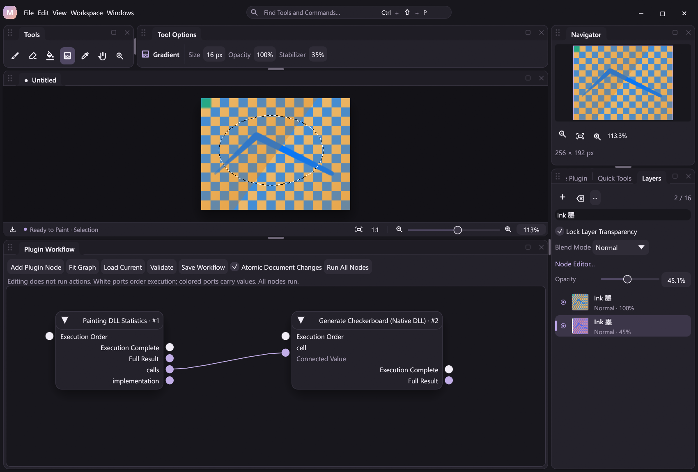
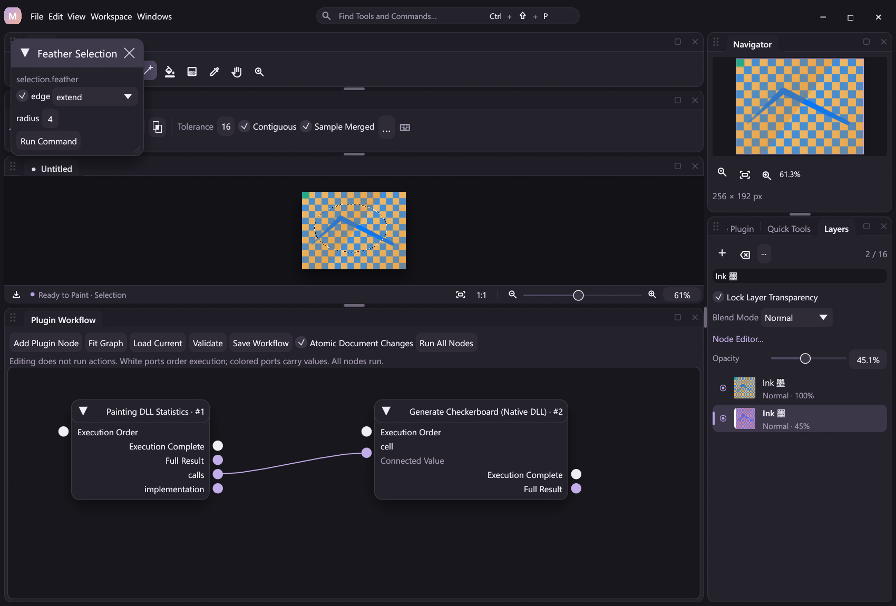
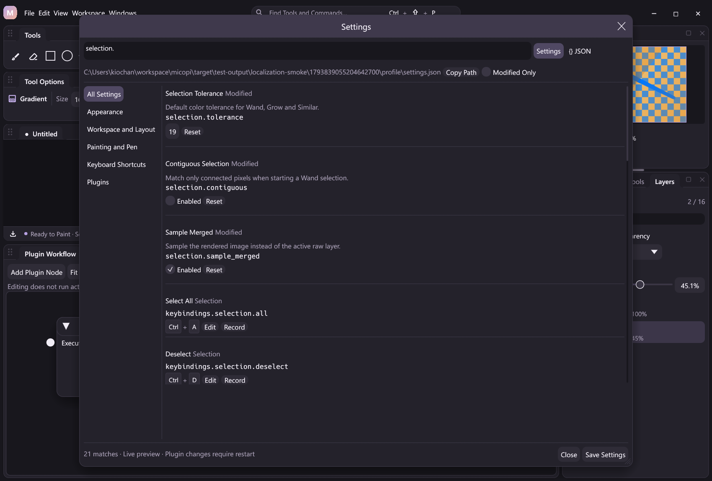

# Selections

Selections belong to the document, not the desktop tool. The current increment provides schema-described rectangle, ellipse and polygon geometry, combination modes, Select All/Deselect/Reselect/Invert, native painting/action clipping, persistence, undo and verified replay. Mouse/pen marquee and lasso gestures are available. Color-based selection is available through the Magic Wand tool and shared commands. Native selection edge processing is available; [Session clipboard](clipboard.md) copy/cut/paste is available. [Layer via Copy/Cut](layer-editing.md#layer-via-copy-and-cut) is also available. The Windows clipboard adapter is implemented, with native interoperability verification pending in [the editing checklist](photoshop-essentials.md).



*A development build captured by the localization smoke check. The existing ellipse outline is a presentation overlay; the generated checkerboard and pressure strokes remain unchanged.*

## Desktop gestures

| Tool | Default shortcut | Completion |
| --- | --- | --- |
| Rectangular Marquee | M | Release the mouse/pen contact |
| Elliptical Marquee | Shift+M | Release the contact |
| Freehand Lasso | L | Release the contact; closes the traced polygon |
| Polygonal Lasso | Shift+L | Click vertices, then Enter, double-click the last vertex, or click near the first vertex |
| Magic Wand | W | Select once on mouse/pen press; dragging does not paint |

The Tools strip exposes all five tools; their order, visibility and spacing use the existing workspace settings. Tool Options offers New/Add/Subtract/Intersect icon controls with full-name tooltips instead of brush size/opacity controls. The selected combination is frozen when a gesture starts. Shift at the initial press adds, Alt subtracts and Shift+Alt intersects; Alt is a selection modifier here rather than a temporary eyedropper. Press Shift after starting a rectangle/ellipse drag to constrain a square/circle. A Shift already held at the initial press selects Add; release/repress it to constrain afterward.

Only the preview changes during dragging or polygon clicks. Completion dispatches one `selection.shape` action with the captured expected revision; it uses the same DLL geometry, history and verified outcomes as automation. Escape, right-click, focus loss, changing tools/options or starting temporary navigation cancels an unfinished gesture. A document/revision change from another action discards stale previews. An empty New marquee click deselects; an insufficient Add/Subtract/Intersect trace leaves the current mask unchanged. Geometry outside the canvas is clipped by the native kernel; UI coordinates are bounded to -4096..8192 to keep previews finite.

Lasso traces sample at one display point initially. At the vertex limit they progressively decimate older samples, with the same retained geometry shown in the preview and submitted on release; at most 4096 points enter the action. Polygonal lassos accept at most 4096 explicitly clicked vertices and report the limit. Mouse and synthetic pen packet tests exercise the adapters; this does not establish compatibility with a physical tablet/driver.

`toolbox.mode.selection_rectangle`, `toolbox.mode.selection_ellipse`, `toolbox.mode.selection_lasso`, `toolbox.mode.selection_polygon` and `toolbox.mode.selection_wand` activate the desktop modes. `toolbox.selection.replace`, `.add`, `.subtract` and `.intersect` change the Tool Options combination. These commands are searchable/bindable and available to GUI-attached clients. They explicitly report `ui_unavailable` in headless sessions; use `selection.shape` or `selection.wand` for headless document editing. The underlying typed painting tool remains cached, and the desktop mode is exposed through `canvas.state.ui["painting.mode"]`.

When loading older shortcut profiles, implicit M/L/W defaults for these new selection tools yield to explicitly configured built-in or plugin bindings. For example, an existing custom M binding remains assigned and the unconfigured rectangular-marquee default becomes unbound. Explicitly configured conflicting bindings are still rejected. Portable builds append missing Toolbox contributions and core public-state schema properties without replacing existing customized definitions.

## Commands and automation

| Action | Arguments | Default shortcut |
| --- | --- | --- |
| `selection.shape` | `kind`: `rectangle`, `ellipse` or `polygon`; optional `mode` | Unbound; parameter form in command search |
| `selection.wand` | Required `x`, `y`; optional `tolerance`, `contiguous`, `sample_merged`, `mode` | Unbound; parameter form |
| `selection.grow` | Optional `tolerance`, `sample_merged` | Unbound |
| `selection.similar` | Optional `tolerance`, `sample_merged` | Unbound |
| `selection.expand` | Required integer `radius`; optional `edge` | Unbound; parameter form |
| `selection.contract` | Required integer `radius`; optional `edge` | Unbound; parameter form |
| `selection.feather` | Required integer `radius`; optional `edge` | Unbound; parameter form |
| `selection.smooth` | Required integer `radius`; optional `edge` | Unbound; parameter form |
| `selection.all` | None | Ctrl+A |
| `selection.deselect` | None | Ctrl+D |
| `selection.reselect` | None | Ctrl+Shift+D |
| `selection.invert` | None | Ctrl+Shift+I |
| `selection.read` | None; read-only current/previous encoded masks | Unbound |

Rectangle/ellipse geometry requires positive `width` and `height`, with `x` and `y` defaulting to zero. Polygon geometry requires 3–4096 `[x,y]` pairs; it closes the final edge automatically and uses an even-odd fill rule. Coordinates are document pixels, bounded to ±16384; dimensions are at most 16384. Geometry samples pixel centers and currently produces binary coverage without antialiasing. Out-of-canvas portions are clipped. A completely outside shape creates an active empty selection.

`mode` defaults to `replace`. `add` uses maximum coverage, `subtract` uses saturating subtraction and `intersect` uses minimum coverage. An absent current mask is treated as empty for these combinations; use `selection.all` before subtracting from the whole canvas. Invert without a current mask selects the whole canvas. Deselect removes the editing restriction while retaining the last active mask for Reselect. Reselect without a previous mask fails. Commands that replace an active mask retain that mask as the previous selection.

The Edit menu and command search expose the four shortcuts; all bindings remain configurable. A cached static outline overlays the canvas without changing artwork or export pixels. It shows the 50% coverage boundary, with a 1024-pixel longest-edge preview limit. It is not an animated marching-ants or full-resolution mask editor. `canvas.state.selection` reports `active` and `can_reselect` without copying mask data; `selection.read` explicitly requests encoded current/previous masks. Selection actions become workflow nodes and are available through MCP, JSONL and GUI attachment. Read-only inspection does not change revision or finish a stroke.

```json
{"action":"selection.shape","args":{"kind":"rectangle","x":20,"y":30,"width":160,"height":100}}
{"action":"layer.fill_color","args":{"color":"#8066dd"}}
{"action":"selection.invert"}
{"action":"native.invert"}
{"action":"selection.deselect"}
```

## Color selection

`selection.wand` samples a document-pixel seed on the active raw layer in a new profile. `sample_merged: true` samples the rendered image, including visible layers, blend modes and image-graph filters; it fails before selection publication if composition fails. It never changes source pixels. `contiguous: true` (factory default) uses four-neighbor connectivity; false matches across the whole canvas. Existing selection coverage does not restrict sampling or connectivity: `mode` combines the generated mask with the current selection afterward.

`tolerance` is an integer from 0 to 255, 32 in a new profile. Omitted values use the configured selection defaults; explicit action arguments take precedence. Matching requires every straight RGBA channel to differ by at most that value. Fully transparent pixels normalize to zero so hidden RGB does not separate transparent areas. Alpha is part of the comparison. This is an exact channel-distance contract, not perceptual or ICC-aware matching. Newly selected pixels have binary coverage; antialiased edges are not generated in this increment.

`selection.grow` expands to matching four-connected regions reachable from any originally selected pixel. `selection.similar` selects matching pixels anywhere in the image. Both compare against all colors under the **original positive selection coverage**, using the same tolerance/source options. They do not repeatedly add new reference colors while traversing a gradient. Existing positive fractional coverage remains unchanged; newly included pixels receive 255. Both require a nonempty active selection and fail otherwise. Grow uses connectivity regardless of Wand's `contiguous` option.

```json
{"action":"selection.wand","args":{"x":20,"y":30,"tolerance":16,"sample_merged":true}}
{"action":"selection.grow","args":{"tolerance":16,"sample_merged":true}}
{"action":"selection.similar","args":{"tolerance":16,"sample_merged":true}}
```

All three actions are searchable, bindable and available as schema-derived workflow nodes, JSONL and MCP operations. Their selection-only history entries preserve source pixels; atomic failure rolls back the group, and replay restores recorded mask outcomes without executing the color kernel. A runnable [color-selection example](../examples/automation/color-selection.jsonl) demonstrates the commands. The W tool dispatches the same Wand action with explicit controls and the selected combination on each press. A seed outside the document is ignored. Temporary pan/zoom still takes precedence; no drawing contact or gradient is started by Wand. Tool Options exposes tolerance, contiguous matching and merged sampling, plus a Grow/Similar menu that passes the current tolerance/source controls. Shift/Alt combinations apply on press. Tool Options stores a temporary session choice in `canvas.state.ui["selection.options"]`; effective values are exposed as `canvas.state.selection_sampling`. The configured defaults live separately in `canvas.state.selection_defaults`. `toolbox.selection.options` validates all three schema-described arguments and publishes one UI effect. These desktop commands reject headless execution; direct document actions remain available with explicit arguments. Configured defaults are persisted in searchable settings, as described below.

The DLL borrows active or composed pixels and allocates one output coverage buffer. Grow/Similar use an exact in-place balanced color tree (sorted lookup at tolerance zero), plus a fixed 4096-entry color memo table; there is no arbitrary palette cutoff or approximation. The reference palette uses at most four bytes per originally selected pixel, in addition to output coverage and host history/encoding costs. Highly irregular output remains subject to the existing compressed-mask bound below, and may fail without replacing the selection.

## Selection edges

Use the ellipsis **Selection Actions** menu in any selection tool's options, or search the registered command. Expand, Contract, Feather and Smooth open the shared parameter form. Editing or cancelling a form does not process the mask; Run Command commits one action. Forms use the shared [command admission policy](command-contact-admission.md): entry preserves active contacts and defers automatic brush/view synchronization. Run uses the backend preflight, and an intervening external revision still requires Refresh Revision. The global Cancel command also closes a pending parameter form. These commands are schema-derived workflow nodes and run through the same DLL in GUI, MCP, JSONL and headless sessions.

All four require an active mask. An active empty mask stays empty; no active mask is an error. `radius` is an integer from 1 to 256 document pixels (the form starts at 4). `edge` defaults to `extend`, repeating nearest canvas-edge coverage. `zero` treats everything beyond the canvas as unselected. This policy is applied at every blur pass. Extend keeps a full selection full; zero allows contraction/feathering at the document boundary.

- **Expand** takes maximum coverage over the exact integer disk `dx² + dy² <= radius²`.
- **Contract** takes minimum coverage over the same disk. Both retain fractional levels; neither substitutes a square kernel or thresholds a feathered mask.
- **Feather** approximates a Gaussian using three separable running-sum boxes with radii `[r-1, r-1, r]`. The nominal blur scale is `r`; the box variance is `r²-r/3` per axis before boundary handling. Intermediate coverage uses 8 fractional bits and rounds each axis at that precision, then rounds once to 8-bit output. This is a documented fast approximation, not Photoshop-identical Gaussian output.
- **Smooth** uses that fixed-point blur, then thresholds at 128/255 before final 8-bit rounding. It produces binary coverage, rounds jagged regions and can remove thin details/small islands. It does not preserve an existing feathered edge.

Source pixels remain untouched. Each operation publishes one reversible mask change and one verified outcome event, rather than an event per pass/pixel. Current/previous masks, projects, atomic rollback and replay retain their existing format. Missing DLL tails, invalid arguments or an oversized compressed result fail before selection replacement. The existing 128 KiB-per-mask compressed bound can reject complex results; no approximation or silent truncation is used to make them fit.

```json
{"action":"selection.expand","args":{"radius":4}}
{"action":"selection.contract","args":{"radius":2,"edge":"zero"}}
{"action":"selection.feather","args":{"radius":3}}
{"action":"selection.smooth","args":{"radius":2}}
```

A runnable [edge-processing example](../examples/automation/selection-edges.jsonl) finishes with clipped painting and verification. See [Development](development.md#selection-edge-costs) for measured costs and workspace bounds. Binary disk processing uses linear-time squared-distance transforms. Fractional disk processing is exact but costs O(pixel count × radius); large fractional masks/radii can take noticeably longer. Feather/Smooth use running sums with O(pixel count + radius × (width + height)) work. Empty/uniform cases avoid scratch allocation when their result is constant. These are cold commands on the Session thread; no processing, mask copying or serialization is added to pointer MOVE.



## Persistent defaults

Open Settings with **Ctrl+,** and search `selection.`. Tolerance, connected matching and merged sampling appear in the same searchable settings center as appearance, painting and shortcuts. Individual resets, `@modified`, JSON validation, live preview, cancel and Save Settings apply to these fields. The [settings example](../examples/config/settings.json) and [schema](reference/settings.schema.json) include:

```json
"selection": {
  "tolerance": 32,
  "contiguous": true,
  "sample_merged": false
}
```

Tolerance must be an integer from 0 to 255; both flags must be booleans. Invalid values or failed file writes retain the previous file and runtime defaults. Saving preserves other supported settings and unknown root fields. Desktop and CLI/MCP sessions load these defaults from their configured profile. `settings.read` and `settings.update` expose the same validated section. Writes to another profile do not activate it in an already configured session; embedded sessions without a profile apply successful writes directly.

Wand's omitted tolerance/contiguous/source arguments use the configured defaults; Grow/Similar use the configured tolerance/source defaults. Temporary Tool Options changes do not alter those automation defaults. GUI clicks pass explicit current controls, and command parameter forms initialize their visible fields from configured defaults. Existing workflow literal parameters remain explicit values; omitted arguments inherit defaults when the workflow executes.

Changing selection defaults resets the old temporary control override. Saving an unrelated setting preserves it. Cancelling settings restores the tool controls that were active before preview, including a temporary choice different from the saved defaults. A successful update of the active profile changes runtime defaults in the same action; presentation reload follows through the existing GUI effect queue. No defaults are loaded or serialized on pointer MOVE.

Preferences are runtime configuration, separate from document undo. Recorded selection outcomes remain verifiable even if a profile changes: replay restores stored masks/pixels without reloading settings or re-executing a DLL/action.



## Editing and compatibility

No current mask means unrestricted editing. An all-zero current mask blocks pixel changes. Brush and eraser freeze borrowed coverage at contact start and multiply dab opacity by that coverage, preserving pressure, stabilization and spacing. The host retains the immutable mask until the cached tool can no longer read it. No mask serialization, compression, copying or registry lookup is added to MOVE.

Native `edit_region` actions, including fill, gradient and direct filters, produce staged pixels. Before commit, the painting DLL mixes them with the original pixels according to selection coverage in premultiplied-alpha space. Coverage 0 preserves exact original storage; coverage 255 keeps the action result. Fractional coverage retains original hidden RGB when both weighted alphas are zero. Clear uses the same mixing kernel. Transparency lock still applies. Non-destructive image graph filters continue to affect their connected full layer; mask-aware composition ports are a later increment. Whole-layer structural operations such as merge, duplication and deletion remain whole-layer operations.

Connected fill traverses only positive selection coverage using four-neighbor connectivity. A zero-coverage seed is a no-op, including global color matching. Disconnected selected islands cannot share a connected fill through unselected source pixels. Expansion and feathering stay within the seed's selection component; they cannot jump a small excluded gap into another island. Global color matching can affect matching pixels in all selected islands when the seed is selected. Fractional selection coverage is applied once at output blending, not during traversal. An optional immutable action-entry snapshot lends coverage to the native fill kernel; no JSON mask decoding or byte copy is required.

Pixel kernels and geometry stay in the independent painting DLL. Optional size-checked ABI extensions preserve older tool prefixes; an old DLL lacking selection capabilities rejects selected painting or clipping instead of silently ignoring the mask. Restart after rebuilding/staging DLLs. See [Native plugins](native-plugins.md).

Selection changes create composition undo entries and participate in atomic document pipelines. Failed geometry, stale revisions, unsupported DLL capabilities and failed clipping do not publish a partial selection/pixel result. Project metadata and outcome journals retain both masks. Replay restores coverage and pixels without invoking geometry or drawing kernels. Existing no-selection metadata remains byte-compatible with legacy journal hashes. Canvas resize/crop reframes both current and previous masks.

Storage bounds remain 4096 pixels per side, 128 KiB compressed per mask and 1 MiB total project metadata. Construction caches the compressed encoding; snapshots share coverage allocations. Invalid dimensions, incomplete streams, trailing data and decoded lengths are rejected. Highly irregular masks can exceed the compressed limit and fail before selection replacement. See [Architecture](architecture.md).
