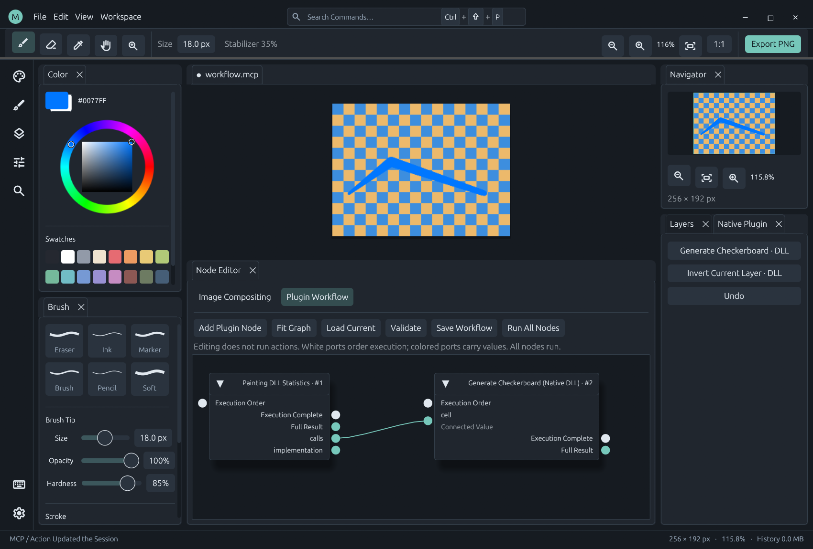

# Plugin Nodes and AI Workflows

MiCoPi 0.18+ unifies plugin actions, public state and image definitions in node.catalog. The independent Plugin Workflow window (`workflow.open`) is separate from Image Compositing and generates ports and controls from schemas. Graphs are saved in .mcp projects with undoable edits. Version 0.19 localizes presentation while keeping all IDs and schemas stable.



## Register nodes

Every action automatically supplies action.<action-id>; every public resource supplies state.<resource-id>. Discovery reads metadata without invoking providers. Access is limited to public resources and enforced read-only scopes.

Manifests and DLL describe contributions may include named aliases:

```json
{"nodes":[{"id":"my_plugin.checkerboard","title":"Generate Checkerboard","category":"Patterns","binding":{"kind":"action","action":"native.checkerboard"},"defaults":{"cell":32}},{"id":"my_plugin.document","title":"Current Document","binding":{"kind":"state","resource":"document.active"}}]}
```

Explicit IDs must start with the plugin ID plus a dot. Declare dependencies in requires. action. and state. namespaces are reserved for adapters. Invalid contributions reject the whole package. Each plugin may register at most 256 explicit definitions.

Action aliases inherit the action's input_schema, output_schema and read-only flag. State aliases inherit the provider's output_schema and have no mutable parameters. Do not repeat parameters_schema for either binding. Image bindings declare their own parameters_schema and kernel defaults.

Schema properties become ports; required marks mandatory inputs. title, default, enum, minimum and maximum drive controls. Object parameters become individual inputs. Scalar, array or unconstrained root arguments use a single value input, unwrapped before dispatch. Missing output schemas remain any; declaring properties exposes individual top-level output fields.

All workflow nodes have $exec ordering ports and a result output for the complete value. $exec is reserved; an actual output property named result is accessible inside the complete value rather than as a separate port. Integer can connect to number; incompatible types or disjoint enums are rejected. any values are validated at runtime.

plugins/native-paint/src/contributions.json demonstrates a DLL-registered state alias. Node contributions require host 0.18+; the SDK remains 1.2 and C ABI tables are unchanged. Titles should be English canonical messages. Bundled translations affect labels, not bindings or node IDs.

## Create and edit from AI

Discover node.catalog first. It returns definitions, ports, parameter/output schemas and workflow_schema. Example action envelopes:

```json
{"action":"workflow.set","args":{"graph":{"version":1,"nodes":[{"id":1,"type":"state.document.active","position":[0,0],"parameters":{}},{"id":2,"type":"action.canvas.new","position":[420,0],"parameters":{}}],"edges":[{"from":1,"output":"width","to":2,"input":"width"},{"from":1,"output":"height","to":2,"input":"height"}]}}}
{"action":"workflow.validate","args":{}}
{"action":"workflow.patch","args":{"operations":[{"op":"move_node","id":2,"position":[460,0]}]}}
{"action":"workflow.run","args":{"dry_run":true}}
{"action":"workflow.run","args":{}}
```

workflow.read returns the stored graph and validation. set replaces it; patch supports add_node, remove_node, set_parameters, move_node, connect and disconnect. Edits apply to a copy and commit only after complete validation. Failed edits retain the original graph. Removing a node removes its edges. set_parameters replaces the parameter object. A patch accepts at most 256 operations.

validate returns topology, compiled steps and deferred checks without execution. run accepts an optional temporary graph; otherwise it uses the stored graph. It supports dry_run and integer expected_revision. MCP exposes these actions as tools and document.workflow as a resource. Run examples/automation/workflow.jsonl with micopi-cli.exe for a window-free example.

## Execution semantics

Workflow compilation targets the existing pipeline.run implementation. Data edges become typed JSON Pointer references; $exec edges impose order without carrying values. A data input cannot have multiple sources or both a literal and an edge. Defaults can be overridden by explicit parameters or connections.

All workflow nodes execute, including unconnected nodes. Topological ties use numeric IDs; connect side-effecting actions with $exec to make order explicit. State is read when its node executes, not at a global start-of-graph snapshot. Cycles, unavailable types, invalid ports and static argument errors are rejected before running. Dynamic arguments and outputs are validated as steps execute.

Failure stops subsequent nodes and reports completed_nodes, failed_node, results and execution. This is not a cross-node transaction: completed painting/file operations remain. A step whose output violates schema may already have produced side effects. Dry run does not query providers and cannot predict dynamic errors.

Limits: 128 nodes, 512 edges and 512 KiB per workflow, plus the shared pipeline depth 16 and leaf budget 1024. Projects retain graphs with missing plugins for inspection and later recovery. New/open document actions inside a running workflow carry the active workflow snapshot into the replacement document and mark it dirty.

## Image domain and performance

Image definitions use binding.kind=image and one of layer, filter, blend or output, with parameters_schema and binding.defaults. See plugins/compositing/manifest.json. Parameters and defaults must match the typed kernel fields. Legacy graphs without node_type migrate to compositing.* IDs on application.

Image buffers and JSON operation graphs are separate typed domains. AI may use action.graph.set in a workflow to apply an image graph. New aliases reuse existing kernels; a new algorithm still requires extending the compositor DLL.

Painting remains on the independent typed tool ABI with pressure, stabilization and tiled undo. No workflow JSON is built per input point. Workflow editing, moving, saving and validation never execute nodes; only Run does. Image compositing preserves its dirty-region fast path.

The desktop Run control enables **Atomic Document Changes** by default. Disable it to retain partial completion. API callers use `workflow.run {"atomic":true}` explicitly; editing remains inert. See [Atomic Operations](atomic-operations.md).
